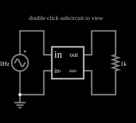

# Retificador de onda completa em subcircuito

<!-- navegacao:inicio -->
[Índice](README.md) · [Próximo: Full Adder (nested)](adder4-sc.md)
<!-- navegacao:fim -->

## Objetivo

Mostrar um **subcircuito**: a ponte de quatro diodos de um retificador de onda completa é definida uma vez, com nome e terminais, e usada no circuito principal como um único componente (um bloco com quatro terminais).

## O circuito

<!-- esquema:inicio -->

<!-- esquema:fim -->

O circuito principal tem uma fonte senoidal de $5\ \text{V}$ de pico e $40\ \text{Hz}$, um resistor de carga de $1\ \text{k}\Omega$ e um bloco chamado *fullrect*. O bloco tem os terminais *in*, *in-* (a entrada), *out* e *out-* (a saída) e por dentro tem quatro diodos em ponte: *in* → *out* e *out-* → *in-* conduzem num semiciclo; *in-* → *out* e *out-* → *in* no outro. O texto *double-click subcircuit to view* no desenho lembra que um clique duplo abre o conteúdo do bloco.

<!-- componentes:inicio -->
| N.º | Tipo | Elemento | Valores |
|----:|------|----------|---------|
| 0 | `CustomCompositeElm` | subcircuit (fullrect) | Model Name = fullrect; High Logic Voltage (0=default) = 0 |
| 1 | `DCVoltageElm` | A/C source | Max Voltage = 5; Waveform = A/C; DC Offset (V) = 0; Internal Resistance (ohms) = 0; Show Voltage = não; Frequency (Hz) = 40; Phase Offset (degrees) = 0 |
| 2 | `ResistorElm` | resistor | Resistance (ohms) = 1k |
| 3 | `RoutedWireElm` | wire | Show Current = não; Show Voltage = não; Show Bus Value = não; Show Bus Value (Hex) = não |
| 4 | `RoutedWireElm` | wire | Show Current = não; Show Voltage = não; Show Bus Value = não; Show Bus Value (Hex) = não |
| 5 | `RoutedWireElm` | wire | Show Current = não; Show Voltage = não; Show Bus Value = não; Show Bus Value (Hex) = não |
| 6 | `RoutedWireElm` | wire | Show Current = não; Show Voltage = não; Show Bus Value = não; Show Bus Value (Hex) = não |
| 7 | `GroundElm` | ground | Symbol = Earth |
| 8 | `TextElm` | text | Text = double-click subcircuit to view; Size = 12; Draw Bar On Top = não; Color = #c0c0c0 |
<!-- componentes:fim -->

## Símbolos e parâmetros

Os símbolos usados neste documento (definições completas no [glossário](../glossario-simbolos.md)):

| Símbolo | Nome | Significado | Unidade |
|---------|------|-------------|---------|
| $i$ | corrente instantânea | valor da corrente em cada instante, que pode variar no tempo | A |
| $R$ | resistência | oposição de um resistor à passagem da corrente ($V = R I$) | Ω |
| $n$ | fator de idealidade | expoente do diodo na equação de Shockley, $i = I_s(e^{v/(nV_T)}-1)$ | — |
| $v_R$ | tensão no resistor | tensão entre os terminais do resistor | V |
| $v_s$ | tensão instantânea da fonte | tensão do sinal da fonte de entrada em cada instante | V |
| $v_D$ | tensão instantânea no diodo | tensão entre o ânodo e o cátodo do diodo em cada instante | V |
| $V_T$ | tensão térmica | $kT/q$: cerca de $25{,}85\ \text{mV}$ a $300\ \text{K}$ | V |
| $I_s$ | corrente de saturação | corrente reversa de um diodo ou de uma junção | A |
| $i_{\text{pico}}$ | corrente de pico | maior valor atingido pela corrente | A |
| $v_{R,\text{pico}}$ | tensão de pico no resistor | maior valor atingido pela tensão no resistor | V |

## Teoria

Um subcircuito é um modelo (um sub-circuito com terminais externos) instanciado por referência: o simulador monta, para cada instância, uma cópia dos elementos do modelo com os nós internos próprios e liga os terminais externos aos nós do circuito. O resultado elétrico é idêntico ao de desenhar os quatro diodos diretamente, como no exemplo *Full-Wave Rectifier*; o ganho é de organização (reuso, hierarquia, leitura).

Em cada semiciclo conduzem dois diodos em série com a carga, então

$$v_R = |v_s| - 2v_D.$$

O diodo do modelo padrão segue a equação de Shockley; na corrente de pico, $v_D = nV_T\ln(i/I_s + 1)$ com $I_s = 1{,}714\cdot 10^{-7}\ \text{A}$, $n = 2$, $V_T = 25{,}865\ \text{mV}$. Resolvendo com $i = v_R/R$:

$$i_{pico} = 3{,}96\ \text{mA}\ \Rightarrow\ v_D = 0{,}520\ \text{V},\qquad v_{R,pico} = 5 - 2\cdot 0{,}520 = 3{,}96\ \text{V}.$$

A frequência na carga é o dobro da da fonte: $80\ \text{Hz}$.

## Resultados esperados

O simulador dá, em regime permanente:

- **Pico da tensão na carga:** $3{,}960\ \text{V}$; o mínimo é $0\ \text{V}$ (a tensão não inverte).
- **Valor médio:** $2{,}272\ \text{V}$; valor eficaz: $2{,}655\ \text{V}$.
- **Frequência da tensão na carga:** $80\ \text{Hz}$, o dobro dos $40\ \text{Hz}$ da fonte.
- **Corrente na fonte:** alternada, com pico de $\pm 3{,}96\ \text{mA}$.

## O que observar

Compare o resultado com o do exemplo *Full-Wave Rectifier* (a mesma ponte desenhada diodo a diodo): o resultado é o mesmo, porque o subcircuito é só uma forma de organizar o desenho. Dê um clique duplo no bloco para ver os quatro diodos.

## Limites do modelo

- O subcircuito é só organização do desenho: não muda o modelo elétrico dos diodos nem acrescenta efeitos próprios.
- Os quatro diodos têm o mesmo modelo ideal de Shockley, sem resistência série nem capacitância de junção.
- O resultado vale para a fonte de $5\ \text{V}$ e a carga de $1\ \text{k}\Omega$; com outra carga a queda dos diodos muda.

## Referências

Sedra e Smith, *Microeletrônica*, capítulo sobre diodos (retificadores de onda completa em ponte); documentação do CircuitJS1 sobre subcircuitos.

O circuito deste exemplo faz parte da coleção do simulador original de Paul Falstad e Iain Sharp (CircuitJS1); a explicação é deste projeto.
