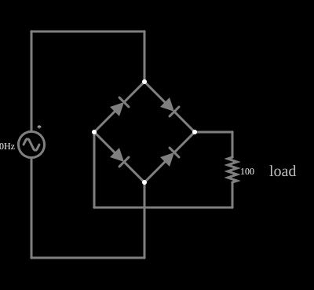

# Retificador de onda completa em ponte

<!-- navegacao:inicio -->
[Índice](README.md) · [Anterior: Half-Wave Rectifier](rectify.md) · [Próximo: Full-Wave Rectifier w/ Filter](fullrectf.md)
<!-- navegacao:fim -->

## Objetivo

Mostrar a retificação de onda completa com quatro diodos em ponte: a corrente na carga tem sempre o mesmo sentido, nos dois semiciclos da fonte.

## O circuito

<!-- esquema:inicio -->

<!-- esquema:fim -->

Uma fonte senoidal de $5\ \text{V}$ de pico e $40\ \text{Hz}$ alimenta uma ponte de quatro diodos; a saída da ponte alimenta uma carga de $100\ \Omega$. Em cada semiciclo, dois diodos (uma diagonal da ponte) conduzem e os outros dois bloqueiam. Dois osciloscópios mostram a tensão da fonte e a da carga.

<!-- componentes:inicio -->
| N.º | Tipo | Elemento | Valores |
|----:|------|----------|---------|
| 0 | `VoltageElm` | A/C source | Max Voltage = 5; Waveform = A/C; DC Offset (V) = 0; Internal Resistance (ohms) = 0; Show Voltage = não; Frequency (Hz) = 40; Phase Offset (degrees) = 0 |
| 3 | `DiodeElm` | diode | Model = default |
| 4 | `DiodeElm` | diode | Model = default |
| 5 | `DiodeElm` | diode | Model = default |
| 6 | `DiodeElm` | diode | Model = default |
| 12 | `ResistorElm` | resistor | Resistance (ohms) = 100 |
| 13 | `TextElm` | text | Text = load; Size = 20; Draw Bar On Top = não; Color = #c0c0c0 |
<!-- componentes:fim -->

## Teoria

O diodo do simulador (modelo "default") segue a equação de Shockley,

$$i = I_s\left(e^{v/(nV_T)} - 1\right),\qquad I_s = 1{,}714\cdot 10^{-7}\ \text{A},\quad n = 2,\quad V_T = 25{,}865\ \text{mV},$$

sem resistência série. Para uma corrente $i \gg I_s$ a tensão é $v = nV_T\ln(i/I_s + 1)$, que dá $0{,}806\ \text{V}$ em $1\ \text{A}$, $0{,}568\ \text{V}$ em $10\ \text{mA}$ e $0{,}449\ \text{V}$ em $1\ \text{mA}$: a tensão cresce $nV_T\ln 10 = 119\ \text{mV}$ a cada década de corrente. Para $v < 0$ a corrente tende a $-I_s = -0{,}17\ \mu\text{A}$.

## Resultados esperados

Num semiciclo conduzem os diodos da diagonal "fonte positiva → carga → fonte negativa", e no outro os da outra diagonal; em ambos a carga é percorrida no mesmo sentido: $v_R = |v_s| - 2v_D$. Os valores ideais ($v_D = 0$) são

$$V_{med} = \frac{2V_p}{\pi},\qquad V_{ef} = \frac{V_p}{\sqrt2},$$

e cada diodo bloqueado suporta $V_p$ (menos uma queda) em tensão inversa.

## O que observar

Cada ramo da condução tem **dois** diodos em série com a carga. Resolvendo o circuito com $R = 100\ \Omega$: no pico, a corrente é $37{,}3\ \text{mA}$ e cada diodo cai $0{,}636\ \text{V}$, de modo que a carga recebe $5 - 2\cdot 0{,}636 = 3{,}728\ \text{V}$.

| grandeza | ideal | com os diodos |
|:---------|------:|--------------:|
| pico na carga | $5{,}000\ \text{V}$ | $3{,}728\ \text{V}$ |
| valor médio | $3{,}183\ \text{V}$ | $2{,}072\ \text{V}$ |
| valor eficaz | $3{,}536\ \text{V}$ | $2{,}461\ \text{V}$ |
| tensão inversa de um diodo | $5{,}000\ \text{V}$ | $4{,}364\ \text{V}$ |

(valores por integração numérica independente, a menos de $10^{-5}$ do simulador). As verificações conferem o pico, o mínimo, a média e o valor eficaz da carga e a queda e a tensão inversa de um dos diodos, em dois ciclos (de $0{,}1$ a $0{,}15\ \text{s}$), com tolerância de 1%.

## Limites do modelo

- A tensão na carga tem o dobro da frequência da fonte: $80\ \text{Hz}$, com picos nos dois semiciclos.
- Em cada instante só dois diodos conduzem: passe o ponteiro por eles e veja as correntes.
- Em comparação com o retificador de meia onda, o valor médio é maior e a ondulação, menor.

## Referências

A queda em dois diodos pesa muito numa fonte de só $5\ \text{V}$ (a carga perde $25\%$ do pico). A fonte tem resistência nula, de modo que a corrente de pico depende só da carga; sem filtro, a tensão cai a zero duas vezes por ciclo.

O circuito deste exemplo faz parte da coleção do simulador original de Paul Falstad e Iain Sharp (CircuitJS1); a explicação é deste projeto.
