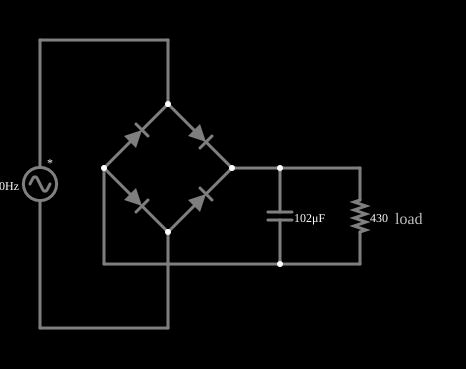

# Retificador de onda completa com filtro

<!-- navegacao:inicio -->
[Índice](README.md) · [Anterior: Full-Wave Rectifier](fullrect.md) · [Próximo: Diode Limiter](diodelimit.md)
<!-- navegacao:fim -->

## Objetivo

Mostrar como um capacitor de filtro transforma a saída pulsante de um retificador numa tensão quase contínua, com uma ondulação (ripple) que depende da carga.

## O circuito

<!-- esquema:inicio -->

<!-- esquema:fim -->

A mesma ponte de quatro diodos do exemplo anterior, agora com um capacitor de $102\ \mu\text{F}$ em paralelo com a carga de $430\ \Omega$ (fonte de $5\ \text{V}$ de pico, $40\ \text{Hz}$). Os diodos têm o modelo de queda de $0{,}806\ \text{V}$ a $1\ \text{A}$ (equivalente ao padrão).

<!-- componentes:inicio -->
| N.º | Tipo | Elemento | Valores |
|----:|------|----------|---------|
| 0 | `VoltageElm` | A/C source | Max Voltage = 5; Waveform = A/C; DC Offset (V) = 0; Internal Resistance (ohms) = 0; Show Voltage = não; Frequency (Hz) = 40; Phase Offset (degrees) = 0 |
| 3 | `DiodeElm` | diode | Model = default |
| 4 | `DiodeElm` | diode | Model = default |
| 5 | `DiodeElm` | diode | Model = default |
| 6 | `DiodeElm` | diode | Model = default |
| 12 | `CapacitorElm` | capacitor | Capacitance (F) = 102μ; Trapezoidal Approximation = sim; Initial Voltage (on Reset) = 1m; Series Resistance = 0 |
| 15 | `ResistorElm` | resistor | Resistance (ohms) = 430 |
| 16 | `TextElm` | text | Text = load; Size = 16; Draw Bar On Top = não; Color = #c0c0c0 |
<!-- componentes:fim -->

## Teoria

O diodo do simulador (modelo "default") segue a equação de Shockley,

$$i = I_s\left(e^{v/(nV_T)} - 1\right),\qquad I_s = 1{,}714\cdot 10^{-7}\ \text{A},\quad n = 2,\quad V_T = 25{,}865\ \text{mV},$$

sem resistência série. Para uma corrente $i \gg I_s$ a tensão é $v = nV_T\ln(i/I_s + 1)$, que dá $0{,}806\ \text{V}$ em $1\ \text{A}$, $0{,}568\ \text{V}$ em $10\ \text{mA}$ e $0{,}449\ \text{V}$ em $1\ \text{mA}$: a tensão cresce $nV_T\ln 10 = 119\ \text{mV}$ a cada década de corrente. Para $v < 0$ a corrente tende a $-I_s = -0{,}17\ \mu\text{A}$.

## Resultados esperados

O capacitor se carrega até o pico (menos duas quedas de diodo) durante a curta condução dos diodos, e se descarrega na carga entre os picos, com $\tau = RC = 430\cdot 102\ \mu\text{F} = 43{,}9\ \text{ms}$. Como a descarga é quase linear (corrente constante $I = V/R$), a ondulação pico a pico é aproximadamente

$$\Delta V \approx \frac{I}{f_r C} = \frac{V_{pico}}{R\,f_r\,C},$$

em que $f_r = 80\ \text{Hz}$ é a frequência de ondulação (o dobro da da rede, por ser onda completa). É um limite superior, porque o capacitor só descarrega durante parte do período (os diodos reassumem a corrente antes do fim).

## O que observar

A integração numérica independente, em regime (de $0{,}4$ a $0{,}6\ \text{s}$), dá

| grandeza | valor |
|:---------|------:|
| pico | $3{,}822\ \text{V}$ |
| mínimo | $3{,}106\ \text{V}$ |
| ondulação pico a pico | $0{,}715\ \text{V}$ |
| valor médio | $3{,}479\ \text{V}$ |

A estimativa $\Delta V \approx 3{,}82/(430\cdot 80\cdot 102\ \mu\text{F}) = 1{,}09\ \text{V}$ é maior que o valor real ($0{,}715\ \text{V}$), como previsto. As verificações conferem o máximo, o mínimo e a média da tensão na carga (tolerância de 1%; o simulador fica a menos de $0{,}01\%$ da integração independente).

## Limites do modelo

- Compare com o retificador sem filtro: a tensão não cai mais a zero, e a ondulação é de uns $20\%$ do valor médio.
- Aumente o capacitor ou a resistência de carga: a ondulação diminui com $1/(RC)$.
- Os diodos só conduzem em picos curtos de corrente (o capacitor se recarrega de uma vez), bem maiores que a corrente média da carga.

## Referências

Fonte ideal (resistência nula): numa fonte real, a resistência do transformador e a do diodo limitam a corrente de carga do capacitor e reduzem a tensão de saída. O modelo não inclui a resistência série equivalente do capacitor.

O circuito deste exemplo faz parte da coleção do simulador original de Paul Falstad e Iain Sharp (CircuitJS1); a explicação é deste projeto.
