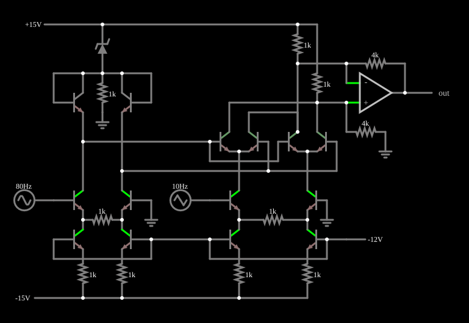

# Multiplicador de célula de Gilbert

<!-- navegacao:inicio -->
[Índice](README.md) · [Anterior: Darlington Pair](darlington.md) · [Próximo: True RMS Converter](rmsconverter.md)
<!-- navegacao:fim -->

## Objetivo

Mostrar o **multiplicador analógico de célula de Gilbert**: um circuito de transistores cuja saída é proporcional ao **produto** de duas tensões de entrada. Aqui uma senoide de $80\ \text{Hz}$ é multiplicada por uma onda triangular de $10\ \text{Hz}$, e a saída é a senoide com a amplitude "desenhada" pela triangular: modulação de amplitude.

## O circuito

<!-- esquema:inicio -->

<!-- esquema:fim -->

As duas entradas são uma senoide de $2\ \text{V}$ de pico e $80\ \text{Hz}$ (**X**) e uma onda triangular de $2\ \text{V}$ de pico e $10\ \text{Hz}$ (**Y**), que começa em $-2\ \text{V}$ em $t = 0$. O circuito usa transistores NPN ($\beta = 100$) e tem, em linhas gerais, quatro blocos: dois conversores tensão-corrente, um para X e outro para Y, com resistores de $1\ \text{k}\Omega$ entre os emissores de pares diferenciais, que fazem a corrente variar linearmente com a tensão; o núcleo multiplicador, de dois pares diferenciais com acoplamento cruzado; um diodo Zener que polariza o circuito (alimentado por $\pm 15\ \text{V}$ e $-12\ \text{V}$); e um amplificador operacional, com resistores de $4\ \text{k}\Omega$, que converte a corrente diferencial do núcleo numa tensão referida à terra, a saída. Três osciloscópios mostram X, Y e a saída.

<!-- componentes:inicio -->
| N.º | Tipo | Elemento | Valores |
|----:|------|----------|---------|
| 0 | `NTransistorElm` | transistor | Beta/hFE = 100; Swap E/C = não; Draw Circle = não; Model = default |
| 1 | `NTransistorElm` | transistor | Beta/hFE = 100; Swap E/C = não; Draw Circle = não; Model = default |
| 3 | `ResistorElm` | resistor | Resistance (ohms) = 1k |
| 7 | `NTransistorElm` | transistor | Beta/hFE = 100; Swap E/C = não; Draw Circle = não; Model = default |
| 8 | `NTransistorElm` | transistor | Beta/hFE = 100; Swap E/C = não; Draw Circle = não; Model = default |
| 9 | `ResistorElm` | resistor | Resistance (ohms) = 1k |
| 10 | `ResistorElm` | resistor | Resistance (ohms) = 1k |
| 12 | `RailElm` | voltage source | Voltage = -15; Waveform = D/C; DC Offset (V) = 0; Internal Resistance (ohms) = 0 |
| 13 | `RailElm` | A/C source | Max Voltage = 2; Waveform = A/C; DC Offset (V) = 0; Internal Resistance (ohms) = 0; Show Voltage = não; Frequency (Hz) = 80; Phase Offset (degrees) = 0 |
| 17 | `GroundElm` | ground | Symbol = Earth |
| 18 | `RailElm` | triangle gen | Max Voltage = 2; Waveform = Triangle; DC Offset (V) = 0; Internal Resistance (ohms) = 0; Show Voltage = não; Frequency (Hz) = 10; Phase Offset (degrees) = 0 |
| 19 | `NTransistorElm` | transistor | Beta/hFE = 100; Swap E/C = não; Draw Circle = não; Model = default |
| 20 | `NTransistorElm` | transistor | Beta/hFE = 100; Swap E/C = não; Draw Circle = não; Model = default |
| 23 | `ResistorElm` | resistor | Resistance (ohms) = 1k |
| 24 | `NTransistorElm` | transistor | Beta/hFE = 100; Swap E/C = não; Draw Circle = não; Model = default |
| 25 | `NTransistorElm` | transistor | Beta/hFE = 100; Swap E/C = não; Draw Circle = não; Model = default |
| 28 | `ResistorElm` | resistor | Resistance (ohms) = 1k |
| 29 | `ResistorElm` | resistor | Resistance (ohms) = 1k |
| 33 | `RailElm` | voltage source | Voltage = -12; Waveform = D/C; DC Offset (V) = 0; Internal Resistance (ohms) = 0 |
| 38 | `GroundElm` | ground | Symbol = Earth |
| 39 | `NTransistorElm` | transistor | Beta/hFE = 100; Swap E/C = não; Draw Circle = não; Model = default |
| 40 | `NTransistorElm` | transistor | Beta/hFE = 100; Swap E/C = não; Draw Circle = não; Model = default |
| 44 | `NTransistorElm` | transistor | Beta/hFE = 100; Swap E/C = não; Draw Circle = não; Model = default |
| 45 | `NTransistorElm` | transistor | Beta/hFE = 100; Swap E/C = não; Draw Circle = não; Model = default |
| 58 | `NTransistorElm` | transistor | Beta/hFE = 100; Swap E/C = não; Draw Circle = não; Model = default |
| 59 | `NTransistorElm` | transistor | Beta/hFE = 100; Swap E/C = não; Draw Circle = não; Model = default |
| 72 | `ResistorElm` | resistor | Resistance (ohms) = 1k |
| 73 | `GroundElm` | ground | Symbol = Earth |
| 80 | `OpAmpElm` | op-amp | Max Output (V) = 15; Min Output (V) = -15; Gain = 100k |
| 82 | `ResistorElm` | resistor | Resistance (ohms) = 4k |
| 85 | `ResistorElm` | resistor | Resistance (ohms) = 4k |
| 86 | `GroundElm` | ground | Symbol = Earth |
| 88 | `ResistorElm` | resistor | Resistance (ohms) = 1k |
| 90 | `ResistorElm` | resistor | Resistance (ohms) = 1k |
| 94 | `ZenerElm` | Zener diode | Model = default-zener |
| 95 | `RailElm` | voltage source | Voltage = 15; Waveform = D/C; DC Offset (V) = 0; Internal Resistance (ohms) = 0 |
| 96 | `OutputElm` | output | Show Voltage = não |
<!-- componentes:fim -->

## Teoria

**A célula básica.** Um par diferencial dividindo a corrente $I_{EE}$ de uma cauda tem a corrente diferencial de coletor

$$\Delta I = I_{EE}\tanh\!\left(\frac{v}{2V_T}\right),$$

com $V_T = 25{,}9\ \text{mV}$. Dois pares diferenciais cujas correntes de cauda são elas mesmas moduladas por um segundo par (a célula de Gilbert) dão, para a corrente de saída,

$$\Delta I_{out} = I_{EE}\,\tanh\!\left(\frac{v_x}{2V_T}\right)\tanh\!\left(\frac{v_y}{2V_T}\right) \approx I_{EE}\,\frac{v_x v_y}{4V_T^2} \quad (|v| \ll V_T),$$

um produto, mas só para sinais bem menores que $2V_T \approx 52\ \text{mV}$: com $2\ \text{V}$ a célula básica saturaria, e a saída seria quase quadrada.

**A linearização.** Para estender o intervalo de entrada, as entradas passam por conversores tensão-corrente (resistor de $1\ \text{k}\Omega$ entre os emissores): a corrente diferencial passa a ser proporcional à tensão, $\Delta I = v/R$, e o produto de duas correntes dividido por uma corrente de referência dá

$$\Delta I_{out} = \frac{\Delta I_x\,\Delta I_y}{I_{ref}} = \frac{v_x\,v_y}{R_x R_y I_{ref}}, \qquad v_{out} = R_f\,\Delta I_{out} = k\,v_x v_y.$$

O ganho $k$ ($\text{V}^{-1}$) depende dos resistores e da corrente de polarização. Quando um dos pares sai da região de operação (as correntes ficam muito desiguais), a saída comprime.

## Resultados esperados

Ajustando por mínimos quadrados a saída a $k\,x\,y$ em $0{,}1\ \text{s}$ (uma volta completa da triangular, $20\,001$ amostras), o ganho do multiplicador é $k = 3{,}09\ \text{V}^{-1}$, com correlação de $0{,}99999$ e resíduo de $0{,}016\ \text{V}$ eficaz sobre uma saída de $5{,}02\ \text{V}$ eficaz ($0{,}3\%$). Com X no pico de $+2\ \text{V}$, as amostras em cinco instantes são:

| $t$ (ms) | $y$ (V) | $v_{out}$ (V) | $v_{out}/(x\,y)$ |
|---------:|--------:|--------------:|------------------:|
| $3{,}125$ | $-1{,}750$ | $-10{,}771$ | $3{,}077$ |
| $15{,}625$ | $-0{,}750$ | $-4{,}640$ | $3{,}092$ |
| $28{,}125$ | $0{,}250$ | $1{,}544$ | $3{,}094$ |
| $40{,}625$ | $1{,}250$ | $7{,}715$ | $3{,}087$ |
| $53{,}125$ | $1{,}750$ | $10{,}771$ | $3{,}077$ |

O ganho é praticamente constante ($3{,}08$ a $3{,}09$) até $|x\,y| = 3{,}5\ \text{V}^2$; no extremo ($|y| = 2\ \text{V}$) a saída comprime: o máximo é $\pm 10{,}81\ \text{V}$, contra $3{,}09 \cdot 4 = 12{,}36\ \text{V}$ de um multiplicador ideal. A média da saída é zero. As verificações conferem a saída nos cinco instantes, a tensão de Y em um deles e o máximo, o mínimo e o valor eficaz da saída na janela $0{,}2$ a $0{,}3\ \text{s}$ (tolerância de $0{,}5\%$).

## O que observar

No osciloscópio da saída, uma senoide de $80\ \text{Hz}$ cuja amplitude acompanha a triangular: cresce até $\pm 10{,}8\ \text{V}$ quando $|y|$ chega a $2\ \text{V}$, passa por zero quando $y = 0$ e **inverte a fase** quando $y$ troca de sinal. Para testar: troque a triangular por uma tensão contínua e veja a saída virar uma senoide de amplitude $3{,}09\,|y| \cdot 2$ com o sinal de $y$; troque as duas entradas pela mesma senoide e veja a saída ser $k\,v^2$, isto é, uma senoide em $2f$ com um nível contínuo (a multiplicação gera a soma e a diferença das frequências).

## Limites do modelo

- A descrição dos blocos é feita em linhas gerais; os valores reais de $I_{ref}$ e $k$ dependem das tensões de polarização do circuito, que o exemplo fixa. A única medida de $k$ aqui é a do simulador.
- O modelo do transistor não tem capacitâncias nem efeito Early; num circuito real a largura de banda de um multiplicador de Gilbert é limitada pelas capacitâncias e pela dependência de $V_{BE}$ com a temperatura.
- O produto só é linear quando os dois pares diferenciais trabalham longe da saturação: aqui a compressão é de $0{,}4\%$ em $|x\,y| = 3{,}5\ \text{V}^2$ e de $12{,}5\%$ em $4\ \text{V}^2$.
- O ajuste de $k$ e o resíduo vêm do simulador e não fazem parte das verificações automáticas.

## Referências

Gilbert, B., "A precise four-quadrant multiplier with subnanosecond response", *IEEE J. Solid-State Circuits*, 1968; Sedra e Smith, *Microelectronic Circuits*, seção sobre a célula de Gilbert; Horowitz e Hill, *The Art of Electronics*, seção 7.x (multiplicadores analógicos).

O circuito deste exemplo faz parte da coleção do simulador original de Paul Falstad e Iain Sharp (CircuitJS1); a explicação é deste projeto.
