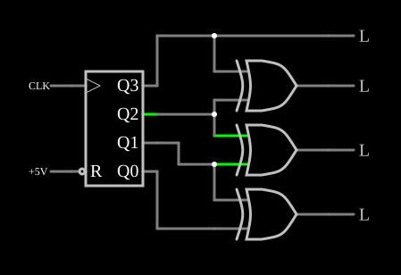

# Contador em código Gray

<!-- navegacao:inicio -->
[Índice](README.md) · [Anterior: Decimal Counter](deccounter.md) · [Próximo: Johnson Counter](johnsonctr.md)
<!-- navegacao:fim -->

## Objetivo

Mostrar o **código Gray**, em que dois valores consecutivos diferem em um só bit, obtido de um contador binário com três portas XOR.

## O circuito

<!-- esquema:inicio -->

<!-- esquema:fim -->

Um contador binário de 4 bits (elemento 13, disparado pela borda de subida) recebe um relógio de $200\ \text{Hz}$. As saídas Gray são, de cima para baixo, $G_3$ (elemento 9), $G_2$ (elemento 10), $G_1$ (elemento 11) e $G_0$ (elemento 12). $G_3$ é o bit mais significativo do contador; os outros três vêm de portas XOR entre bits vizinhos. O exemplo abre com o contador em $1$.

<!-- componentes:inicio -->
| N.º | Tipo | Elemento | Valores |
|----:|------|----------|---------|
| 0 | `RailElm` | square wave gen | Max Voltage = 2.5; Waveform = Square Wave; DC Offset (V) = 2.5; Internal Resistance (ohms) = 0; Show Voltage = não; Specify As = Frequency/Duty Cycle; Frequency (Hz) = 200; Phase Offset (degrees) = 0; Duty Cycle = 50; Rise/Fall Time (s) = 0 |
| 1 | `XorGateElm` | XOR gate | # of Inputs = 2; High Logic Voltage = 5; Schmitt Inputs = não; Propagation Delay (s) = 0; DeMorgan's Symbol = não |
| 2 | `XorGateElm` | XOR gate | # of Inputs = 2; High Logic Voltage = 5; Schmitt Inputs = não; Propagation Delay (s) = 0; DeMorgan's Symbol = não |
| 3 | `XorGateElm` | XOR gate | # of Inputs = 2; High Logic Voltage = 5; Schmitt Inputs = não; Propagation Delay (s) = 0; DeMorgan's Symbol = não |
| 9 | `LogicOutputElm` | logic output | Threshold = 2.5; Current Required = não; Numeric = não; Ternary = não |
| 10 | `LogicOutputElm` | logic output | Threshold = 2.5; Current Required = não; Numeric = não; Ternary = não |
| 11 | `LogicOutputElm` | logic output | Threshold = 2.5; Current Required = não; Numeric = não; Ternary = não |
| 12 | `LogicOutputElm` | logic output | Threshold = 2.5; Current Required = não; Numeric = não; Ternary = não |
| 13 | `CounterElm` | Counter | High Logic Voltage = 5; Bit Order = MSB First; Invert reset pin = sim; # of Bits = 4; Modulus = 0; Up/Down Pin = não; Negative Edge Triggered = não |
| 22 | `RailElm` | voltage source | Voltage = 5; Waveform = D/C; DC Offset (V) = 0; Internal Resistance (ohms) = 0 |
<!-- componentes:fim -->

## Teoria

A conversão de binário $B$ para Gray $G$ é

$$G_3 = B_3, \qquad G_i = B_i \oplus B_{i+1} \quad (i = 0, 1, 2).$$

Quando o binário passa de $k$ para $k+1$, vários bits podem mudar (de $0111$ para $1000$ mudam quatro), mas no Gray muda exatamente um. Por isso o código Gray é usado em *encoders* de posição (um erro de leitura na transição custa no máximo uma unidade), em ponteiros de FIFOs que cruzam domínios de relógio e nos mapas de Karnaugh. A sequência de 4 bits é cíclica: de $15$ ($1000$) volta a $0$ ($0000$) também mudando um só bit.

## Resultados esperados

O simulador dá a sequência $0001, 0011, 0010, 0110, 0111, 0101, 0100, 1100, 1101, 1111, 1110, 1010, 1011, 1001, 1000, 0000, \dots$ ($G_3 G_2 G_1 G_0$), mudando a cada borda de subida do relógio ($5\ \text{ms}$): $0001$ em $1\ \text{ms}$, $0011$ em $9\ \text{ms}$, $1100$ em $39\ \text{ms}$, $1000$ em $74\ \text{ms}$. Em cada passo só um bit muda.

## O que observar

Nos osciloscópios, repare que nunca há duas saídas mudando no mesmo instante.

## Limites do modelo

- Num circuito real, as XORs depois de um contador binário podem gerar pulsos espúrios quando dois bits do contador mudam com atrasos diferentes; um contador Gray "verdadeiro" muda um só flip-flop por vez. Aqui não há atrasos.

## Referências

Gray, patente US 2.632.058 (1953), *Pulse Code Communication*; Mano e Ciletti, *Digital Design*, capítulo sobre códigos binários.

O circuito deste exemplo faz parte da coleção do simulador original de Paul Falstad e Iain Sharp (CircuitJS1); a explicação é deste projeto.
