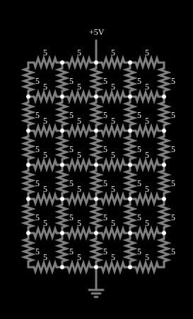

# Grade de resistores

<!-- navegacao:inicio -->
[Índice](README.md) · [Anterior: Power Factor Correction](powerfactor2.md) · [Próximo: Resistor Grid 2](grid2.md)
<!-- navegacao:fim -->

## Objetivo

Mostrar a resistência equivalente de uma rede grande de resistores, que não se obtém por associações em série e paralelo, mas pela solução das equações de nós (a matriz de condutâncias).

## O circuito

<!-- esquema:inicio -->

<!-- esquema:fim -->

Uma grade retangular de $5\times 7$ nós, com resistores de $5\ \Omega$ em cada aresta (ao todo $58$ resistores), é alimentada por $5\ \text{V}$ no nó do meio da borda superior, com o nó do meio da borda inferior ligado à terra.

<!-- componentes:inicio -->
| N.º | Tipo | Elemento | Valores |
|----:|------|----------|---------|
| 0 | `RailElm` | voltage source | Voltage = 5; Waveform = D/C; DC Offset (V) = 0; Internal Resistance (ohms) = 0 |
| 1 | `GroundElm` | ground | Symbol = Earth |
| 2 | `ResistorElm` | resistor | Resistance (ohms) = 5 |
| 3 | `ResistorElm` | resistor | Resistance (ohms) = 5 |
| 4 | `ResistorElm` | resistor | Resistance (ohms) = 5 |
| 5 | `ResistorElm` | resistor | Resistance (ohms) = 5 |
| 6 | `ResistorElm` | resistor | Resistance (ohms) = 5 |
| 7 | `ResistorElm` | resistor | Resistance (ohms) = 5 |
| 8 | `ResistorElm` | resistor | Resistance (ohms) = 5 |
| 9 | `ResistorElm` | resistor | Resistance (ohms) = 5 |
| 10 | `ResistorElm` | resistor | Resistance (ohms) = 5 |
| 11 | `ResistorElm` | resistor | Resistance (ohms) = 5 |
| 12 | `ResistorElm` | resistor | Resistance (ohms) = 5 |
| 13 | `ResistorElm` | resistor | Resistance (ohms) = 5 |
| 14 | `ResistorElm` | resistor | Resistance (ohms) = 5 |
| 15 | `ResistorElm` | resistor | Resistance (ohms) = 5 |
| 16 | `ResistorElm` | resistor | Resistance (ohms) = 5 |
| 17 | `ResistorElm` | resistor | Resistance (ohms) = 5 |
| 18 | `ResistorElm` | resistor | Resistance (ohms) = 5 |
| 19 | `ResistorElm` | resistor | Resistance (ohms) = 5 |
| 20 | `ResistorElm` | resistor | Resistance (ohms) = 5 |
| 21 | `ResistorElm` | resistor | Resistance (ohms) = 5 |
| 22 | `ResistorElm` | resistor | Resistance (ohms) = 5 |
| 23 | `ResistorElm` | resistor | Resistance (ohms) = 5 |
| 24 | `ResistorElm` | resistor | Resistance (ohms) = 5 |
| 25 | `ResistorElm` | resistor | Resistance (ohms) = 5 |
| 26 | `ResistorElm` | resistor | Resistance (ohms) = 5 |
| 27 | `ResistorElm` | resistor | Resistance (ohms) = 5 |
| 28 | `ResistorElm` | resistor | Resistance (ohms) = 5 |
| 29 | `ResistorElm` | resistor | Resistance (ohms) = 5 |
| 30 | `ResistorElm` | resistor | Resistance (ohms) = 5 |
| 31 | `ResistorElm` | resistor | Resistance (ohms) = 5 |
| 32 | `ResistorElm` | resistor | Resistance (ohms) = 5 |
| 33 | `ResistorElm` | resistor | Resistance (ohms) = 5 |
| 34 | `ResistorElm` | resistor | Resistance (ohms) = 5 |
| 35 | `ResistorElm` | resistor | Resistance (ohms) = 5 |
| 36 | `ResistorElm` | resistor | Resistance (ohms) = 5 |
| 37 | `ResistorElm` | resistor | Resistance (ohms) = 5 |
| 38 | `ResistorElm` | resistor | Resistance (ohms) = 5 |
| 39 | `ResistorElm` | resistor | Resistance (ohms) = 5 |
| 40 | `ResistorElm` | resistor | Resistance (ohms) = 5 |
| 41 | `ResistorElm` | resistor | Resistance (ohms) = 5 |
| 42 | `ResistorElm` | resistor | Resistance (ohms) = 5 |
| 43 | `ResistorElm` | resistor | Resistance (ohms) = 5 |
| 44 | `ResistorElm` | resistor | Resistance (ohms) = 5 |
| 45 | `ResistorElm` | resistor | Resistance (ohms) = 5 |
| 46 | `ResistorElm` | resistor | Resistance (ohms) = 5 |
| 47 | `ResistorElm` | resistor | Resistance (ohms) = 5 |
| 48 | `ResistorElm` | resistor | Resistance (ohms) = 5 |
| 49 | `ResistorElm` | resistor | Resistance (ohms) = 5 |
| 50 | `ResistorElm` | resistor | Resistance (ohms) = 5 |
| 51 | `ResistorElm` | resistor | Resistance (ohms) = 5 |
| 52 | `ResistorElm` | resistor | Resistance (ohms) = 5 |
| 53 | `ResistorElm` | resistor | Resistance (ohms) = 5 |
| 54 | `ResistorElm` | resistor | Resistance (ohms) = 5 |
| 55 | `ResistorElm` | resistor | Resistance (ohms) = 5 |
| 56 | `ResistorElm` | resistor | Resistance (ohms) = 5 |
| 57 | `ResistorElm` | resistor | Resistance (ohms) = 5 |
| 58 | `ResistorElm` | resistor | Resistance (ohms) = 5 |
| 59 | `ResistorElm` | resistor | Resistance (ohms) = 5 |
<!-- componentes:fim -->

## Teoria

Para uma rede de $n$ nós e condutâncias $G_{ij} = 1/R_{ij}$, a lei de Kirchhoff das correntes em cada nó dá o sistema linear

$$\mathbf{G}\,\mathbf{v} = \mathbf{i},$$

em que $\mathbf{G}$ é a matriz de condutâncias (a "laplaciana" do grafo: $G_{ii}$ é a soma das condutâncias que chegam ao nó $i$, e $G_{ij} = -1/R_{ij}$), $\mathbf{v}$ é o vetor de tensões e $\mathbf{i}$, o das correntes injetadas. A resistência equivalente entre dois nós $a$ e $b$ é a tensão entre eles quando se injeta $1\ \text{A}$ em $a$ e se retira em $b$:

$$R_{ab} = v_a - v_b.$$

O simulador resolve exatamente um sistema desses a cada passo.

## Resultados esperados

Resolvendo o sistema de $35$ nós por um programa independente, a resistência entre o nó superior e o inferior é

$$R_{eq} = 8{,}8458\ \Omega,\qquad I = \frac{5}{8{,}8458} = 0{,}5652\ \text{A}.$$

O simulador dá $0{,}565243\ \text{A}$. A verificação confere a corrente da fonte, com tolerância de 1%.

## O que observar

- Passe o ponteiro pelos resistores: a corrente é maior perto dos nós da fonte e da terra e se espalha pela grade, caindo nas bordas.
- Reduza a grade apagando resistores (selecione e apague): a resistência equivalente aumenta, porque há menos caminhos.
- Compare com o resultado intuitivo (uma associação série-paralelo "adivinhada"), que erra por não conhecer o caminho exato da corrente.

## Limites do modelo

Resistores ideais (sem coeficiente de temperatura nem ruído). Uma grade real ainda teria a resistência das conexões, que o modelo ignora.

## Referências

- J. W. Nilsson e S. A. Riedel, *Circuitos Elétricos*, Pearson.
- C. K. Alexander e M. N. O. Sadiku, *Fundamentos de Circuitos Elétricos*, AMGH.

O circuito deste exemplo faz parte da coleção do simulador original de Paul Falstad e Iain Sharp (CircuitJS1); a explicação é deste projeto.
