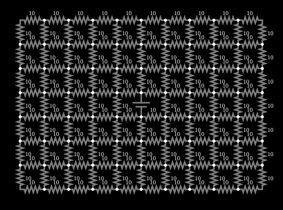

# Grade de resistores 2

<!-- navegacao:inicio -->
[Índice](README.md) · [Anterior: Resistor Grid](grid.md) · [Próximo: Resistor Cube](cube.md)
<!-- navegacao:fim -->

## Objetivo

Mostrar a resistência de uma grade quadrada de resistores vista por uma fonte ligada entre dois nós vizinhos, que tende a um valor simples (a resistência de uma aresta) quando a grade é grande.

## O circuito

<!-- esquema:inicio -->

<!-- esquema:fim -->

Uma grade de $11\times 8$ nós, com resistores de $10\ \Omega$ nas arestas, em que **um dos resistores foi retirado e substituído por uma fonte de $5\ \text{V}$**: a fonte é ligada entre dois nós vizinhos, e a corrente que ela fornece volta pelo resto da grade ($156$ resistores no total).

<!-- componentes:inicio -->
| N.º | Tipo | Elemento | Valores |
|----:|------|----------|---------|
| 0 | `VoltageElm` | voltage source | Voltage = 5; Waveform = D/C; DC Offset (V) = 0; Internal Resistance (ohms) = 0; Show Voltage = não; Circle Symbol = não |
| 1 | `ResistorElm` | resistor | Resistance (ohms) = 10 |
| 2 | `ResistorElm` | resistor | Resistance (ohms) = 10 |
| 3 | `ResistorElm` | resistor | Resistance (ohms) = 10 |
| 4 | `ResistorElm` | resistor | Resistance (ohms) = 10 |
| 5 | `ResistorElm` | resistor | Resistance (ohms) = 10 |
| 6 | `ResistorElm` | resistor | Resistance (ohms) = 10 |
| 7 | `ResistorElm` | resistor | Resistance (ohms) = 10 |
| 8 | `ResistorElm` | resistor | Resistance (ohms) = 10 |
| 9 | `ResistorElm` | resistor | Resistance (ohms) = 10 |
| 10 | `ResistorElm` | resistor | Resistance (ohms) = 10 |
| 11 | `ResistorElm` | resistor | Resistance (ohms) = 10 |
| 12 | `ResistorElm` | resistor | Resistance (ohms) = 10 |
| 13 | `ResistorElm` | resistor | Resistance (ohms) = 10 |
| 14 | `ResistorElm` | resistor | Resistance (ohms) = 10 |
| 15 | `ResistorElm` | resistor | Resistance (ohms) = 10 |
| 16 | `ResistorElm` | resistor | Resistance (ohms) = 10 |
| 17 | `ResistorElm` | resistor | Resistance (ohms) = 10 |
| 18 | `ResistorElm` | resistor | Resistance (ohms) = 10 |
| 19 | `ResistorElm` | resistor | Resistance (ohms) = 10 |
| 20 | `ResistorElm` | resistor | Resistance (ohms) = 10 |
| 21 | `ResistorElm` | resistor | Resistance (ohms) = 10 |
| 22 | `ResistorElm` | resistor | Resistance (ohms) = 10 |
| 23 | `ResistorElm` | resistor | Resistance (ohms) = 10 |
| 24 | `ResistorElm` | resistor | Resistance (ohms) = 10 |
| 25 | `ResistorElm` | resistor | Resistance (ohms) = 10 |
| 26 | `ResistorElm` | resistor | Resistance (ohms) = 10 |
| 27 | `ResistorElm` | resistor | Resistance (ohms) = 10 |
| 28 | `ResistorElm` | resistor | Resistance (ohms) = 10 |
| 29 | `ResistorElm` | resistor | Resistance (ohms) = 10 |
| 30 | `ResistorElm` | resistor | Resistance (ohms) = 10 |
| 31 | `ResistorElm` | resistor | Resistance (ohms) = 10 |
| 32 | `ResistorElm` | resistor | Resistance (ohms) = 10 |
| 33 | `ResistorElm` | resistor | Resistance (ohms) = 10 |
| 34 | `ResistorElm` | resistor | Resistance (ohms) = 10 |
| 35 | `ResistorElm` | resistor | Resistance (ohms) = 10 |
| 36 | `ResistorElm` | resistor | Resistance (ohms) = 10 |
| 37 | `ResistorElm` | resistor | Resistance (ohms) = 10 |
| 38 | `ResistorElm` | resistor | Resistance (ohms) = 10 |
| 39 | `ResistorElm` | resistor | Resistance (ohms) = 10 |
| 40 | `ResistorElm` | resistor | Resistance (ohms) = 10 |
| 41 | `ResistorElm` | resistor | Resistance (ohms) = 10 |
| 42 | `ResistorElm` | resistor | Resistance (ohms) = 10 |
| 43 | `ResistorElm` | resistor | Resistance (ohms) = 10 |
| 44 | `ResistorElm` | resistor | Resistance (ohms) = 10 |
| 45 | `ResistorElm` | resistor | Resistance (ohms) = 10 |
| 46 | `ResistorElm` | resistor | Resistance (ohms) = 10 |
| 47 | `ResistorElm` | resistor | Resistance (ohms) = 10 |
| 48 | `ResistorElm` | resistor | Resistance (ohms) = 10 |
| 49 | `ResistorElm` | resistor | Resistance (ohms) = 10 |
| 50 | `ResistorElm` | resistor | Resistance (ohms) = 10 |
| 51 | `ResistorElm` | resistor | Resistance (ohms) = 10 |
| 52 | `ResistorElm` | resistor | Resistance (ohms) = 10 |
| 53 | `ResistorElm` | resistor | Resistance (ohms) = 10 |
| 54 | `ResistorElm` | resistor | Resistance (ohms) = 10 |
| 55 | `ResistorElm` | resistor | Resistance (ohms) = 10 |
| 56 | `ResistorElm` | resistor | Resistance (ohms) = 10 |
| 57 | `ResistorElm` | resistor | Resistance (ohms) = 10 |
| 58 | `ResistorElm` | resistor | Resistance (ohms) = 10 |
| 59 | `ResistorElm` | resistor | Resistance (ohms) = 10 |
| 60 | `ResistorElm` | resistor | Resistance (ohms) = 10 |
| 61 | `ResistorElm` | resistor | Resistance (ohms) = 10 |
| 62 | `ResistorElm` | resistor | Resistance (ohms) = 10 |
| 63 | `ResistorElm` | resistor | Resistance (ohms) = 10 |
| 64 | `ResistorElm` | resistor | Resistance (ohms) = 10 |
| 65 | `ResistorElm` | resistor | Resistance (ohms) = 10 |
| 66 | `ResistorElm` | resistor | Resistance (ohms) = 10 |
| 67 | `ResistorElm` | resistor | Resistance (ohms) = 10 |
| 68 | `ResistorElm` | resistor | Resistance (ohms) = 10 |
| 69 | `ResistorElm` | resistor | Resistance (ohms) = 10 |
| 70 | `ResistorElm` | resistor | Resistance (ohms) = 10 |
| 71 | `ResistorElm` | resistor | Resistance (ohms) = 10 |
| 72 | `ResistorElm` | resistor | Resistance (ohms) = 10 |
| 73 | `ResistorElm` | resistor | Resistance (ohms) = 10 |
| 74 | `ResistorElm` | resistor | Resistance (ohms) = 10 |
| 75 | `ResistorElm` | resistor | Resistance (ohms) = 10 |
| 76 | `ResistorElm` | resistor | Resistance (ohms) = 10 |
| 77 | `ResistorElm` | resistor | Resistance (ohms) = 10 |
| 78 | `ResistorElm` | resistor | Resistance (ohms) = 10 |
| 79 | `ResistorElm` | resistor | Resistance (ohms) = 10 |
| 80 | `ResistorElm` | resistor | Resistance (ohms) = 10 |
| 81 | `ResistorElm` | resistor | Resistance (ohms) = 10 |
| 82 | `ResistorElm` | resistor | Resistance (ohms) = 10 |
| 83 | `ResistorElm` | resistor | Resistance (ohms) = 10 |
| 84 | `ResistorElm` | resistor | Resistance (ohms) = 10 |
| 85 | `ResistorElm` | resistor | Resistance (ohms) = 10 |
| 86 | `ResistorElm` | resistor | Resistance (ohms) = 10 |
| 87 | `ResistorElm` | resistor | Resistance (ohms) = 10 |
| 88 | `ResistorElm` | resistor | Resistance (ohms) = 10 |
| 89 | `ResistorElm` | resistor | Resistance (ohms) = 10 |
| 90 | `ResistorElm` | resistor | Resistance (ohms) = 10 |
| 91 | `ResistorElm` | resistor | Resistance (ohms) = 10 |
| 92 | `ResistorElm` | resistor | Resistance (ohms) = 10 |
| 93 | `ResistorElm` | resistor | Resistance (ohms) = 10 |
| 94 | `ResistorElm` | resistor | Resistance (ohms) = 10 |
| 95 | `ResistorElm` | resistor | Resistance (ohms) = 10 |
| 96 | `ResistorElm` | resistor | Resistance (ohms) = 10 |
| 97 | `ResistorElm` | resistor | Resistance (ohms) = 10 |
| 98 | `ResistorElm` | resistor | Resistance (ohms) = 10 |
| 99 | `ResistorElm` | resistor | Resistance (ohms) = 10 |
| 100 | `ResistorElm` | resistor | Resistance (ohms) = 10 |
| 101 | `ResistorElm` | resistor | Resistance (ohms) = 10 |
| 102 | `ResistorElm` | resistor | Resistance (ohms) = 10 |
| 103 | `ResistorElm` | resistor | Resistance (ohms) = 10 |
| 104 | `ResistorElm` | resistor | Resistance (ohms) = 10 |
| 105 | `ResistorElm` | resistor | Resistance (ohms) = 10 |
| 106 | `ResistorElm` | resistor | Resistance (ohms) = 10 |
| 107 | `ResistorElm` | resistor | Resistance (ohms) = 10 |
| 108 | `ResistorElm` | resistor | Resistance (ohms) = 10 |
| 109 | `ResistorElm` | resistor | Resistance (ohms) = 10 |
| 110 | `ResistorElm` | resistor | Resistance (ohms) = 10 |
| 111 | `ResistorElm` | resistor | Resistance (ohms) = 10 |
| 112 | `ResistorElm` | resistor | Resistance (ohms) = 10 |
| 113 | `ResistorElm` | resistor | Resistance (ohms) = 10 |
| 114 | `ResistorElm` | resistor | Resistance (ohms) = 10 |
| 115 | `ResistorElm` | resistor | Resistance (ohms) = 10 |
| 116 | `ResistorElm` | resistor | Resistance (ohms) = 10 |
| 117 | `ResistorElm` | resistor | Resistance (ohms) = 10 |
| 118 | `ResistorElm` | resistor | Resistance (ohms) = 10 |
| 119 | `ResistorElm` | resistor | Resistance (ohms) = 10 |
| 120 | `ResistorElm` | resistor | Resistance (ohms) = 10 |
| 121 | `ResistorElm` | resistor | Resistance (ohms) = 10 |
| 122 | `ResistorElm` | resistor | Resistance (ohms) = 10 |
| 123 | `ResistorElm` | resistor | Resistance (ohms) = 10 |
| 124 | `ResistorElm` | resistor | Resistance (ohms) = 10 |
| 125 | `ResistorElm` | resistor | Resistance (ohms) = 10 |
| 126 | `ResistorElm` | resistor | Resistance (ohms) = 10 |
| 127 | `ResistorElm` | resistor | Resistance (ohms) = 10 |
| 128 | `ResistorElm` | resistor | Resistance (ohms) = 10 |
| 129 | `ResistorElm` | resistor | Resistance (ohms) = 10 |
| 130 | `ResistorElm` | resistor | Resistance (ohms) = 10 |
| 131 | `ResistorElm` | resistor | Resistance (ohms) = 10 |
| 132 | `ResistorElm` | resistor | Resistance (ohms) = 10 |
| 133 | `ResistorElm` | resistor | Resistance (ohms) = 10 |
| 134 | `ResistorElm` | resistor | Resistance (ohms) = 10 |
| 135 | `ResistorElm` | resistor | Resistance (ohms) = 10 |
| 136 | `ResistorElm` | resistor | Resistance (ohms) = 10 |
| 137 | `ResistorElm` | resistor | Resistance (ohms) = 10 |
| 138 | `ResistorElm` | resistor | Resistance (ohms) = 10 |
| 139 | `ResistorElm` | resistor | Resistance (ohms) = 10 |
| 140 | `ResistorElm` | resistor | Resistance (ohms) = 10 |
| 141 | `ResistorElm` | resistor | Resistance (ohms) = 10 |
| 142 | `ResistorElm` | resistor | Resistance (ohms) = 10 |
| 143 | `ResistorElm` | resistor | Resistance (ohms) = 10 |
| 144 | `ResistorElm` | resistor | Resistance (ohms) = 10 |
| 145 | `ResistorElm` | resistor | Resistance (ohms) = 10 |
| 146 | `ResistorElm` | resistor | Resistance (ohms) = 10 |
| 147 | `ResistorElm` | resistor | Resistance (ohms) = 10 |
| 148 | `ResistorElm` | resistor | Resistance (ohms) = 10 |
| 149 | `ResistorElm` | resistor | Resistance (ohms) = 10 |
| 150 | `ResistorElm` | resistor | Resistance (ohms) = 10 |
| 151 | `ResistorElm` | resistor | Resistance (ohms) = 10 |
| 152 | `ResistorElm` | resistor | Resistance (ohms) = 10 |
| 153 | `ResistorElm` | resistor | Resistance (ohms) = 10 |
| 154 | `ResistorElm` | resistor | Resistance (ohms) = 10 |
| 155 | `ResistorElm` | resistor | Resistance (ohms) = 10 |
| 156 | `ResistorElm` | resistor | Resistance (ohms) = 10 |
<!-- componentes:fim -->

## Teoria

Numa grade quadrada infinita de resistores $R$, a resistência equivalente entre dois nós vizinhos (incluindo o resistor que os liga) vale exatamente $R/2$, por simetria: a corrente injetada num nó se divide igualmente pelas quatro arestas, de modo que metade do efeito vem do resistor direto e metade do resto da grade. Se o resistor direto é retirado, as condutâncias se subtraem:

$$\frac{1}{R_{resto}} = \frac{1}{R/2} - \frac{1}{R} = \frac{1}{R}\ \Longrightarrow\ R_{resto} = R = 10\ \Omega.$$

Numa grade finita o resultado é um pouco maior, porque faltam os caminhos que existiriam além das bordas. A resistência equivalente se obtém resolvendo as equações de nós $\mathbf{G}\mathbf{v} = \mathbf{i}$, como no exemplo anterior.

## Resultados esperados

Resolvendo as equações da grade finita de $88$ nós por um programa independente, a resistência vista pela fonte é

$$R_{eq} = 10{,}224\ \Omega\ (\text{contra }10\ \Omega\text{ da grade infinita}),\qquad I = \frac{5}{10{,}224} = 0{,}4890\ \text{A}.$$

O simulador dá $0{,}489046\ \text{A}$. A verificação confere a corrente da fonte, com tolerância de 1%. O desvio de $2{,}2\%$ em relação ao valor da grade infinita é o efeito do tamanho finito.

## O que observar

- A corrente do resistor mais próximo da fonte é a maior; ela decai com a distância.
- Compare com o exemplo "Grade de resistores": lá a fonte e a terra ficam afastadas; aqui, vizinhas.
- Aumente a grade (copiando linhas de resistores): a resistência tende a $10\ \Omega$.

## Limites do modelo

Resistores ideais. O valor de $R/2$ vale só para a grade infinita; uma grade real tem bordas, e o resultado depende da posição da fonte.

## Referências

- J. W. Nilsson e S. A. Riedel, *Circuitos Elétricos*, Pearson.
- C. K. Alexander e M. N. O. Sadiku, *Fundamentos de Circuitos Elétricos*, AMGH.

O circuito deste exemplo faz parte da coleção do simulador original de Paul Falstad e Iain Sharp (CircuitJS1); a explicação é deste projeto.
