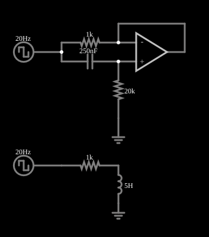

# Girador (indutor simulado)

<!-- navegacao:inicio -->
[Índice](README.md) · [Anterior: Negative Impedance Converter](nic-r.md) · [Próximo: Capacitance Multiplier](capmult.md)
<!-- navegacao:fim -->

## Objetivo

Mostrar o girador: um circuito com um amplificador operacional e um capacitor que, visto de seus terminais, se comporta como um **indutor**. O exemplo compara o girador com um indutor de verdade, de $5\ \text{H}$, e as correntes são idênticas.

## O circuito

<!-- esquema:inicio -->

<!-- esquema:fim -->

Duas montagens recebem a mesma onda quadrada de $20\ \text{Hz}$ e $\pm 5\ \text{V}$. A de baixo é a referência: um indutor de $5\ \text{H}$ em série com um resistor de $1\ \text{k}\Omega$. A de cima é o girador: a fonte alimenta, por um resistor de $1\ \text{k}\Omega$, a saída de um seguidor de tensão (amplificador operacional), e a entrada do seguidor está ligada à fonte por um capacitor de $250\ \text{nF}$ e à terra por um resistor de $20\ \text{k}\Omega$. Dois osciloscópios acompanham as duas fontes, uma em cada montagem.

<!-- componentes:inicio -->
| N.º | Tipo | Elemento | Valores |
|----:|------|----------|---------|
| 0 | `OpAmpElm` | op-amp | Max Output (V) = 15; Min Output (V) = -15; Gain = 100k |
| 4 | `ResistorElm` | resistor | Resistance (ohms) = 20k |
| 5 | `ResistorElm` | resistor | Resistance (ohms) = 1k |
| 6 | `CapacitorElm` | capacitor | Capacitance (F) = 250n; Trapezoidal Approximation = sim; Initial Voltage (on Reset) = 1m; Series Resistance = 0 |
| 9 | `RailElm` | square wave gen | Max Voltage = 5; Waveform = Square Wave; DC Offset (V) = 0; Internal Resistance (ohms) = 0; Show Voltage = não; Specify As = Frequency/Duty Cycle; Frequency (Hz) = 20; Phase Offset (degrees) = 0; Duty Cycle = 50; Rise/Fall Time (s) = 0 |
| 10 | `GroundElm` | ground | Symbol = Earth |
| 11 | `RailElm` | square wave gen | Max Voltage = 5; Waveform = Square Wave; DC Offset (V) = 0; Internal Resistance (ohms) = 0; Show Voltage = não; Specify As = Frequency/Duty Cycle; Frequency (Hz) = 20; Phase Offset (degrees) = 0; Duty Cycle = 50; Rise/Fall Time (s) = 0 |
| 12 | `InductorElm` | inductor | Inductance (H) = 5; Trapezoidal Approximation = sim; Initial Current (on Reset) (A) = 0; Saturation Current (A) (0=none) = 0 |
| 13 | `GroundElm` | ground | Symbol = Earth |
| 14 | `ResistorElm` | resistor | Resistance (ohms) = 1k |
<!-- componentes:fim -->

## Teoria

A entrada do seguidor é a tensão da fonte filtrada por um passa-altas $RC$ ($R = 20\ \text{k}\Omega$, $C = 250\ \text{nF}$):

$$V_M = V\,\frac{sRC}{1 + sRC}.$$

O seguidor copia $V_M$ para o outro terminal do resistor $R_g = 1\ \text{k}\Omega$ que sai da fonte, e a corrente de entrada é

$$I = \frac{V - V_M}{R_g} = \frac{V}{R_g\,(1 + sRC)} \quad\Longrightarrow\quad Z_\text{in} = \frac{V}{I} = R_g + s\,R_g R C.$$

Isso é a impedância de um resistor $R_g$ em série com um indutor

$$L = R_g\,R\,C = 1\ \text{k}\Omega\cdot 20\ \text{k}\Omega\cdot 250\ \text{nF} = 5\ \text{H}.$$

O girador "inverte" a impedância do capacitor em uma indutância, sem usar nenhum enrolamento: é como se obtém um indutor grande em circuitos integrados.

## Resultados esperados

Os dois circuitos têm a mesma constante de tempo $L/R_g = 5\ \text{ms}$ e as mesmas condições iniciais (corrente de $-1{,}94\ \text{mA}$ no indutor), e a corrente em resposta a um degrau de $5\ \text{V}$ é

$$i(t) = \frac{V}{R_g} + \left(I_0 - \frac{V}{R_g}\right)e^{-tR_g/L}.$$

| Instante | Corrente (cálculo) | Girador (simulador) | Indutor (simulador) |
|----------|-------------------:|--------------------:|--------------------:|
| $10\ \text{ms}$ | $4{,}061\ \text{mA}$ | $4{,}0603\ \text{mA}$ | $4{,}0603\ \text{mA}$ |

(O sinal das correntes nos resistores é o da convenção do simulador.) Em $t = 40\ \text{ms}$, depois de a onda quadrada inverter em $t = 25\ \text{ms}$, a corrente tem outro valor, e a verificação confere que os dois circuitos continuam iguais.

## O que observar

- Os resultados das duas montagens se sobrepõem: não é possível distinguir o girador do indutor real.
- A corrente sobe exponencialmente com a constante de tempo de $5\ \text{ms}$ após cada degrau.
- Duplique o capacitor do girador e a indutância simulada dobra.

## Limites do modelo

O operacional é ideal. Um girador real tem banda limitada, o indutor simulado tem uma extremidade ligada à terra por dentro do circuito (não é flutuante, como um indutor de verdade) e a corrente máxima que ele suporta é a da saída do operacional.

## Referências

- A. S. Sedra e K. C. Smith, *Microeletrônica*, Pearson.
- P. Horowitz e W. Hill, *The Art of Electronics*, Cambridge University Press.
- B. D. H. Tellegen, "The gyrator, a new electric network element", *Philips Research Reports*, 1948.

O circuito deste exemplo faz parte da coleção do simulador original de Paul Falstad e Iain Sharp (CircuitJS1); a explicação é deste projeto.
