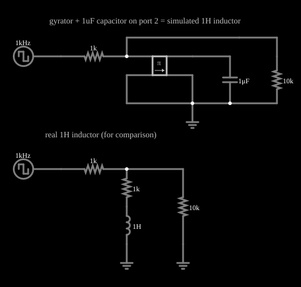

# Girador

<!-- navegacao:inicio -->
[Índice](README.md) · [Anterior: Latching Relay](latchingrelay.md)
<!-- navegacao:fim -->

## Objetivo

Mostrar o **girador**, um elemento de dois terminais por porta (quatro terminais) que transforma uma impedância na sua inversa: com um capacitor numa porta, a outra porta se comporta como um **indutor** sem bobina.

## O circuito

<!-- esquema:inicio -->

<!-- esquema:fim -->

Dois circuitos iguais recebem a mesma onda quadrada de $5\ \text{V}$ e $1\ \text{kHz}$, cada um por um resistor de $1\ \text{k}\Omega$ e com uma carga de $10\ \text{k}\Omega$:

- **De cima:** um girador de resistência de giração $R = 1\ \text{k}\Omega$ com um capacitor de $1\ \mu\text{F}$ na segunda porta (*gyrator + 1uF capacitor on port 2 = simulated 1H inductor*).
- **De baixo:** um indutor real de $1\ \text{H}$ (*real 1H inductor, for comparison*).

Os osciloscópios mostram os dois lados.

<!-- componentes:inicio -->
| N.º | Tipo | Elemento | Valores |
|----:|------|----------|---------|
| 0 | `ResistorElm` | resistor | Resistance (ohms) = 1k |
| 1 | `GyratorElm` | gyrator | Gyration Resistance (Ω) = 1k |
| 5 | `GroundElm` | ground | Symbol = Earth |
| 6 | `RailElm` | square wave gen | Max Voltage = 5; Waveform = Square Wave; DC Offset (V) = 0; Internal Resistance (ohms) = 0; Show Voltage = não; Specify As = Frequency/Duty Cycle; Frequency (Hz) = 1k; Phase Offset (degrees) = 0; Duty Cycle = 50; Rise/Fall Time (s) = 0 |
| 8 | `CapacitorElm` | capacitor | Capacitance (F) = 1μ; Trapezoidal Approximation = sim; Initial Voltage (on Reset) = 1m; Series Resistance = 0 |
| 10 | `ResistorElm` | resistor | Resistance (ohms) = 10k |
| 12 | `ResistorElm` | resistor | Resistance (ohms) = 1k |
| 13 | `InductorElm` | inductor | Inductance (H) = 1; Trapezoidal Approximation = sim; Initial Current (on Reset) (A) = 0; Saturation Current (A) (0=none) = 0 |
| 14 | `GroundElm` | ground | Symbol = Earth |
| 15 | `RailElm` | square wave gen | Max Voltage = 5; Waveform = Square Wave; DC Offset (V) = 0; Internal Resistance (ohms) = 0; Show Voltage = não; Specify As = Frequency/Duty Cycle; Frequency (Hz) = 1k; Phase Offset (degrees) = 0; Duty Cycle = 50; Rise/Fall Time (s) = 0 |
| 17 | `ResistorElm` | resistor | Resistance (ohms) = 10k |
| 18 | `GroundElm` | ground | Symbol = Earth |
| 19 | `TextElm` | text | Text = gyrator + 1uF capacitor on port 2 = simulated 1H inductor; Size = 14; Draw Bar On Top = não; Color = #c0c0c0 |
| 20 | `TextElm` | text | Text = real 1H inductor (for comparison); Size = 14; Draw Bar On Top = não; Color = #c0c0c0 |
| 21 | `RoutedWireElm` | wire | Show Current = não; Show Voltage = não; Show Bus Value = não; Show Bus Value (Hex) = não |
| 22 | `ResistorElm` | resistor | Resistance (ohms) = 1k |
<!-- componentes:fim -->

## Teoria

Um girador ideal tem $v_1 = R\thinspace i_2$ e $v_2 = -R\thinspace i_1$. A impedância vista numa porta quando a outra tem a impedância $Z_L$ é

$$Z_{in} = \frac{R^2}{Z_L}.$$

Com um capacitor, $Z_L = 1/(sC)$, e então $Z_{in} = sR^2C$: um indutor de

$$L = R^2 C = (1\ \text{k}\Omega)^2\cdot 1\ \mu\text{F} = 1\ \text{H}.$$

É assim que se obtêm indutores em circuitos integrados, onde bobinas grandes não cabem. A analogia inversa (indutor na carga vira capacitor) também vale.

## Resultados esperados

O simulador dá a tensão no resistor de $10\ \text{k}\Omega$ de cada circuito (em volts):

| $t$ | Com o girador | Com o indutor real |
|---:|---:|---:|
| $0{,}1\ \text{ms}$ | $4{,}727$ | $4{,}724$ |
| $0{,}3\ \text{ms}$ | $3{,}941$ | $3{,}980$ |
| $0{,}5\ \text{ms}$ | $3{,}286$ | $3{,}473$ |

Os extremos no fim do período ($9{,}5$ a $9{,}9\ \text{ms}$) são $-5{,}56\ \text{V}$ e $-3{,}87\ \text{V}$ com o girador e $-5{,}50\ \text{V}$ e $-3{,}84\ \text{V}$ com o indutor.

## O que observar

As duas respostas ao degrau da onda quadrada são quase iguais: o girador com capacitor é indistinguível de um indutor real na escala do osciloscópio. Troque o capacitor por um de $2\ \mu\text{F}$ e a indutância simulada passa a $2\ \text{H}$.

## Limites do modelo

- As duas curvas diferem em até $5\ \%$ ($3{,}29\ \text{V}$ contra $3{,}47\ \text{V}$ em $0{,}5\ \text{ms}$); este projeto não investigou a origem da diferença (os dois ramos não são idênticos nos componentes em série).
- O girador do simulador é ideal; um girador real, feito com amplificadores operacionais, tem faixa de frequência limitada e ruído.

## Referências

Tellegen, *The gyrator, a new electric network element*, Philips Research Reports (1948); Sedra e Smith, *Microeletrônica*, capítulo sobre filtros ativos (simulação de indutores com giradores).

O circuito deste exemplo faz parte da coleção do simulador original de Paul Falstad e Iain Sharp (CircuitJS1); a explicação é deste projeto.
