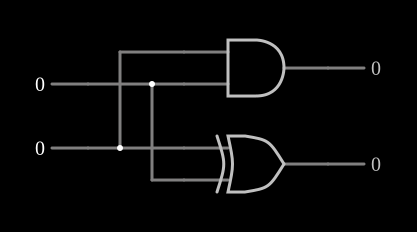

# Meio-somador

<!-- navegacao:inicio -->
[Índice](README.md) · [Anterior: Exclusive OR](xor.md) · [Próximo: Full Adder](fulladd.md)
<!-- navegacao:fim -->

## Objetivo

Mostrar o **meio-somador**, o circuito que soma dois bits e produz a soma e o vai-um. É o bloco mais simples da aritmética binária.

## O circuito

<!-- esquema:inicio -->

<!-- esquema:fim -->

Duas entradas lógicas numéricas, $A$ (elemento 2) e $B$ (elemento 3), vão a uma porta XOR e a uma porta AND. A XOR dá a soma $S$ (elemento 13, embaixo) e a AND o vai-um $C$ (elemento 12, em cima); as saídas mostram $0$ ou $1$. O exemplo abre com as duas entradas em $0$.

<!-- componentes:inicio -->
| N.º | Tipo | Elemento | Valores |
|----:|------|----------|---------|
| 0 | `XorGateElm` | XOR gate | # of Inputs = 2; High Logic Voltage = 5; Schmitt Inputs = não; Propagation Delay (s) = 0; DeMorgan's Symbol = não |
| 1 | `AndGateElm` | AND gate | # of Inputs = 2; High Logic Voltage = 5; Schmitt Inputs = não; Invert Inputs = não; Propagation Delay (s) = 0; DeMorgan's Symbol = não |
| 2 | `LogicInputElm` | logic input | Momentary Switch = não; High Logic Voltage = 5; Low Voltage = 0; Numeric = sim; Ternary = não; Keyboard Shortcut =  |
| 3 | `LogicInputElm` | logic input | Momentary Switch = não; High Logic Voltage = 5; Low Voltage = 0; Numeric = sim; Ternary = não; Keyboard Shortcut =  |
| 12 | `LogicOutputElm` | logic output | Threshold = 2.5; Current Required = não; Numeric = sim; Ternary = não |
| 13 | `LogicOutputElm` | logic output | Threshold = 2.5; Current Required = não; Numeric = sim; Ternary = não |
<!-- componentes:fim -->

## Teoria

Somar dois bits dá um número de $0$ a $2$, que precisa de dois bits para ser escrito: $A + B = 2C + S$. A tabela da soma é a da [XOR](xor.md) e a do vai-um é a da AND:

$$S = A \oplus B, \qquad C = A \cdot B.$$

É "meio" somador porque não tem uma entrada para o vai-um da coluna anterior; para somar números de vários bits é preciso o [Full Adder](fulladd.md).

## Resultados esperados

O simulador dá:

| $A$ | $B$ | $C$ | $S$ | $A + B$ |
|----:|----:|----:|----:|--------:|
| 0 | 0 | 0 | 0 | 0 |
| 1 | 0 | 0 | 1 | 1 |
| 0 | 1 | 0 | 1 | 1 |
| 1 | 1 | 1 | 0 | 2 |

## O que observar

Clique nas entradas e leia $C\,S$ como um número binário de dois bits: é sempre a soma $A + B$.

## Limites do modelo

- As portas são ideais e sem atraso.

## Referências

Mano e Ciletti, *Digital Design*, capítulo sobre lógica combinacional (somadores); Wakerly, *Digital Design: Principles and Practices*.

O circuito deste exemplo faz parte da coleção do simulador original de Paul Falstad e Iain Sharp (CircuitJS1); a explicação é deste projeto.
