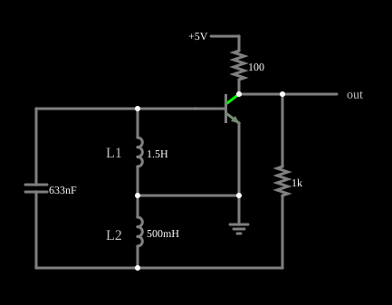

# Oscilador Hartley

<!-- navegacao:inicio -->
[Índice](README.md) · [Anterior: Colpitts Oscillator](colpitts.md) · [Próximo: Emitter-Coupled LC Oscillator](eclosc.md)
<!-- navegacao:fim -->

## Objetivo

Mostrar o **oscilador Hartley**, o parente do Colpitts em que o circuito ressonante tem um capacitor e **dois indutores em série**, com a tomada entre eles ligada ao emissor. A oscilação surge sozinha, perto da frequência de ressonância do circuito LC.

## O circuito

<!-- esquema:inicio -->

<!-- esquema:fim -->

O transistor NPN ($\beta = 100$) tem o emissor ligado à terra e ao ponto entre dois indutores em série, $L_1 = 1{,}5\ \text{H}$ (entre a base e a terra) e $L_2 = 0{,}5\ \text{H}$ (entre a terra e um nó inferior). Um capacitor de $633\ \text{nF}$ liga a base ao nó inferior, e um resistor de $1\ \text{k}\Omega$ liga o coletor a esse mesmo nó, realimentando o sinal. A alimentação de $5\ \text{V}$ chega ao coletor por $100\ \Omega$, e a saída é o coletor.

<!-- componentes:inicio -->
| N.º | Tipo | Elemento | Valores |
|----:|------|----------|---------|
| 0 | `NTransistorElm` | transistor | Beta/hFE = 100; Swap E/C = não; Draw Circle = não; Model = default |
| 7 | `ResistorElm` | resistor | Resistance (ohms) = 1k |
| 9 | `ResistorElm` | resistor | Resistance (ohms) = 100 |
| 10 | `RailElm` | voltage source | Voltage = 5; Waveform = D/C; DC Offset (V) = 0; Internal Resistance (ohms) = 0 |
| 11 | `GroundElm` | ground | Symbol = Earth |
| 12 | `OutputElm` | output | Show Voltage = não |
| 13 | `InductorElm` | inductor | Inductance (H) = 1.5; Trapezoidal Approximation = sim; Initial Current (on Reset) (A) = 0; Saturation Current (A) (0=none) = 0 |
| 14 | `InductorElm` | inductor | Inductance (H) = 500m; Trapezoidal Approximation = sim; Initial Current (on Reset) (A) = 0; Saturation Current (A) (0=none) = 0 |
| 15 | `CapacitorElm` | capacitor | Capacitance (F) = 633n; Trapezoidal Approximation = sim; Initial Voltage (on Reset) = 1m; Series Resistance = 0 |
| 16 | `TextElm` | text | Text = L1; Size = 16; Draw Bar On Top = não; Color = #c0c0c0 |
| 17 | `TextElm` | text | Text = L2; Size = 16; Draw Bar On Top = não; Color = #c0c0c0 |
<!-- componentes:fim -->

## Teoria

Como no [oscilador Colpitts](colpitts.md), o emissor comum inverte a fase em $180^\circ$ e a tomada dos indutores inverte outros $180^\circ$, o que realimenta o sinal com a fase certa. A frequência é a do circuito LC com os dois indutores em série (os dois elementos do simulador não têm acoplamento mútuo):

$$L = L_1 + L_2 = 2\ \text{H}, \qquad f_0 = \frac{1}{2\pi\sqrt{L\,C}} = \frac{1}{2\pi\sqrt{2\ \text{H} \cdot 633\ \text{nF}}} \approx 141{,}5\ \text{Hz}.$$

A razão $L_1/L_2$ define a fração do sinal que volta à base. Em grande sinal o transistor satura num extremo do ciclo e corta no outro, o que limita a amplitude.

## Resultados esperados

O simulador dá uma oscilação estável de $126{,}83\ \text{Hz}$, $10{,}3\%$ abaixo dos $141{,}5\ \text{Hz}$ do circuito LC ideal. A diferença é efeito de grande sinal e de carga: o coletor oscila entre $0{,}119\ \text{V}$ (transistor saturado) e $4{,}700\ \text{V}$, de modo que a junção base-emissor conduz com forte corrente e o resistor de $1\ \text{k}\Omega$ e o transistor carregam o circuito ressonante. Para confirmar que a fórmula descreve o circuito de pequenos sinais, trocou-se no simulador o resistor de realimentação de $1\ \text{k}\Omega$ por $3\ \text{k}\Omega$: a oscilação deixa de se sustentar (a saída tende a um nível contínuo) e o resíduo que resta oscila em $141{,}6\ \text{Hz}$, praticamente a frequência ideal (esse teste é uma observação, não uma verificação automática). A oscilação já está em regime nos primeiros ciclos (o arquivo já traz as correntes e tensões de um circuito em oscilação), e a frequência é a mesma em $1\ \text{s}$ e em $2\ \text{s}$. As verificações conferem a frequência (duas janelas) e o máximo e o mínimo do coletor.

## O que observar

No osciloscópio, uma onda não senoidal de $7{,}9\ \text{ms}$ de período, achatada na parte de cima: ela passa $45\%$ do período na faixa dos $10\%$ superiores da excursão (perto de $4{,}7\ \text{V}$, com o transistor cortado) e $21\%$ na dos $10\%$ inferiores. Para testar: aumente $L_2$ e veja a frequência cair; troque o resistor de realimentação de $1\ \text{k}\Omega$ por $3\ \text{k}\Omega$ e veja a oscilação morrer, por falta de ganho de malha; mude o capacitor e veja a frequência acompanhar $1/\sqrt{C}$.

## Limites do modelo

- Os dois indutores são elementos independentes, sem acoplamento mútuo; um oscilador Hartley real usa uma bobina com tomada, em que há acoplamento entre as duas partes e a relação entre elas define a realimentação.
- A frequência prevista é de pequenos sinais; em grande sinal, como aqui, ela é bem menor.
- O transistor não tem capacitâncias, que em radiofrequência somam-se ao capacitor do circuito ressonante.
- A amplitude de regime não é prevista pela fórmula: ela depende da saturação do transistor.

## Referências

Sedra e Smith, *Microelectronic Circuits*, capítulo sobre osciladores senoidais (Colpitts e Hartley); Horowitz e Hill, *The Art of Electronics*, seção 5.x (osciladores LC).

O circuito deste exemplo faz parte da coleção do simulador original de Paul Falstad e Iain Sharp (CircuitJS1); a explicação é deste projeto.
