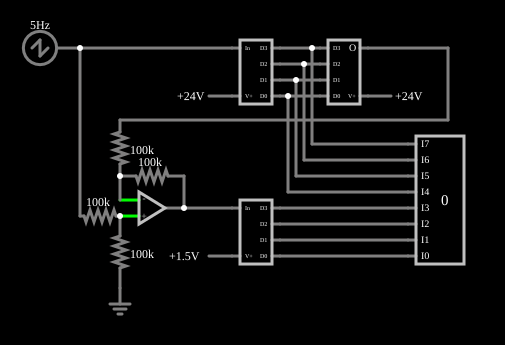

# Conversor A/D *half-flash* (sub-faixas)

<!-- navegacao:inicio -->
[Índice](README.md) · [Anterior: Delta-Sigma ADC](deltasigma.md) · [Próximo: Binary-Weighted DAC](dac.md)
<!-- navegacao:fim -->

## Objetivo

Mostrar como obter 8 bits com dois conversores de 4 bits: um conversor grosso acha os bits altos, um DAC reconstrói esse valor, e um conversor fino converte a **diferença** (o resíduo) nos bits baixos.

## O circuito

<!-- esquema:inicio -->

<!-- esquema:fim -->

- **Entrada:** uma rampa (dente de serra) de $5\ \text{Hz}$ que sobe de $0$ a $25{,}6\ \text{V}$.
- **Estágio grosso:** um ADC de 4 bits com referência de $24\ \text{V}$ (elemento 15) e um DAC de 4 bits com a mesma referência (elemento 0), ligado às suas saídas.
- **Subtrator:** um amp-op com quatro resistores de $100\ \text{k}\Omega$ (amplificador diferencial de ganho 1) calcula $V_{in} - V_{DAC}$.
- **Estágio fino:** um ADC de 4 bits com referência de $1{,}5\ \text{V}$ (elemento 18) converte o resíduo.
- **Saída:** um mostrador decimal de 8 bits (elemento 33) com os 4 bits do estágio grosso em cima e os 4 do fino embaixo.

<!-- componentes:inicio -->
| N.º | Tipo | Elemento | Valores |
|----:|------|----------|---------|
| 0 | `DACElm` | DAC | Bit Order = MSB First; # of Bits = 4 |
| 1 | `RailElm` | voltage source | Voltage = 24; Waveform = D/C; DC Offset (V) = 0; Internal Resistance (ohms) = 0 |
| 4 | `OpAmpElm` | op-amp | Max Output (V) = 15; Min Output (V) = -15; Gain = 100k |
| 5 | `ResistorElm` | resistor | Resistance (ohms) = 100k |
| 8 | `ResistorElm` | resistor | Resistance (ohms) = 100k |
| 11 | `RailElm` | sawtooth gen | Max Voltage = 12.8; Waveform = Sawtooth; DC Offset (V) = 12.8; Internal Resistance (ohms) = 0; Show Voltage = não; Frequency (Hz) = 5; Phase Offset (degrees) = 0 |
| 12 | `ResistorElm` | resistor | Resistance (ohms) = 100k |
| 13 | `GroundElm` | ground | Symbol = Earth |
| 14 | `ResistorElm` | resistor | Resistance (ohms) = 100k |
| 15 | `ADCElm` | ADC | Bit Order = MSB First; # of Bits = 4 |
| 17 | `RailElm` | voltage source | Voltage = 24; Waveform = D/C; DC Offset (V) = 0; Internal Resistance (ohms) = 0 |
| 18 | `ADCElm` | ADC | Bit Order = MSB First; # of Bits = 4 |
| 20 | `RailElm` | voltage source | Voltage = 1.5; Waveform = D/C; DC Offset (V) = 0; Internal Resistance (ohms) = 0 |
| 33 | `DecimalDisplayElm` | decimal display | High Logic Voltage = 5; Bit Order = MSB First; # of Bits = 8; Display Mode = Decimal |
<!-- componentes:fim -->

## Teoria

No modelo do simulador, o código máximo de um conversor de 4 bits ($15$) corresponde à sua referência: o passo do estágio grosso é $24/15 = 1{,}6\ \text{V}$ e o do fino, $1{,}5/15 = 0{,}1\ \text{V}$. O estágio grosso dá $C = \lfloor V_{in}/1{,}6 \rfloor$, o DAC reconstrói $1{,}6\,C$, e o resíduo $V_{in} - 1{,}6\,C$, entre $0$ e $1{,}6\ \text{V}$, vai ao estágio fino, que dá $F = \lfloor \text{resíduo}/0{,}1 \rfloor$ (no máximo $15$). Como $1{,}6\ \text{V} = 16 \times 0{,}1\ \text{V}$, o número $16C + F$ é a entrada medida em passos de $0{,}1\ \text{V}$:

$$N = 16C + F = \lfloor 10\, V_{in} \rfloor.$$

São $2 \times 15$ comparadores em vez dos $255$ de um [conversor *flash*](flashadc.md) de 8 bits, ao custo de duas etapas em série e de exigir um DAC e um subtrator precisos: um erro no DAC maior que meio passo fino produz códigos perdidos.

## Resultados esperados

O simulador dá:

| $t$ (ms) | $V_{in}$ (V) | DAC (V) | Resíduo (V) | Código | $\lfloor 10 V_{in} \rfloor$ |
|----:|----:|----:|----:|----:|----:|
| 10 | 1,28 | 0 | 1,28 | 12 | 12 |
| 50 | 6,40 | 4,8 | 1,60 | 63 | 63 |
| 100 | 12,80 | 11,2 | 1,60 | 127 | 127 |
| 130 | 16,64 | 16,0 | 0,64 | 166 | 166 |
| 195 | 24,96 | 24,0 | 0,96 | 249 | 249 |

## O que observar

Nos osciloscópios, a saída do DAC sobe em degraus de $1{,}6\ \text{V}$ e o resíduo é uma "serra" que volta a zero em cada degrau.

## Limites do modelo

- Os conversores são ideais e instantâneos; um conversor real precisa de amostragem e retenção na entrada, porque a entrada não pode mudar entre as duas etapas.
- Com a referência do estágio grosso em $24\ \text{V}$ e a escala de $1{,}6\ \text{V}$ por passo, o código máximo, $255$, corresponde a $25{,}5\ \text{V}$.

## Referências

Johns e Martin, *Analog Integrated Circuit Design*, capítulo sobre conversores de duas etapas e sub-faixas; Kester (ed.), *Data Conversion Handbook*, Analog Devices.

O circuito deste exemplo faz parte da coleção do simulador original de Paul Falstad e Iain Sharp (CircuitJS1); a explicação é deste projeto.
