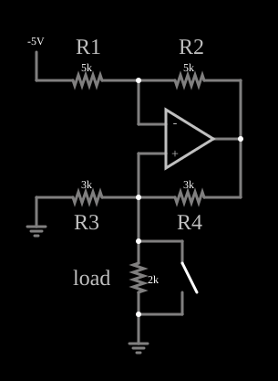

# Fonte de corrente de Howland

<!-- navegacao:inicio -->
[Índice](README.md) · [Anterior: Capacitance Multiplier](capmult.md) · [Próximo: I-to-V Converter](itov.md)
<!-- navegacao:fim -->

## Objetivo

Mostrar a fonte de corrente de Howland, que fornece à carga uma corrente proporcional à tensão de controle e **independente da carga**, usando um amplificador operacional e quatro resistores. Um interruptor em paralelo com a carga permite verificar que a corrente não muda quando a carga é curto-circuitada.

## O circuito

<!-- esquema:inicio -->

<!-- esquema:fim -->

Uma fonte de $-5\ \text{V}$ ($V_\text{in}$) liga-se por um resistor de $5\ \text{k}\Omega$ à entrada inversora de um amplificador operacional; um resistor de $5\ \text{k}\Omega$ liga a saída a essa entrada. A saída também alimenta, por um resistor de $3\ \text{k}\Omega$ ($R_3$), a entrada não inversora, que tem um resistor de $3\ \text{k}\Omega$ ($R_4$) para a terra. A carga, um resistor de $2\ \text{k}\Omega$, também está ligada à entrada não inversora e à terra, com um interruptor (aberto ao abrir) em paralelo.

<!-- componentes:inicio -->
| N.º | Tipo | Elemento | Valores |
|----:|------|----------|---------|
| 0 | `OpAmpElm` | op-amp | Max Output (V) = 15; Min Output (V) = -15; Gain = 100k |
| 3 | `ResistorElm` | resistor | Resistance (ohms) = 3k |
| 4 | `ResistorElm` | resistor | Resistance (ohms) = 5k |
| 5 | `ResistorElm` | resistor | Resistance (ohms) = 5k |
| 6 | `ResistorElm` | resistor | Resistance (ohms) = 3k |
| 8 | `RailElm` | voltage source | Voltage = -5; Waveform = D/C; DC Offset (V) = 0; Internal Resistance (ohms) = 0 |
| 9 | `GroundElm` | ground | Symbol = Earth |
| 12 | `ResistorElm` | resistor | Resistance (ohms) = 2k |
| 13 | `SwitchElm` | switch (SPST) | Momentary Switch = não; IEC Symbol = não; Label (for linking) = ; Keyboard Shortcut = ; On Resistance (ohms) = 0 |
| 15 | `GroundElm` | ground | Symbol = Earth |
| 17 | `TextElm` | text | Text = R1; Size = 24; Draw Bar On Top = não; Color = #c0c0c0 |
| 18 | `TextElm` | text | Text = R2; Size = 24; Draw Bar On Top = não; Color = #c0c0c0 |
| 19 | `TextElm` | text | Text = R3; Size = 24; Draw Bar On Top = não; Color = #c0c0c0 |
| 20 | `TextElm` | text | Text = R4; Size = 24; Draw Bar On Top = não; Color = #c0c0c0 |
| 21 | `TextElm` | text | Text = load; Size = 24; Draw Bar On Top = não; Color = #c0c0c0 |
<!-- componentes:fim -->

## Teoria

Seja $V_L$ a tensão sobre a carga (a mesma da entrada não inversora). Pelo curto-circuito virtual, a entrada inversora também está em $V_L$. A corrente em $R_1$ é a mesma que passa em $R_2$:

$$\frac{V_\text{in} - V_L}{R_1} = \frac{V_L - V_o}{R_2} \;\;(R_1 = R_2)\quad\Longrightarrow\quad V_o = 2V_L - V_\text{in}.$$

A corrente na carga é a que sobra da corrente que vem da saída por $R_3$ menos a que vai à terra por $R_4$:

$$I_L = \frac{V_o - V_L}{R_3} - \frac{V_L}{R_4} = \frac{V_o - 2V_L}{R_3} = -\frac{V_\text{in}}{R_3} \qquad (R_3 = R_4).$$

$I_L$ não depende de $V_L$, ou seja, da carga: é uma fonte de corrente. Com $V_\text{in} = -5\ \text{V}$ e $R_3 = 3\ \text{k}\Omega$, $I_L = 5/3 = 1{,}667\ \text{mA}$. A tensão da carga é $V_L = I_L R_L$ e a saída do operacional é $V_o = 2V_L - V_\text{in}$, que não pode passar de $15\ \text{V}$: a corrente só é constante para $R_L \le (15 - 5)/(2\cdot 1{,}667\ \text{mA}) = 3\ \text{k}\Omega$.

## Resultados esperados

| Grandeza | Valor |
|----------|------:|
| Corrente na carga | $1{,}667\ \text{mA}$ |
| Tensão na carga ($2\ \text{k}\Omega$) | $3{,}333\ \text{V}$ |
| Saída do operacional ($2V_L - V_\text{in}$) | $11{,}667\ \text{V}$ |
| Corrente no interruptor, com a carga em curto | $1{,}667\ \text{mA}$ (a corrente total não muda) |

As verificações conferem a corrente e a tensão da carga, a saída do operacional e a corrente no interruptor fechado.

## O que observar

- Feche o interruptor: a tensão na carga cai a zero, mas a corrente total continua em $1{,}667\ \text{mA}$; agora ela passa pelo interruptor.
- Troque a carga por valores maiores até $3\ \text{k}\Omega$ e a corrente não muda; acima disso a saída do operacional satura em $15\ \text{V}$ e a corrente cai.
- Mude a tensão da fonte e a corrente muda proporcionalmente, com $I_L = -V_\text{in}/R_3$.

## Limites do modelo

A corrente só é independente da carga se $R_1 = R_2$ e $R_3 = R_4$ (casamento): com 1% de tolerância, a impedância de saída cai de infinita para algumas centenas de quilohms. O operacional é ideal, mas a corrente fica limitada pela tensão de saída ($\pm 15\ \text{V}$).

## Referências

- A. S. Sedra e K. C. Smith, *Microeletrônica*, Pearson.
- P. Horowitz e W. Hill, *The Art of Electronics*, Cambridge University Press.
- W. G. Jung, *Op Amp Applications Handbook*, Newnes.

O circuito deste exemplo faz parte da coleção do simulador original de Paul Falstad e Iain Sharp (CircuitJS1); a explicação é deste projeto.
