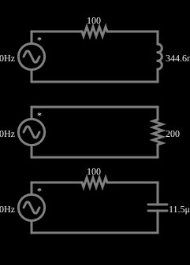

# Impedâncias de mesmo módulo

<!-- navegacao:inicio -->
[Índice](README.md) · [Anterior: Inductors w/ Various Frequencies](indmultfreq.md) · [Próximo: Series Resonance](res-series.md)
<!-- navegacao:fim -->

## Objetivo

Mostrar que impedâncias com o mesmo módulo podem ter fases opostas: uma parte reativa indutiva e uma capacitiva produzem a mesma amplitude de corrente, mas com defasagens de sinais contrários.

## O circuito

<!-- esquema:inicio -->

<!-- esquema:fim -->

Três ramos alimentados por fontes de 5 V e 80 Hz: um resistor de $100\ \Omega$ em série com um indutor de $344{,}6\ \text{mH}$; um resistor de $100\ \Omega$ em série com um capacitor de $11{,}49\ \mu\text{F}$; e um resistor de $200\ \Omega$. Um osciloscópio mostra as correntes dos três ramos.

<!-- componentes:inicio -->
| N.º | Tipo | Elemento | Valores |
|----:|------|----------|---------|
| 0 | `VoltageElm` | A/C source | Max Voltage = 5; Waveform = A/C; DC Offset (V) = 0; Internal Resistance (ohms) = 0; Show Voltage = não; Frequency (Hz) = 80; Phase Offset (degrees) = 90 |
| 1 | `ResistorElm` | resistor | Resistance (ohms) = 100 |
| 3 | `VoltageElm` | A/C source | Max Voltage = 5; Waveform = A/C; DC Offset (V) = 0; Internal Resistance (ohms) = 0; Show Voltage = não; Frequency (Hz) = 80; Phase Offset (degrees) = 90 |
| 5 | `ResistorElm` | resistor | Resistance (ohms) = 100 |
| 6 | `InductorElm` | inductor | Inductance (H) = 344.6m; Trapezoidal Approximation = sim; Initial Current (on Reset) (A) = 0; Saturation Current (A) (0=none) = 0 |
| 7 | `CapacitorElm` | capacitor | Capacitance (F) = 11.5μ; Trapezoidal Approximation = sim; Initial Voltage (on Reset) = 1m; Series Resistance = 0 |
| 9 | `VoltageElm` | A/C source | Max Voltage = 5; Waveform = A/C; DC Offset (V) = 0; Internal Resistance (ohms) = 0; Show Voltage = não; Frequency (Hz) = 80; Phase Offset (degrees) = 90 |
| 11 | `ResistorElm` | resistor | Resistance (ohms) = 200 |
<!-- componentes:fim -->

## Teoria

Em regime permanente senoidal, tensões e correntes são fasores e cada elemento tem uma **impedância**:

$$Z_R = R,\qquad Z_L = j\omega L,\qquad Z_C = \frac{1}{j\omega C},\qquad \omega = 2\pi f.$$

A parte imaginária é a **reatância**: $X_L=\omega L$ (cresce com a frequência) e $X_C = 1/(\omega C)$ (diminui com ela). A amplitude da corrente e a defasagem entre tensão e corrente seguem de $I = V/Z$.

Na frequência $f=80\ \text{Hz}$ ($\omega = 502{,}7\ \text{rad/s}$): $X_L=\omega L=173{,}2\ \Omega$ e $X_C = 1/(\omega C) = 173{,}2\ \Omega$. Os dois ramos têm

$$Z_{RL} = 100 + j\,173{,}2 = 200\,\angle{+60^\circ}\ \Omega,\qquad Z_{RC} = 100 - j\,173{,}2 = 200\,\angle{-60^\circ}\ \Omega,$$

e o terceiro ramo, $Z=200\ \Omega$ com fase $0^\circ$. Os três módulos são iguais, então as amplitudes das correntes são iguais: $I = 5/200 = 25\ \text{mA}$; mas a corrente do ramo RL atrasa $60^\circ$, a do ramo RC adianta $60^\circ$ e a do resistor está em fase com a tensão.

## Resultados esperados

As três correntes têm pico de $25\ \text{mA}$. A tensão sobre o indutor e sobre o capacitor tem pico $I\,X = 25\ \text{mA}\cdot173{,}2\ \Omega = 4{,}33\ \text{V}$. As verificações conferem as três correntes e essas duas tensões (de 200 ms a 300 ms).

## O que observar

- No osciloscópio as três correntes têm a mesma altura, mas deslocadas no tempo: uma atrasada, uma adiantada e uma em fase com a fonte.
- Mude a frequência: os módulos deixam de coincidir (o indutor passa a oferecer mais impedância e o capacitor, menos).

## Limites do modelo

Elementos ideais. As fontes têm uma defasagem de $90^\circ$ configurada (cosseno), que não altera as amplitudes.

## Referências

- J. W. Nilsson e S. A. Riedel, *Circuitos Elétricos*, Pearson.
- C. K. Alexander e M. N. O. Sadiku, *Fundamentos de Circuitos Elétricos*, AMGH.

O circuito deste exemplo faz parte da coleção do simulador original de Paul Falstad e Iain Sharp (CircuitJS1); a explicação é deste projeto.
