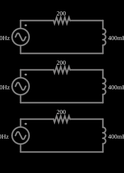

# Indutores em várias frequências

<!-- navegacao:inicio -->
[Índice](README.md) · [Anterior: Inductors of Various Inductances](indmultind.md) · [Próximo: Impedances of Same Magnitude](impedance.md)
<!-- navegacao:fim -->

## Objetivo

Mostrar que o mesmo indutor se comporta de modo diferente em frequências diferentes: a reatância $\omega L$ aumenta com a frequência.

## O circuito

<!-- esquema:inicio -->

<!-- esquema:fim -->

Três circuitos RL série iguais ($200\ \Omega$ e $400\ \text{mH}$) são alimentados por fontes de 5 V de pico com frequências de 30 Hz, 80 Hz e 200 Hz. Três osciloscópios mostram as tensões nos indutores.

<!-- componentes:inicio -->
| N.º | Tipo | Elemento | Valores |
|----:|------|----------|---------|
| 0 | `VoltageElm` | A/C source | Max Voltage = 5; Waveform = A/C; DC Offset (V) = 0; Internal Resistance (ohms) = 0; Show Voltage = não; Frequency (Hz) = 30; Phase Offset (degrees) = 90 |
| 1 | `ResistorElm` | resistor | Resistance (ohms) = 200 |
| 3 | `VoltageElm` | A/C source | Max Voltage = 5; Waveform = A/C; DC Offset (V) = 0; Internal Resistance (ohms) = 0; Show Voltage = não; Frequency (Hz) = 80; Phase Offset (degrees) = 90 |
| 4 | `ResistorElm` | resistor | Resistance (ohms) = 200 |
| 6 | `VoltageElm` | A/C source | Max Voltage = 5; Waveform = A/C; DC Offset (V) = 0; Internal Resistance (ohms) = 0; Show Voltage = não; Frequency (Hz) = 200; Phase Offset (degrees) = 90 |
| 8 | `ResistorElm` | resistor | Resistance (ohms) = 200 |
| 9 | `InductorElm` | inductor | Inductance (H) = 400m; Trapezoidal Approximation = sim; Initial Current (on Reset) (A) = 0; Saturation Current (A) (0=none) = 0 |
| 10 | `InductorElm` | inductor | Inductance (H) = 400m; Trapezoidal Approximation = sim; Initial Current (on Reset) (A) = 0; Saturation Current (A) (0=none) = 0 |
| 11 | `InductorElm` | inductor | Inductance (H) = 400m; Trapezoidal Approximation = sim; Initial Current (on Reset) (A) = 0; Saturation Current (A) (0=none) = 0 |
<!-- componentes:fim -->

## Teoria

Em regime permanente senoidal, tensões e correntes são fasores e cada elemento tem uma **impedância**:

$$Z_R = R,\qquad Z_L = j\omega L,\qquad Z_C = \frac{1}{j\omega C},\qquad \omega = 2\pi f.$$

A parte imaginária é a **reatância**: $X_L=\omega L$ (cresce com a frequência) e $X_C = 1/(\omega C)$ (diminui com ela). A amplitude da corrente e a defasagem entre tensão e corrente seguem de $I = V/Z$.

No divisor RL, $V_L = V\,\dfrac{X_L}{\sqrt{R^2+X_L^2}}$ com $X_L=2\pi f L$. A frequência de corte (onde $X_L=R$) é $f_c = R/(2\pi L) = 79{,}6\ \text{Hz}$.

## Resultados esperados

| $f$ | $X_L$ | $V_{L,pico}$ | $I_{pico}$ | $\varphi$ (atraso) |
|----:|------:|-------------:|-----------:|-------------------:|
| 30 Hz | $75{,}4\ \Omega$ | $1{,}764\ \text{V}$ | $23{,}4\ \text{mA}$ | $20{,}7^\circ$ |
| 80 Hz | $201{,}1\ \Omega$ | $3{,}545\ \text{V}$ | $17{,}6\ \text{mA}$ | $45{,}2^\circ$ |
| 200 Hz | $502{,}7\ \Omega$ | $4{,}646\ \text{V}$ | $9{,}2\ \text{mA}$ | $68{,}3^\circ$ |

As verificações medem os três picos de tensão depois do transitório (de 150 ms a 250 ms).

## O que observar

- Em frequência baixa o indutor se comporta quase como curto; em frequência alta, quase como circuito aberto (o oposto do capacitor).
- Isto é o princípio dos filtros RL.

## Limites do modelo

Elementos ideais.

## Referências

- J. W. Nilsson e S. A. Riedel, *Circuitos Elétricos*, Pearson.
- C. K. Alexander e M. N. O. Sadiku, *Fundamentos de Circuitos Elétricos*, AMGH.

O circuito deste exemplo faz parte da coleção do simulador original de Paul Falstad e Iain Sharp (CircuitJS1); a explicação é deste projeto.
