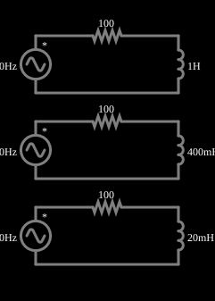

# Indutores de várias indutâncias

<!-- navegacao:inicio -->
[Índice](README.md) · [Anterior: Caps w/ Various Frequencies](capmultfreq.md) · [Próximo: Inductors w/ Various Frequencies](indmultfreq.md)
<!-- navegacao:fim -->

## Objetivo

Comparar, na mesma frequência, o efeito da indutância: quanto maior o indutor, maior a reatância e maior a fração da tensão que fica sobre ele.

## O circuito

<!-- esquema:inicio -->

<!-- esquema:fim -->

Três circuitos RL série idênticos (fonte de 5 V de pico a 80 Hz e resistor de $100\ \Omega$) diferem no indutor: $1\ \text{H}$, $400\ \text{mH}$ e $20\ \text{mH}$. Três osciloscópios mostram as tensões nos indutores.

<!-- componentes:inicio -->
| N.º | Tipo | Elemento | Valores |
|----:|------|----------|---------|
| 0 | `VoltageElm` | A/C source | Max Voltage = 5; Waveform = A/C; DC Offset (V) = 0; Internal Resistance (ohms) = 0; Show Voltage = não; Frequency (Hz) = 80; Phase Offset (degrees) = 90 |
| 1 | `ResistorElm` | resistor | Resistance (ohms) = 100 |
| 3 | `VoltageElm` | A/C source | Max Voltage = 5; Waveform = A/C; DC Offset (V) = 0; Internal Resistance (ohms) = 0; Show Voltage = não; Frequency (Hz) = 80; Phase Offset (degrees) = 90 |
| 4 | `ResistorElm` | resistor | Resistance (ohms) = 100 |
| 6 | `VoltageElm` | A/C source | Max Voltage = 5; Waveform = A/C; DC Offset (V) = 0; Internal Resistance (ohms) = 0; Show Voltage = não; Frequency (Hz) = 80; Phase Offset (degrees) = 90 |
| 8 | `ResistorElm` | resistor | Resistance (ohms) = 100 |
| 9 | `InductorElm` | inductor | Inductance (H) = 1; Trapezoidal Approximation = sim; Initial Current (on Reset) (A) = 0; Saturation Current (A) (0=none) = 0 |
| 10 | `InductorElm` | inductor | Inductance (H) = 400m; Trapezoidal Approximation = sim; Initial Current (on Reset) (A) = 0; Saturation Current (A) (0=none) = 0 |
| 11 | `InductorElm` | inductor | Inductance (H) = 20m; Trapezoidal Approximation = sim; Initial Current (on Reset) (A) = 0; Saturation Current (A) (0=none) = 0 |
<!-- componentes:fim -->

## Teoria

Em regime permanente senoidal, tensões e correntes são fasores e cada elemento tem uma **impedância**:

$$Z_R = R,\qquad Z_L = j\omega L,\qquad Z_C = \frac{1}{j\omega C},\qquad \omega = 2\pi f.$$

A parte imaginária é a **reatância**: $X_L=\omega L$ (cresce com a frequência) e $X_C = 1/(\omega C)$ (diminui com ela). A amplitude da corrente e a defasagem entre tensão e corrente seguem de $I = V/Z$.

No divisor RL a tensão sobre o indutor é

$$V_L = V\,\frac{X_L}{\sqrt{R^2+X_L^2}},\qquad X_L = 2\pi f L,$$

e a corrente, $I = V/\sqrt{R^2+X_L^2}$, se atrasa $\varphi=\arctan(X_L/R)$.

## Resultados esperados

A 80 Hz: $X_L = 502{,}7$, $201{,}1$ e $10{,}05\ \Omega$:

| $L$ | $V_{L,pico}$ | $I_{pico}$ | $\varphi$ (atraso) |
|----:|-------------:|-----------:|-------------------:|
| $1\ \text{H}$ | $4{,}904\ \text{V}$ | $9{,}76\ \text{mA}$ | $78{,}7^\circ$ |
| $400\ \text{mH}$ | $4{,}477\ \text{V}$ | $22{,}3\ \text{mA}$ | $63{,}6^\circ$ |
| $20\ \text{mH}$ | $0{,}500\ \text{V}$ | $49{,}7\ \text{mA}$ | $5{,}7^\circ$ |

As verificações medem os três picos de tensão depois do transitório (de 200 ms a 300 ms).

## O que observar

- O indutor de $1\ \text{H}$ limita muito a corrente; o de $20\ \text{mH}$ quase não a limita.
- A fase da corrente tende a $90^\circ$ de atraso quando $X_L\gg R$.

## Limites do modelo

Indutores ideais, sem resistência do fio.

## Referências

- J. W. Nilsson e S. A. Riedel, *Circuitos Elétricos*, Pearson.
- C. K. Alexander e M. N. O. Sadiku, *Fundamentos de Circuitos Elétricos*, AMGH.

O circuito deste exemplo faz parte da coleção do simulador original de Paul Falstad e Iain Sharp (CircuitJS1); a explicação é deste projeto.
