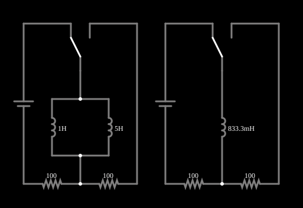

# Indutores em paralelo

<!-- navegacao:inicio -->
[Índice](README.md) · [Anterior: Inductors in Series](indseries.md) · [Próximo: Caps in Series](capseries.md)
<!-- navegacao:fim -->

## Objetivo

Mostrar que indutores em paralelo equivalem a um indutor cuja indutância é o inverso da soma dos inversos, e como a corrente se divide entre eles em proporção inversa às indutâncias.

## O circuito

<!-- esquema:inicio -->

<!-- esquema:fim -->

Cada exemplo desta família tem dois circuitos lado a lado, idênticos exceto por um detalhe: à esquerda a associação de dois (ou mais) elementos, à direita o **único elemento equivalente**. Cada circuito é uma fonte de 5 V contínuos em série com um resistor de $100\ \Omega$, e uma chave de duas posições liga o elemento ao circuito (na posição em que o exemplo abre, o segundo resistor de $100\ \Omega$ fica fora do caminho da corrente, como mostram as correntes nulas dele na simulação). Se a associação for mesmo equivalente ao elemento único, as duas metades se comportam de forma idêntica. Aqui a associação é de $L_1 = 1\ \text{H}$ e $L_2 = 5\ \text{H}$ em paralelo, comparada com um indutor de $0{,}8333\ \text{H}$.

<!-- componentes:inicio -->
| N.º | Tipo | Elemento | Valores |
|----:|------|----------|---------|
| 0 | `VoltageElm` | voltage source | Voltage = 5; Waveform = D/C; DC Offset (V) = 0; Internal Resistance (ohms) = 0; Show Voltage = não; Circle Symbol = não |
| 1 | `Switch2Elm` | switch (SPDT) | Momentary Switch = não; Group Number (for linking) = 1; # of Throws = 2; Keyboard Shortcut = ; On Resistance (ohms) = 0 |
| 3 | `ResistorElm` | resistor | Resistance (ohms) = 100 |
| 4 | `ResistorElm` | resistor | Resistance (ohms) = 100 |
| 7 | `ResistorElm` | resistor | Resistance (ohms) = 100 |
| 8 | `ResistorElm` | resistor | Resistance (ohms) = 100 |
| 10 | `Switch2Elm` | switch (SPDT) | Momentary Switch = não; Group Number (for linking) = 1; # of Throws = 2; Keyboard Shortcut = ; On Resistance (ohms) = 0 |
| 13 | `VoltageElm` | voltage source | Voltage = 5; Waveform = D/C; DC Offset (V) = 0; Internal Resistance (ohms) = 0; Show Voltage = não; Circle Symbol = não |
| 19 | `InductorElm` | inductor | Inductance (H) = 1; Trapezoidal Approximation = sim; Initial Current (on Reset) (A) = 0; Saturation Current (A) (0=none) = 0 |
| 20 | `InductorElm` | inductor | Inductance (H) = 5; Trapezoidal Approximation = sim; Initial Current (on Reset) (A) = 0; Saturation Current (A) (0=none) = 0 |
| 21 | `InductorElm` | inductor | Inductance (H) = 833.3m; Trapezoidal Approximation = sim; Initial Current (on Reset) (A) = 0; Saturation Current (A) (0=none) = 0 |
<!-- componentes:fim -->

## Teoria

Indutores em paralelo têm a mesma tensão $v$, e a corrente de cada um é $i_k = \dfrac{1}{L_k}\displaystyle\int v\,dt$ (com correntes iniciais nulas). A corrente total é a soma, então

$$\frac{1}{L_{eq}} = \sum_k \frac{1}{L_k},\qquad\text{ou, para dois: } L_{eq} = \frac{L_1 L_2}{L_1 + L_2}.$$

A corrente se divide em proporção inversa à indutância: $i_k = i\,\dfrac{L_{eq}}{L_k}$, ou seja, o menor indutor leva a maior parte.

A constante de tempo do RL é $\tau = L_{eq}/R$.

## Resultados esperados

Com $L_{eq} = \dfrac{1\cdot 5}{6} = 0{,}8333\ \text{H}$, $\tau = 8{,}333\ \text{ms}$. Em $t=\tau$:

$$i = 50\,(1-e^{-1}) = 31{,}61\ \text{mA},\qquad v_L = 5\,e^{-1} = 1{,}839\ \text{V}.$$

A corrente se divide em $\dfrac{L_{eq}}{L_1} = \dfrac56$ para o indutor de $1\ \text{H}$ ($26{,}34\ \text{mA}$) e $\dfrac{L_{eq}}{L_2} = \dfrac16$ para o de $5\ \text{H}$ ($5{,}268\ \text{mA}$). As verificações conferem a corrente do indutor único, as duas correntes parciais e a tensão, em $t = 8{,}333\ \text{ms}$.

## O que observar

- Compare a corrente do indutor único com a soma das correntes dos dois da esquerda: coincidem.
- Note que o indutor de $1\ \text{H}$ leva cinco vezes a corrente do de $5\ \text{H}$, e que a indutância equivalente ($0{,}833\ \text{H}$) é menor que a do menor indutor.
- Compare com o exemplo de indutores em série, em que a indutância equivalente é a soma.

## Limites do modelo

Indutores ideais, sem resistência nem acoplamento mútuo, e com corrente inicial nula. Com acoplamento magnético entre os indutores em paralelo, a associação não segue a fórmula acima.

## Referências

- J. W. Nilsson e S. A. Riedel, *Circuitos Elétricos*, Pearson.
- C. K. Alexander e M. N. O. Sadiku, *Fundamentos de Circuitos Elétricos*, AMGH.

O circuito deste exemplo faz parte da coleção do simulador original de Paul Falstad e Iain Sharp (CircuitJS1); a explicação é deste projeto.
