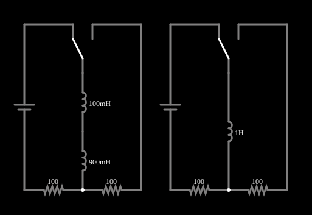

# Indutores em série

<!-- navegacao:inicio -->
[Índice](README.md) · [Próximo: Inductors in Parallel](indpar.md)
<!-- navegacao:fim -->

## Objetivo

Mostrar que indutores em série equivalem a um indutor de indutância igual à soma, e como a tensão se divide entre eles em proporção às indutâncias.

## O circuito

<!-- esquema:inicio -->

<!-- esquema:fim -->

Cada exemplo desta família tem dois circuitos lado a lado, idênticos exceto por um detalhe: à esquerda a associação de dois (ou mais) elementos, à direita o **único elemento equivalente**. Cada circuito é uma fonte de 5 V contínuos em série com um resistor de $100\ \Omega$, e uma chave de duas posições liga o elemento ao circuito (na posição em que o exemplo abre, o segundo resistor de $100\ \Omega$ fica fora do caminho da corrente, como mostram as correntes nulas dele na simulação). Se a associação for mesmo equivalente ao elemento único, as duas metades se comportam de forma idêntica. Aqui a associação é de $L_1 = 0{,}1\ \text{H}$ e $L_2 = 0{,}9\ \text{H}$ em série, comparada com um indutor de $1\ \text{H}$.

<!-- componentes:inicio -->
| N.º | Tipo | Elemento | Valores |
|----:|------|----------|---------|
| 0 | `VoltageElm` | voltage source | Voltage = 5; Waveform = D/C; DC Offset (V) = 0; Internal Resistance (ohms) = 0; Show Voltage = não; Circle Symbol = não |
| 1 | `Switch2Elm` | switch (SPDT) | Momentary Switch = não; Group Number (for linking) = 1; # of Throws = 2; Keyboard Shortcut = ; On Resistance (ohms) = 0 |
| 3 | `ResistorElm` | resistor | Resistance (ohms) = 100 |
| 4 | `ResistorElm` | resistor | Resistance (ohms) = 100 |
| 7 | `ResistorElm` | resistor | Resistance (ohms) = 100 |
| 8 | `ResistorElm` | resistor | Resistance (ohms) = 100 |
| 10 | `Switch2Elm` | switch (SPDT) | Momentary Switch = não; Group Number (for linking) = 1; # of Throws = 2; Keyboard Shortcut = ; On Resistance (ohms) = 0 |
| 13 | `VoltageElm` | voltage source | Voltage = 5; Waveform = D/C; DC Offset (V) = 0; Internal Resistance (ohms) = 0; Show Voltage = não; Circle Symbol = não |
| 14 | `InductorElm` | inductor | Inductance (H) = 1; Trapezoidal Approximation = sim; Initial Current (on Reset) (A) = 0; Saturation Current (A) (0=none) = 0 |
| 15 | `InductorElm` | inductor | Inductance (H) = 100m; Trapezoidal Approximation = sim; Initial Current (on Reset) (A) = 0; Saturation Current (A) (0=none) = 0 |
| 16 | `InductorElm` | inductor | Inductance (H) = 900m; Trapezoidal Approximation = sim; Initial Current (on Reset) (A) = 0; Saturation Current (A) (0=none) = 0 |
<!-- componentes:fim -->

## Teoria

Indutores em série são atravessados pela mesma corrente, e as tensões se somam: $v = L_1\,\dfrac{di}{dt} + L_2\,\dfrac{di}{dt}$. Logo

$$L_{eq} = L_1 + L_2 + \dots = \sum_k L_k .$$

A tensão se divide em proporção à indutância: $v_k = v\,\dfrac{L_k}{L_{eq}}$.

O circuito é um RL em série com constante de tempo $\tau = L_{eq}/R$. Ligada a fonte $V$ em $t=0$, com corrente inicial nula,

$$i(t) = \frac{V}{R}\left(1 - e^{-t/\tau}\right),\qquad v_L(t) = V\,e^{-t/\tau}.$$

## Resultados esperados

Com $V = 5\ \text{V}$, $R = 100\ \Omega$ e $L_{eq} = 1\ \text{H}$: $\tau = 1/100 = 10\ \text{ms}$ e a corrente final é $V/R = 50\ \text{mA}$. Em $t = \tau$:

$$i = 50\,(1 - e^{-1}) = 31{,}6\ \text{mA},\qquad v_L = 5\,e^{-1} = 1{,}839\ \text{V}.$$

A tensão de $1{,}839\ \text{V}$ se divide em $0{,}1/1 \to 0{,}184\ \text{V}$ no indutor de $0{,}1\ \text{H}$ e $0{,}9/1 \to 1{,}655\ \text{V}$ no de $0{,}9\ \text{H}$. As verificações conferem a corrente (nos dois circuitos) e as duas tensões, em $t = 10\ \text{ms}$, com tolerância de 2% e 3%.

## O que observar

- Compare as correntes das duas metades: são as mesmas ao longo de todo o tempo, que é o que "equivalente" quer dizer.
- Veja que o indutor menor recebe a menor parte da tensão, e que as tensões parciais somam a tensão do indutor único.
- Clique na chave para ver como o circuito responde quando o elemento é ligado em outro ponto.

## Limites do modelo

Os indutores são ideais (sem resistência do enrolamento, sem capacitância entre espiras, sem saturação) e **sem acoplamento magnético** entre eles: se os dois indutores compartilhassem fluxo, a indutância equivalente seria $L_1 + L_2 \pm 2M$. As verificações usam a posição inicial da chave.

## Referências

- J. W. Nilsson e S. A. Riedel, *Circuitos Elétricos*, Pearson.
- C. K. Alexander e M. N. O. Sadiku, *Fundamentos de Circuitos Elétricos*, AMGH.

O circuito deste exemplo faz parte da coleção do simulador original de Paul Falstad e Iain Sharp (CircuitJS1); a explicação é deste projeto.
