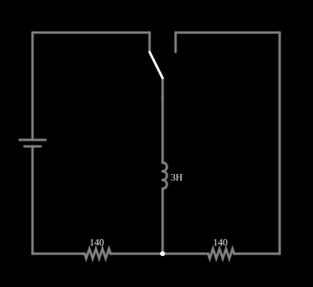

# Corrente num indutor (circuito RL)

<!-- navegacao:inicio -->
[Índice](README.md) · [Anterior: Capacitor](cap.md) · [Próximo: LRC Circuit](lrc.md)
<!-- navegacao:fim -->

## Objetivo

Mostrar o crescimento da corrente num indutor ligado a uma fonte através de um resistor: constante de tempo $\tau = L/R$, tensão no indutor que cai exponencialmente.

## O circuito

<!-- esquema:inicio -->

<!-- esquema:fim -->

Uma fonte de 5 V é ligada, pela chave SPDT, a um indutor de $3\ \text{H}$ em série com um resistor de $140\ \Omega$ (o segundo resistor de $140\ \Omega$ do desenho não conduz na posição inicial da chave). O osciloscópio mostra a corrente. Um *slider* altera a indutância.

<!-- componentes:inicio -->
| N.º | Tipo | Elemento | Valores |
|----:|------|----------|---------|
| 0 | `VoltageElm` | voltage source | Voltage = 5; Waveform = D/C; DC Offset (V) = 0; Internal Resistance (ohms) = 0; Show Voltage = não; Circle Symbol = não |
| 1 | `Switch2Elm` | switch (SPDT) | Momentary Switch = não; Group Number (for linking) = 0; # of Throws = 2; Keyboard Shortcut = ; On Resistance (ohms) = 0 |
| 3 | `ResistorElm` | resistor | Resistance (ohms) = 140 |
| 4 | `ResistorElm` | resistor | Resistance (ohms) = 140 |
| 7 | `InductorElm` | inductor | Inductance (H) = 3; Trapezoidal Approximation = sim; Initial Current (on Reset) (A) = 0; Saturation Current (A) (0=none) = 0 |
<!-- componentes:fim -->

## Teoria

Num indutor, $v = L\,\dfrac{di}{dt}$. Com a lei das tensões de Kirchhoff, $V = R\,i + L\,\dfrac{di}{dt}$, e, com corrente inicial nula,

$$i(t) = \frac{V}{R}\left(1 - e^{-t/\tau}\right),\qquad v_L(t) = V\,e^{-t/\tau},\qquad \tau = \frac{L}{R}.$$

No instante inicial o indutor se opõe à variação da corrente (tensão máxima, corrente nula); no regime permanente ele é um curto-circuito. A energia guardada é $E=\tfrac12 L I^2$.

## Resultados esperados

Aqui $\tau = 3/140 = 21{,}43\ \text{ms}$ e $I_\infty = 5/140 = 35{,}71\ \text{mA}$:

| $t$ | $i$ | $v_L$ |
|----:|----:|------:|
| $5\ \text{ms}$ | $7{,}43\ \text{mA}$ | $3{,}96\ \text{V}$ |
| $\tau = 21{,}43\ \text{ms}$ | $22{,}58\ \text{mA}$ | $1{,}839\ \text{V}$ |
| $150\ \text{ms}\ (7\tau)$ | $35{,}68\ \text{mA}$ | $\approx 0$ |

Energia final: $\tfrac12\cdot 3\cdot(35{,}71\ \text{mA})^2 \approx 1{,}91\ \text{mJ}$. As verificações conferem $i$ e $v_L$ em $\tau$ e $i$ em $7\tau$.

## O que observar

- Aumente a indutância: $\tau$ cresce e a corrente sobe mais devagar.
- Compare com o exemplo do capacitor: aqui é a **corrente** que não pode mudar bruscamente; lá, a tensão.

## Limites do modelo

Indutor ideal, sem resistência do fio nem saturação do núcleo; fonte ideal.

## Referências

- J. W. Nilsson e S. A. Riedel, *Circuitos Elétricos*, Pearson.
- C. K. Alexander e M. N. O. Sadiku, *Fundamentos de Circuitos Elétricos*, AMGH.

O circuito deste exemplo faz parte da coleção do simulador original de Paul Falstad e Iain Sharp (CircuitJS1); a explicação é deste projeto.
