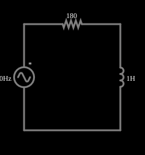

# Indutor em corrente alternada

<!-- navegacao:inicio -->
[Índice](README.md) · [Anterior: Capacitor](capac.md) · [Próximo: Caps of Various Capacitances](capmultcaps.md)
<!-- navegacao:fim -->

## Objetivo

Mostrar como um indutor responde a uma tensão senoidal: a corrente se atrasa em relação à tensão e a reatância indutiva aumenta com a frequência.

## O circuito

<!-- esquema:inicio -->

<!-- esquema:fim -->

Uma fonte alternada de 5 V de pico e 40 Hz alimenta um resistor de $180\ \Omega$ em série com um indutor de $1\ \text{H}$. O osciloscópio mostra a corrente.

<!-- componentes:inicio -->
| N.º | Tipo | Elemento | Valores |
|----:|------|----------|---------|
| 0 | `VoltageElm` | A/C source | Max Voltage = 5; Waveform = A/C; DC Offset (V) = 0; Internal Resistance (ohms) = 0; Show Voltage = não; Frequency (Hz) = 40; Phase Offset (degrees) = 0 |
| 1 | `ResistorElm` | resistor | Resistance (ohms) = 180 |
| 3 | `InductorElm` | inductor | Inductance (H) = 1; Trapezoidal Approximation = sim; Initial Current (on Reset) (A) = 0; Saturation Current (A) (0=none) = 0 |
<!-- componentes:fim -->

## Teoria

Em regime permanente senoidal, tensões e correntes são fasores e cada elemento tem uma **impedância**:

$$Z_R = R,\qquad Z_L = j\omega L,\qquad Z_C = \frac{1}{j\omega C},\qquad \omega = 2\pi f.$$

A parte imaginária é a **reatância**: $X_L=\omega L$ (cresce com a frequência) e $X_C = 1/(\omega C)$ (diminui com ela). A amplitude da corrente e a defasagem entre tensão e corrente seguem de $I = V/Z$.

Para o circuito RL série,

$$|Z| = \sqrt{R^2 + X_L^2},\qquad I_{pico} = \frac{V_{pico}}{|Z|},\qquad V_{L,pico} = I_{pico}\,X_L,\qquad \varphi = \arctan\frac{X_L}{R}$$

em que $\varphi$ é o atraso da corrente em relação à tensão da fonte; $\tau = L/R$ é a constante de tempo do transitório.

## Resultados esperados

$X_L = 2\pi\cdot40\cdot1 = 251{,}3\ \Omega$, $|Z| = 309{,}1\ \Omega$:

$$I_{pico} = 16{,}17\ \text{mA},\qquad V_{L,pico} = 4{,}065\ \text{V},\qquad \varphi = 54{,}4^\circ\ \text{(atraso)}.$$

$\tau = 5{,}6\ \text{ms}$. As verificações medem, de 100 ms a 200 ms, o pico da corrente e o pico da tensão do indutor.

## O que observar

- A corrente está atrasada em relação à tensão, ao contrário do capacitor.
- Aumente a frequência: $X_L$ cresce e a corrente diminui; o indutor "deixa passar" melhor as frequências baixas.

## Limites do modelo

Indutor ideal, sem resistência do enrolamento nem saturação.

## Referências

- J. W. Nilsson e S. A. Riedel, *Circuitos Elétricos*, Pearson.
- C. K. Alexander e M. N. O. Sadiku, *Fundamentos de Circuitos Elétricos*, AMGH.

O circuito deste exemplo faz parte da coleção do simulador original de Paul Falstad e Iain Sharp (CircuitJS1); a explicação é deste projeto.
