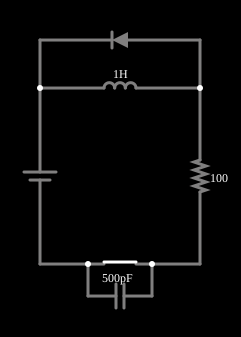

# Coice indutivo bloqueado por diodo

<!-- navegacao:inicio -->
[Índice](README.md) · [Anterior: DC Restoration](dcrestoration.md) · [Próximo: Spike Generator](spikegen.md)
<!-- navegacao:fim -->

## Objetivo

Mostrar como um diodo em antiparalelo com o indutor ("diodo de roda livre") elimina o coice indutivo: a corrente do indutor continua a circular pelo diodo, e a tensão sobre a chave fica em poucos volts.

## O circuito

<!-- esquema:inicio -->

<!-- esquema:fim -->

É o circuito do coice indutivo (fonte de $5\ \text{V}$, indutor de $1\ \text{H}$, resistor de $100\ \Omega$, chave com $500\ \text{pF}$ em paralelo), com um **diodo ligado em paralelo com o indutor**, de modo que ele só conduz quando o indutor tenta inverter a tensão. O exemplo abre com a chave fechada.

<!-- componentes:inicio -->
| N.º | Tipo | Elemento | Valores |
|----:|------|----------|---------|
| 0 | `VoltageElm` | voltage source | Voltage = 5; Waveform = D/C; DC Offset (V) = 0; Internal Resistance (ohms) = 0; Show Voltage = não; Circle Symbol = não |
| 3 | `SwitchElm` | switch (SPST) | Momentary Switch = não; IEC Symbol = não; Label (for linking) = ; Keyboard Shortcut = ; On Resistance (ohms) = 0 |
| 6 | `CapacitorElm` | capacitor | Capacitance (F) = 500p; Trapezoidal Approximation = sim; Initial Voltage (on Reset) = 1m; Series Resistance = 0 |
| 7 | `InductorElm` | inductor | Inductance (H) = 1; Trapezoidal Approximation = sim; Initial Current (on Reset) (A) = 0; Saturation Current (A) (0=none) = 0 |
| 8 | `ResistorElm` | resistor | Resistance (ohms) = 100 |
| 11 | `DiodeElm` | diode | Model = default |
<!-- componentes:fim -->

## Teoria

O diodo do simulador (modelo "default") segue a equação de Shockley,

$$i = I_s\left(e^{v/(nV_T)} - 1\right),\qquad I_s = 1{,}714\cdot 10^{-7}\ \text{A},\quad n = 2,\quad V_T = 25{,}865\ \text{mV},$$

sem resistência série. Para uma corrente $i \gg I_s$ a tensão é $v = nV_T\ln(i/I_s + 1)$, que dá $0{,}806\ \text{V}$ em $1\ \text{A}$, $0{,}568\ \text{V}$ em $10\ \text{mA}$ e $0{,}449\ \text{V}$ em $1\ \text{mA}$: a tensão cresce $nV_T\ln 10 = 119\ \text{mV}$ a cada década de corrente. Para $v < 0$ a corrente tende a $-I_s = -0{,}17\ \mu\text{A}$.

## Resultados esperados

Ao abrir a chave em $t_0$, a corrente $I_0$ do indutor se fecha pelo diodo, em vez de forçar uma tensão enorme: com o diodo conduzindo, a tensão no indutor é $-v_D(i)$ e

$$L\,\frac{di}{dt} = -v_D(i) = -nV_T\ln\left(\frac{i}{I_s} + 1\right).$$

Como $v_D$ varia pouco ($0{,}65$ a $0{,}60\ \text{V}$ para correntes de $50$ a $18\ \text{mA}$), a corrente cai quase linearmente, $di/dt \approx -v_D/L \approx -0{,}64\ \text{A/s}$, e a energia do indutor se dissipa no diodo em cerca de $80\ \text{ms}$. A tensão na chave é a da fonte mais a queda do diodo, $V + v_D$.

## O que observar

Com a abertura em $t = 50\ \text{ms}$, a corrente do indutor valia $I_0 = 49{,}66\ \text{mA}$. Integrando a equação acima:

| $t$ | corrente do indutor | tensão na chave |
|----:|--------------------:|----------------:|
| $50\ \text{ms}$ (abertura) | $49{,}66\ \text{mA}$ | $5{,}65\ \text{V}$ |
| $60\ \text{ms}$ | $43{,}19\ \text{mA}$ | $5{,}64\ \text{V}$ |
| $70\ \text{ms}$ | $36{,}80\ \text{mA}$ | $5{,}635\ \text{V}$ |
| $100\ \text{ms}$ | $18{,}23\ \text{mA}$ | $5{,}60\ \text{V}$ |
| $\approx 134\ \text{ms}$ | $0$ | — |

A tensão na chave fica em torno de $5{,}6\ \text{V}$, em vez dos $\approx 2{,}2\ \text{kV}$ sem o diodo. As verificações conferem a corrente do indutor antes da abertura e em $60$, $70$ e $100\ \text{ms}$, e a tensão da chave em $60\ \text{ms}$ (tolerância de 1%; o simulador fica a menos de $0{,}01\%$ da integração independente, com a abertura em $50\ \text{ms}$).

## Limites do modelo

- Abra a chave: a corrente do indutor decai suavemente até zero, e a tensão na chave sobe só $0{,}65\ \text{V}$ acima da da fonte.
- Compare com o exemplo "Coice indutivo", sem o diodo: lá o pico passa de $2\ \text{kV}$.
- É a proteção usada em bobinas de relés e solenoides acionados por transistor (o "diodo de roda livre").

## Referências

O diodo não tem tempo de recuperação nem resistência série. A corrente decai mais devagar do que com um diodo em série com um resistor: o preço da proteção por um diodo simples é a demora para o relé soltar (a energia só se dissipa na pequena queda do diodo). Os valores da tabela são de uma integração numérica da equação de roda livre.

O circuito deste exemplo faz parte da coleção do simulador original de Paul Falstad e Iain Sharp (CircuitJS1); a explicação é deste projeto.
