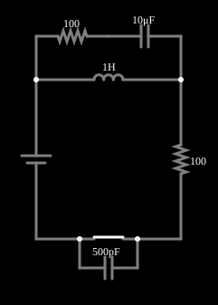

# Coice indutivo com amortecedor

<!-- navegacao:inicio -->
[Índice](README.md) · [Anterior: Inductive Kickback](inductkick.md) · [Próximo: Power Factor](powerfactor1.md)
<!-- navegacao:fim -->

## Objetivo

Mostrar como um circuito de amortecimento ("snubber"), formado por um resistor e um capacitor, limita o pico de tensão do coice indutivo do exemplo anterior, de milhares de volts a algumas dezenas.

## O circuito

<!-- esquema:inicio -->

<!-- esquema:fim -->

É o mesmo circuito do exemplo anterior (fonte de $5\ \text{V}$, indutor de $1\ \text{H}$, resistor de $100\ \Omega$, chave com $500\ \text{pF}$ em paralelo), com um **amortecedor** acrescentado em paralelo com o indutor: um resistor de $100\ \Omega$ em série com um capacitor de $10\ \mu\text{F}$. O exemplo abre com a chave fechada.

<!-- componentes:inicio -->
| N.º | Tipo | Elemento | Valores |
|----:|------|----------|---------|
| 0 | `VoltageElm` | voltage source | Voltage = 5; Waveform = D/C; DC Offset (V) = 0; Internal Resistance (ohms) = 0; Show Voltage = não; Circle Symbol = não |
| 3 | `SwitchElm` | switch (SPST) | Momentary Switch = não; IEC Symbol = não; Label (for linking) = ; Keyboard Shortcut = ; On Resistance (ohms) = 0 |
| 6 | `CapacitorElm` | capacitor | Capacitance (F) = 500p; Trapezoidal Approximation = sim; Initial Voltage (on Reset) = 1m; Series Resistance = 0 |
| 7 | `InductorElm` | inductor | Inductance (H) = 1; Trapezoidal Approximation = sim; Initial Current (on Reset) (A) = 0; Saturation Current (A) (0=none) = 0 |
| 8 | `ResistorElm` | resistor | Resistance (ohms) = 100 |
| 11 | `ResistorElm` | resistor | Resistance (ohms) = 100 |
| 12 | `CapacitorElm` | capacitor | Capacitance (F) = 10μ; Trapezoidal Approximation = sim; Initial Voltage (on Reset) = 1m; Series Resistance = 0 |
<!-- componentes:fim -->

## Teoria

Com a chave aberta, a corrente $I_0$ do indutor precisa continuar. Sem o amortecedor, ela só tem o capacitor parasita de $500\ \text{pF}$ para carregar, e a tensão sobe até $I_0\sqrt{L/C}$, na ordem de $2\ \text{kV}$. Com o amortecedor, o ramo $R_s C_s$ em paralelo com o indutor oferece um caminho: a corrente passa a carregar o capacitor de $10\ \mu\text{F}$, cuja tensão sobe só $\Delta v = I\,t/C_s$, e o resistor $R_s$ dissipa a energia, de modo que a oscilação é fortemente amortecida.

O resultado é uma subida lenta e amortecida da tensão na chave, em lugar da oscilação de alta frequência e de grande amplitude do exemplo anterior.

## Resultados esperados

A integração das equações do circuito dá, para a tensão na chave depois da abertura em $t = 50\ \text{ms}$, um pico de $18{,}2\ \text{V}$ cerca de $3{,}5\ \text{ms}$ depois (contra $2{,}2\ \text{kV}$ sem o amortecedor, uma redução de 120 vezes); o simulador dá $18{,}21\ \text{V}$. As verificações conferem a corrente antes da abertura ($49{,}08\ \text{mA}$ em $40\ \text{ms}$) e o pico de tensão (tolerância de 2%).

## O que observar

- Compare o osciloscópio com o do exemplo anterior: a tensão sobe devagar e sem oscilar, e o pico é 120 vezes menor.
- Aumente $R_s$ ou diminua $C_s$ e veja o pico crescer; reduza $R_s$ e a oscilação volta.
- É o mesmo princípio dos amortecedores usados em contatores, relés e chaves de potência.

## Limites do modelo

Valores de componentes e capacitância parasita idealizados. A escolha de um amortecedor real leva em conta a dissipação de potência no resistor e a corrente de pico do capacitor; o dimensionamento deste exemplo é ilustrativo.

## Referências

- J. W. Nilsson e S. A. Riedel, *Circuitos Elétricos*, Pearson.
- P. Horowitz e W. Hill, *The Art of Electronics*, Cambridge University Press.

O circuito deste exemplo faz parte da coleção do simulador original de Paul Falstad e Iain Sharp (CircuitJS1); a explicação é deste projeto.
