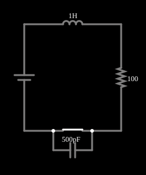

# Coice indutivo

<!-- navegacao:inicio -->
[Índice](README.md) · [Anterior: Current Source](currentsrcelm.md) · [Próximo: Blocking Inductive Kickback](inductkick-snub.md)
<!-- navegacao:fim -->

## Objetivo

Mostrar o "coice" (força contraeletromotriz) de um indutor: ao interromper a corrente de uma indutância, a tensão sobre a chave sobe a milhares de volts, mesmo com uma fonte de apenas $5\ \text{V}$.

## O circuito

<!-- esquema:inicio -->

<!-- esquema:fim -->

Uma fonte de $5\ \text{V}$ alimenta, em série, um indutor de $1\ \text{H}$, um resistor de $100\ \Omega$ e uma chave. Em paralelo com a chave está um capacitor de $500\ \text{pF}$, a capacitância parasita dos contatos da chave aberta. O exemplo abre com a chave fechada; três osciloscópios mostram a corrente e as tensões.

<!-- componentes:inicio -->
| N.º | Tipo | Elemento | Valores |
|----:|------|----------|---------|
| 0 | `VoltageElm` | voltage source | Voltage = 5; Waveform = D/C; DC Offset (V) = 0; Internal Resistance (ohms) = 0; Show Voltage = não; Circle Symbol = não |
| 3 | `SwitchElm` | switch (SPST) | Momentary Switch = não; IEC Symbol = não; Label (for linking) = ; Keyboard Shortcut = ; On Resistance (ohms) = 0 |
| 6 | `CapacitorElm` | capacitor | Capacitance (F) = 500p; Trapezoidal Approximation = sim; Initial Voltage (on Reset) = 1m; Series Resistance = 0 |
| 7 | `InductorElm` | inductor | Inductance (H) = 1; Trapezoidal Approximation = sim; Initial Current (on Reset) (A) = 0; Saturation Current (A) (0=none) = 0 |
| 8 | `ResistorElm` | resistor | Resistance (ohms) = 100 |
<!-- componentes:fim -->

## Teoria

A tensão num indutor é $v = L\,\dfrac{di}{dt}$. Com a chave fechada, a corrente cresce como $i(t) = \dfrac{V}{R}\left(1 - e^{-Rt/L}\right)$ até $V/R = 50\ \text{mA}$ ($\tau = L/R = 10\ \text{ms}$), e o indutor armazena a energia $E = \tfrac12 L I^2 = 1{,}2\ \text{mJ}$.

Quando a chave abre, a corrente do indutor não pode cair a zero instantaneamente (isso exigiria $v = L\,di/dt \to \infty$): ela continua e carrega a capacitância $C$ em paralelo com a chave. O que sobra é um circuito RLC em série com a fonte, quase sem amortecimento (o fator de amortecimento é $\zeta = \tfrac{R}{2}\sqrt{C/L} \approx 10^{-3}$), de modo que a tensão na chave oscila à frequência

$$f_0 = \frac{1}{2\pi\sqrt{LC}}$$

com amplitude $\approx I_0\sqrt{L/C}$, em que $I_0$ é a corrente no instante da abertura: toda a energia do indutor vira energia do capacitor, $\tfrac12 L I_0^2 = \tfrac12 C V_{pico}^2$.

## Resultados esperados

Aberta a chave em $t = 50\ \text{ms}$, a corrente do indutor já chegou a $I_0 = 50\,(1 - e^{-5}) = 49{,}66\ \text{mA}$. Com $C = 500\ \text{pF}$:

$$f_0 = \frac{1}{2\pi\sqrt{1\cdot 500\ \text{pF}}} = 7{,}12\ \text{kHz},\qquad V_{pico} \approx I_0\sqrt{\frac{L}{C}} = 0{,}0497\cdot 44\,721 = 2{,}22\ \text{kV}.$$

A integração das equações do circuito dá $+2\,222\ \text{V}$ e $-2\,204\ \text{V}$ nos extremos da oscilação. O simulador (passo de $5\ \mu\text{s}$, cerca de $28$ pontos por ciclo) dá $+2\,185\ \text{V}$ e $-2\,198\ \text{V}$ e $7{,}09\ \text{kHz}$: o passo discreto da simulação limita o pico lido (cerca de 1,7% abaixo do valor contínuo) e desloca um pouco a frequência (0,4%). As verificações conferem a corrente antes da abertura ($49{,}08\ \text{mA}$ em $40\ \text{ms}$), os dois extremos e a frequência, com tolerância de 2% (3% no pico positivo).

## O que observar

- Abra a chave: a tensão sobre ela sobe a milhares de volts em microssegundos, e depois oscila.
- Reduza o valor do indutor ou aumente a capacitância parasita: o pico cai com $\sqrt{L/C}$.
- Compare com o exemplo seguinte, em que um circuito de proteção ("snubber") limita a tensão a poucas dezenas de volts.

## Limites do modelo

Num circuito real, a tensão sobe até o ponto em que o ar entre os contatos rompe (um arco elétrico) ou até um componente ligado em paralelo conduzir; por isso o pico do modelo (milhares de volts) é teórico. O modelo usa uma capacitância parasita fixa e nenhuma resistência de contato; o resultado é muito sensível ao valor dessa capacitância. A tolerância das verificações cobre o erro do passo de integração.

## Referências

- J. W. Nilsson e S. A. Riedel, *Circuitos Elétricos*, Pearson.
- P. Horowitz e W. Hill, *The Art of Electronics*, Cambridge University Press.

O circuito deste exemplo faz parte da coleção do simulador original de Paul Falstad e Iain Sharp (CircuitJS1); a explicação é deste projeto.
