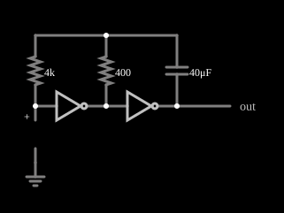

# Oscilador de relaxação com dois inversores

<!-- navegacao:inicio -->
[Índice](README.md) · [Anterior: Inverter Amplifier](invertamp.md) · [Próximo: CMOS Crystal Oscillator](crystalosc.md)
<!-- navegacao:fim -->

## Objetivo

Mostrar o **oscilador de relaxação com dois inversores**, o oscilador mais simples da lógica digital: dois inversores em cascata, um resistor e um capacitor geram uma onda quadrada cuja frequência depende só de $R$ e $C$.

## O circuito

<!-- esquema:inicio -->

<!-- esquema:fim -->

Dois inversores lógicos (alimentação de $5\ \text{V}$, limiar de $2{,}5\ \text{V}$) estão em série; a saída do segundo é a saída do circuito. Um capacitor de $40\ \mu\text{F}$ liga a saída a um nó, que se liga por um resistor de $400\ \Omega$ à saída do primeiro inversor e, por um resistor de proteção de $4\ \text{k}\Omega$, à entrada do primeiro. Um osciloscópio mostra a saída e a entrada do primeiro inversor.

<!-- componentes:inicio -->
| N.º | Tipo | Elemento | Valores |
|----:|------|----------|---------|
| 0 | `InverterElm` | inverter | Slew Rate (V/ns) = 500m; High Logic Voltage = 5; DeMorgan's Symbol = não |
| 1 | `CapacitorElm` | capacitor | Capacitance (F) = 40μ; Trapezoidal Approximation = sim; Initial Voltage (on Reset) = 1m; Series Resistance = 0 |
| 2 | `ResistorElm` | resistor | Resistance (ohms) = 4k |
| 3 | `InverterElm` | inverter | Slew Rate (V/ns) = 200μ; High Logic Voltage = 5; DeMorgan's Symbol = não |
| 4 | `ProbeElm` | voltmeter | Show Voltage = não; Value = Voltage; Scale = Auto; Use Circle Symbol = não; Series Resistance (0 = infinite) = 0 |
| 5 | `GroundElm` | ground | Symbol = Earth |
| 7 | `ResistorElm` | resistor | Resistance (ohms) = 400 |
| 9 | `OutputElm` | output | Show Voltage = não |
<!-- componentes:fim -->

## Teoria

A saída do primeiro inversor é sempre o oposto da saída do segundo. O capacitor $C$ liga a saída $v_o$ ao nó do resistor $R$ (o de $400\ \Omega$, que vai à saída do primeiro inversor, igual a $\overline{v_o}$), e a entrada do primeiro inversor, ligada ao nó pelo resistor de $4\ \text{k}\Omega$, segue a tensão desse nó: como a entrada do inversor não consome corrente, esse resistor não cai tensão e não altera a frequência. Cada transição da saída é transmitida pelo capacitor à entrada do primeiro inversor, que então decai exponencialmente, com $\tau = RC$, em direção ao seu valor de repouso (o trilho oposto à saída); quando cruza o limiar $V_{DD}/2$, a saída muda e o ciclo se repete.

Com limiares em $V_{DD}/2$, o período é $T = 2\,RC\,\ln 3$ e a frequência é

$$f = \frac{1}{2\,RC\,\ln 3} = \frac{1}{2{,}197\,RC} = \frac{1}{2{,}197 \cdot 400\ \Omega \cdot 40\ \mu\text{F}} = 28{,}44\ \text{Hz}.$$

Por causa do acoplamento capacitivo, a tensão na entrada do primeiro inversor excede os trilhos, indo de $-V_{DD}/2$ a $+3V_{DD}/2$.

## Resultados esperados

O simulador dá uma onda quadrada de $28{,}409\ \text{Hz}$ ($0{,}12\%$ abaixo dos $28{,}44\ \text{Hz}$ previstos), entre $0$ e $5\ \text{V}$, com média de $2{,}506\ \text{V}$ (razão cíclica de $50\%$), medida em $112$ ciclos. A entrada do primeiro inversor vai de $-2{,}500\ \text{V}$ a $+7{,}500\ \text{V}$, os $\mp 2{,}5\ \text{V}$ previstos de excursão além dos trilhos. As verificações conferem a frequência, o máximo, o mínimo e a média da saída e os extremos da tensão de entrada do primeiro inversor (tolerância de $0{,}1\%$ a $0{,}5\%$).

## O que observar

No osciloscópio, a saída quadrada e, na entrada do primeiro inversor, uma onda em dentes de serra exponenciais que ultrapassa os trilhos. Para testar: dobre o capacitor e veja a frequência cair à metade; mude o resistor de $400\ \Omega$ e veja a frequência acompanhar $1/R$; troque o resistor de $4\ \text{k}\Omega$ por $400\ \Omega$ ou por $40\ \text{k}\Omega$ e veja que a frequência continua $28{,}41\ \text{Hz}$ nos dois casos (valores medidos no simulador): ele só faria diferença num circuito real, em que limita a corrente nos diodos de proteção da entrada.

## Limites do modelo

- Os inversores têm entrada de corrente nula e sem diodos de proteção: num circuito real, os diodos de entrada limitam a tensão em $-0{,}7\ \text{V}$ e $V_{DD} + 0{,}7\ \text{V}$, e o resistor de proteção limita a corrente neles; a excursão de $-2{,}5$ a $7{,}5\ \text{V}$ vista aqui só existe no modelo.
- A fórmula $T = 2RC\ln 3$ vale com limiares exatamente em $V_{DD}/2$; num circuito real o limiar varia e a frequência varia junto.
- A frequência medida é a mesma durante os $4\ \text{s}$ analisados; o simulador não tem ruído nem deriva.

## Referências

Horowitz e Hill, *The Art of Electronics*, seção sobre osciladores RC com portas lógicas; Sedra e Smith, *Microelectronic Circuits*, capítulo sobre multivibradores astáveis.

O circuito deste exemplo faz parte da coleção do simulador original de Paul Falstad e Iain Sharp (CircuitJS1); a explicação é deste projeto.
