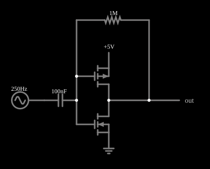

# Amplificador com inversor CMOS (diferenciador inversor)

<!-- navegacao:inicio -->
[Índice](README.md) · [Anterior: Voltage Inverter](voltinvert.md) · [Próximo: Inverter Oscillator](inv-osc.md)
<!-- navegacao:fim -->

## Objetivo

Mostrar um [inversor CMOS](cmosinverter.md) usado como **amplificador linear**: polarizado na região de transição por um resistor de realimentação, ele se comporta como um amplificador operacional de ganho alto, e com um capacitor na entrada o conjunto vira um **diferenciador inversor**, cujo ganho é $\omega R_f C$.

## O circuito

<!-- esquema:inicio -->

<!-- esquema:fim -->

Um PMOS e um NMOS (modelo padrão, sem diodo de corpo) formam um inversor. Um resistor de $1\ \text{M}\Omega$ liga a saída à entrada (realimentação negativa), e o sinal chega à entrada por um capacitor de $100\ \text{nF}$: uma fonte senoidal de $10\ \text{mV}$ de pico e $250\ \text{Hz}$. Dois osciloscópios mostram a entrada e a saída.

<!-- componentes:inicio -->
| N.º | Tipo | Elemento | Valores |
|----:|------|----------|---------|
| 0 | `PMosfetElm` | MOSFET | Model = default-nodiode; Swap D/S = não |
| 1 | `NMosfetElm` | MOSFET | Model = default-nodiode; Swap D/S = não |
| 6 | `RailElm` | voltage source | Voltage = 5; Waveform = D/C; DC Offset (V) = 0; Internal Resistance (ohms) = 0 |
| 7 | `GroundElm` | ground | Symbol = Earth |
| 8 | `CapacitorElm` | capacitor | Capacitance (F) = 100n; Trapezoidal Approximation = sim; Initial Voltage (on Reset) = 1m; Series Resistance = 0 |
| 9 | `RailElm` | A/C source | Max Voltage = 10m; Waveform = A/C; DC Offset (V) = 0; Internal Resistance (ohms) = 0; Show Voltage = não; Frequency (Hz) = 250; Phase Offset (degrees) = 0 |
| 12 | `ResistorElm` | resistor | Resistance (ohms) = 1M |
| 14 | `OutputElm` | output | Show Voltage = não |
<!-- componentes:fim -->

## Teoria

A realimentação por $R_f$ força, em corrente contínua, a entrada e a saída ao mesmo valor, o limiar do inversor $V_M = 2{,}5\ \text{V}$, onde os dois transistores conduzem e o ganho é alto. Para pequenos sinais, o inversor tem ganho de tensão $-A$ com $A \gg 1$ e entrada praticamente em um *terra virtual* (em $V_M$). Com um capacitor $C$ na entrada e $R_f$ na realimentação (a configuração do amplificador inversor com $Z_{in} = 1/(j\omega C)$ e $Z_f = R_f$):

$$\frac{V_{out} - V_M}{V_{in}} = -\frac{Z_f}{Z_{in}} = -j\omega R_f C, \qquad |H| = \omega R_f C = 2\pi f R_f C.$$

É a função de **derivação**: $v_{out} - V_M = -R_f C\,dv_{in}/dt$, com o ganho proporcional à frequência e uma defasagem de $-90^\circ$ em relação à entrada (uma senoide derivada é uma cossenoide). Isso vale enquanto o ganho do inversor for muito maior que $|H|$ e a saída não saturar.

## Resultados esperados

Para $f = 250\ \text{Hz}$, $R_f = 1\ \text{M}\Omega$ e $C = 100\ \text{nF}$:

$$|H| = 2\pi \cdot 250 \cdot 10^6 \cdot 10^{-7} = 157{,}08.$$

O simulador dá um componente de $250\ \text{Hz}$ na saída de $1{,}5696\ \text{V}$ para $10\ \text{mV}$ de entrada: ganho de $157{,}0$, com fase de $-90{,}9^\circ$, em torno de uma média de $2{,}500\ \text{V}$; a tensão de porta é $2{,}5001\ \text{V}$ (o terra virtual), e a saída vai de $0{,}978\ \text{V}$ a $4{,}022\ \text{V}$. O ganho é linear: para amplitudes de entrada de $0{,}1$, $1$ e $3\ \text{mV}$ o simulador dá o mesmo $157{,}1$ (com saídas de $15{,}7\ \text{mV}$, $157\ \text{mV}$ e $471\ \text{mV}$), e só comprime com $50\ \text{mV}$ de entrada, em que a saída ($2{,}34\ \text{V}$ de amplitude) chega ao limite da excursão do inversor. As verificações conferem o máximo, o mínimo, a média e a frequência da saída, o pico da tensão de entrada no capacitor e a tensão de porta (tolerância de $0{,}2\%$ a $0{,}5\%$).

## O que observar

A saída é uma senoide em quadratura com a entrada (atrasada de $90^\circ$, com o sinal trocado: $-\cos$ para uma entrada $\sin$), com amplitude de $1{,}57\ \text{V}$ para uma entrada de $10\ \text{mV}$. Para testar: mude a frequência da fonte para $125\ \text{Hz}$ e veja o ganho cair à metade ($78{,}5$); mude a amplitude para $50\ \text{mV}$ e veja a saída ser cortada nos extremos; troque a fonte por uma onda triangular e veja a saída virar uma onda quadrada (a derivada de uma triangular).

## Limites do modelo

- A faixa linear é limitada pela excursão de saída do inversor ($\approx 0{,}6$ a $4{,}4\ \text{V}$ aqui) e pelo ganho em malha aberta do estágio, que a fórmula supõe infinito.
- Sem capacitâncias nem ruído, o diferenciador ideal teria ganho crescente com a frequência; um diferenciador real precisa de um resistor em série com $C$ para limitar o ganho em altas frequências e evitar oscilação.
- O polo do filtro $R_f C$ é de $1{,}6\ \text{Hz}$ ($1/(2\pi \cdot 0{,}1\ \text{s})$): abaixo dele o circuito deixa de derivar. O valor do ganho de $157{,}0$ e os ganhos para amplitudes menores são medidas do simulador e não fazem parte das verificações automáticas.
- Em corrente contínua o ponto de operação depende de os dois transistores terem os mesmos $\beta$ e $V_t$.

## Referências

Sedra e Smith, *Microelectronic Circuits*, capítulos sobre o MOSFET, a lógica CMOS e os circuitos de capacitor chaveado; Weste e Harris, *CMOS VLSI Design*.

O circuito deste exemplo faz parte da coleção do simulador original de Paul Falstad e Iain Sharp (CircuitJS1); a explicação é deste projeto.
