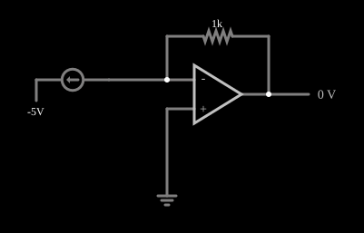

# Conversor de corrente em tensão

<!-- navegacao:inicio -->
[Índice](README.md) · [Anterior: Howland Current Source](howland.md) · [Próximo: Delta PWM Encoder](delta-pwm.md)
<!-- navegacao:fim -->

## Objetivo

Mostrar o conversor de corrente em tensão (amplificador de transimpedância): o amplificador operacional recebe uma corrente na sua entrada inversora e produz uma tensão de saída proporcional a ela, com o resistor de realimentação fixando a constante.

## O circuito

<!-- esquema:inicio -->

<!-- esquema:fim -->

Uma fonte de corrente de $2\ \text{mA}$, ajustável por um *slider* chamado "Current" (de $0$ a $5\ \text{mA}$), injeta a corrente na entrada inversora de um amplificador operacional, cuja entrada não inversora está na terra. Um resistor de $1{,}001\ \text{k}\Omega$ liga a saída à entrada inversora. A outra extremidade da fonte de corrente está ligada a uma fonte de $-5\ \text{V}$. Um elemento de saída mostra a tensão de saída, e dois osciloscópios acompanham o circuito.

<!-- componentes:inicio -->
| N.º | Tipo | Elemento | Valores |
|----:|------|----------|---------|
| 0 | `ResistorElm` | resistor | Resistance (ohms) = 1k |
| 2 | `GroundElm` | ground | Symbol = Earth |
| 3 | `CurrentElm` | current source | Current (A) = 2m; Max Voltage (V, 0=unlimited) = 0 |
| 4 | `OpAmpElm` | op-amp | Max Output (V) = 15; Min Output (V) = -15; Gain = 100k |
| 6 | `OutputElm` | output | Show Voltage = sim; Scale = Auto |
| 7 | `RailElm` | voltage source | Voltage = -5; Waveform = D/C; DC Offset (V) = 0; Internal Resistance (ohms) = 0 |
<!-- componentes:fim -->

## Teoria

A entrada inversora é um terra virtual e o operacional não absorve corrente, de modo que toda a corrente $I$ da fonte passa pelo resistor de realimentação $R_f$:

$$V_\text{out} = I\,R_f \qquad\text{(com o sentido da corrente do exemplo).}$$

A fonte de corrente trabalha com a tensão que precisar (aqui $5\ \text{V}$ entre a entrada e a fonte de $-5\ \text{V}$), e o terra virtual mantém a tensão na entrada igual a zero, o que é a vantagem do circuito sobre um simples resistor: a fonte de corrente vê uma carga de impedância quase nula e a medida não é afetada pela capacitância parasita do sensor. Esse é o circuito típico para ler a corrente de fotodiodos.

## Resultados esperados

Com $I = 2\ \text{mA}$ e $R_f = 1{,}001\ \text{k}\Omega$:

$$V_\text{out} = 2\ \text{mA}\cdot 1{,}001\ \text{k}\Omega = 2{,}002\ \text{V}.$$

O simulador dá $2{,}00198\ \text{V}$, e a entrada inversora fica em $-0{,}02\ \text{mV}$. Variando o *slider* de $0$ a $5\ \text{mA}$, a saída vai de $0$ a $5{,}005\ \text{V}$. As verificações conferem a saída e a entrada inversora.

## O que observar

- Mexa no *slider* "Current": a saída segue a corrente, com $1{,}001\ \text{V}$ por miliampère.
- A entrada inversora fica em $0\ \text{V}$ qualquer que seja a corrente: a tensão da fonte de corrente, em vez disso, varia.
- Para outra sensibilidade, troque $R_f$: $10\ \text{k}\Omega$ dá $10\ \text{V/mA}$.

## Limites do modelo

A fonte de corrente é ideal (impedância infinita) e o operacional também; na prática, a corrente de polarização e a tensão de *offset* do operacional limitam a menor corrente que se mede, e uma capacitância na entrada pode exigir um capacitor em paralelo com $R_f$ para estabilidade.

## Referências

- A. S. Sedra e K. C. Smith, *Microeletrônica*, Pearson.
- P. Horowitz e W. Hill, *The Art of Electronics*, Cambridge University Press.
- W. G. Jung, *Op Amp Applications Handbook*, Newnes.

O circuito deste exemplo faz parte da coleção do simulador original de Paul Falstad e Iain Sharp (CircuitJS1); a explicação é deste projeto.
