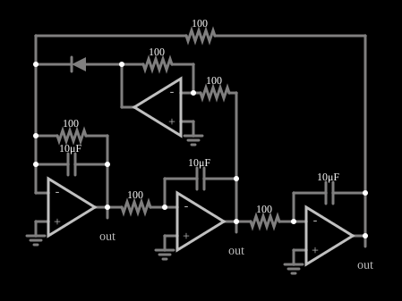

# Circuito jerk

<!-- navegacao:inicio -->
[Índice](README.md) · [Anterior: Chaos 2](chaos2.md)
<!-- navegacao:fim -->

## Objetivo

Mostrar um circuito "jerk": um sistema de terceira ordem com uma única não linearidade (um diodo), que reproduz o tipo mais simples de equação diferencial capaz de caos, em que a derivada terceira da posição (o *jerk*) depende da posição, da velocidade e da aceleração.

## O circuito

<!-- esquema:inicio -->

<!-- esquema:fim -->

Três amplificadores operacionais integradores (resistores de $100\ \Omega$ e capacitores de $10\ \mu\text{F}$, com constante de tempo de $1\ \text{ms}$) estão em cascata. Um quarto operacional soma os três sinais, por resistores de $100\ \Omega$, e fecha a malha de realimentação, com um diodo que dá a não linearidade. Três elementos de saída marcam as variáveis e três osciloscópios XY mostram os retratos de fase de cada par de variáveis.

<!-- componentes:inicio -->
| N.º | Tipo | Elemento | Valores |
|----:|------|----------|---------|
| 0 | `OpAmpElm` | op-amp | Max Output (V) = 15; Min Output (V) = -15; Gain = 100k |
| 1 | `OpAmpElm` | op-amp | Max Output (V) = 15; Min Output (V) = -15; Gain = 100k |
| 2 | `OpAmpElm` | op-amp | Max Output (V) = 15; Min Output (V) = -15; Gain = 100k |
| 3 | `OpAmpElm` | op-amp | Max Output (V) = 15; Min Output (V) = -15; Gain = 100k |
| 4 | `ResistorElm` | resistor | Resistance (ohms) = 100 |
| 5 | `ResistorElm` | resistor | Resistance (ohms) = 100 |
| 6 | `CapacitorElm` | capacitor | Capacitance (F) = 10μ; Trapezoidal Approximation = sim; Initial Voltage (on Reset) = 1m; Series Resistance = 0 |
| 11 | `GroundElm` | ground | Symbol = Earth |
| 12 | `GroundElm` | ground | Symbol = Earth |
| 13 | `GroundElm` | ground | Symbol = Earth |
| 14 | `GroundElm` | ground | Symbol = Earth |
| 15 | `CapacitorElm` | capacitor | Capacitance (F) = 10μ; Trapezoidal Approximation = sim; Initial Voltage (on Reset) = 1m; Series Resistance = 0 |
| 18 | `ResistorElm` | resistor | Resistance (ohms) = 100 |
| 19 | `ResistorElm` | resistor | Resistance (ohms) = 100 |
| 23 | `DiodeElm` | diode | Model = default |
| 25 | `ResistorElm` | resistor | Resistance (ohms) = 100 |
| 26 | `CapacitorElm` | capacitor | Capacitance (F) = 10μ; Trapezoidal Approximation = sim; Initial Voltage (on Reset) = 1m; Series Resistance = 0 |
| 29 | `ResistorElm` | resistor | Resistance (ohms) = 100 |
| 32 | `OutputElm` | output | Show Voltage = não |
| 33 | `OutputElm` | output | Show Voltage = não |
| 34 | `OutputElm` | output | Show Voltage = não |
<!-- componentes:fim -->

## Teoria

Um sistema de terceira ordem pode ser escrito como

$$\dddot x = J(x,\dot x,\ddot x),$$

em que $J$ é o *jerk*. Sprott mostrou que funções $J$ muito simples, com uma só não linearidade, bastam para o caos, por exemplo

$$\dddot x = -A\,\ddot x - \dot x + G(x),$$

com $G$ linear por partes. Em um circuito, as três variáveis $x$, $\dot x$ e $\ddot x$ são as saídas dos três integradores, e a realimentação é o somador com o diodo, que só conduz quando o seu sinal passa de um limiar e produz $G$. O ganho de cada integrador é $1/RC = 1000\ \text{s}^{-1}$, então a dinâmica tem escala de milissegundos.

## Resultados esperados

As três tensões variam de maneira irregular. Cada retrato de fase XY (por exemplo, $x$ contra $\dot x$) é uma figura que se enrola em torno de um ponto e é repetidamente dobrada de volta pelo diodo.

Este documento não traz verificações numéricas (`sem-verificacao`): em regime caótico nenhum valor é reprodutível.

## O que observar

- Nos três osciloscópios XY, as figuras são projeções do mesmo atrator tridimensional em planos diferentes.
- O diodo é o único elemento não linear: retire-o (ou o reverta) e o sistema vira linear e o caos desaparece.
- Mude uma das capacitâncias e a escala de tempo muda, mas a forma do atrator permanece.

## Limites do modelo

O comportamento caótico é extremamente sensível às condições iniciais, ao passo de tempo e à precisão numérica: uma trajetória simulada **não** é reprodutível ponto a ponto, nem em outro simulador nem em outra versão deste, e só as propriedades estatísticas e geométricas do atrator (a forma do retrato de fase, as faixas de tensão) têm significado. Os retratos de fase descritos neste documento são os esperados pela teoria destes sistemas e pela estrutura do circuito; não foram comparados, aqui, com uma captura do simulador. Os componentes (operacionais, diodos) são ideais, sem ruído, que num circuito real é parte do que alimenta o caos. O diodo é o do modelo padrão do simulador, com tensão de joelho e resistência fixas; o formato do atrator depende dessa curva.

## Referências

- S. H. Strogatz, *Nonlinear Dynamics and Chaos*, Westview Press.
- J. C. Sprott, *Elegant Chaos: Algebraically Simple Chaotic Flows*, World Scientific.
- J. C. Sprott, "Some simple chaotic jerk functions", *American Journal of Physics*, 65, 1997.

O circuito deste exemplo faz parte da coleção do simulador original de Paul Falstad e Iain Sharp (CircuitJS1); a explicação é deste projeto.
