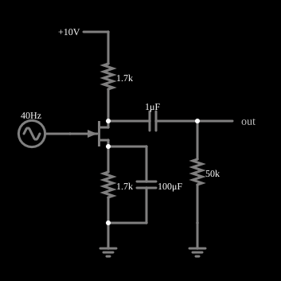

# Amplificador de fonte comum com JFET

<!-- navegacao:inicio -->
[Índice](README.md) · [Anterior: JFET Follower w/zero offset](jfetfollower-nooff.md) · [Próximo: Volume Control](volume.md)
<!-- navegacao:fim -->

## Objetivo

Mostrar o **amplificador de fonte comum** com JFET: um sinal pequeno no gatilho aparece amplificado e invertido no dreno.

## O circuito

<!-- esquema:inicio -->

<!-- esquema:fim -->

O dreno é alimentado com $10\ \text{V}$ por um resistor de $1{,}675\ \text{k}\Omega$; a fonte tem um resistor de $1{,}675\ \text{k}\Omega$ com um capacitor de desacoplamento de $100\ \mu\text{F}$ em paralelo. O gatilho recebe um sinal de $0{,}1\ \text{V}$ de pico a $40\ \text{Hz}$, e a saída é acoplada ao dreno por um capacitor de $1\ \mu\text{F}$ a uma carga de $50\ \text{k}\Omega$.

<!-- componentes:inicio -->
| N.º | Tipo | Elemento | Valores |
|----:|------|----------|---------|
| 0 | `ResistorElm` | resistor | Resistance (ohms) = 1.7k |
| 1 | `NJfetElm` | JFET | Model = default-jfet; Swap D/S = não |
| 2 | `RailElm` | A/C source | Max Voltage = 100m; Waveform = A/C; DC Offset (V) = 0; Internal Resistance (ohms) = 0; Show Voltage = não; Frequency (Hz) = 40; Phase Offset (degrees) = 0 |
| 3 | `RailElm` | voltage source | Voltage = 10; Waveform = D/C; DC Offset (V) = 0; Internal Resistance (ohms) = 0 |
| 4 | `ResistorElm` | resistor | Resistance (ohms) = 1.7k |
| 5 | `CapacitorElm` | capacitor | Capacitance (F) = 1μ; Trapezoidal Approximation = sim; Initial Voltage (on Reset) = 1m; Series Resistance = 0 |
| 6 | `ResistorElm` | resistor | Resistance (ohms) = 50k |
| 7 | `GroundElm` | ground | Symbol = Earth |
| 8 | `OutputElm` | output | Show Voltage = não |
| 10 | `CapacitorElm` | capacitor | Capacitance (F) = 100μ; Trapezoidal Approximation = sim; Initial Voltage (on Reset) = 1m; Series Resistance = 0 |
| 12 | `GroundElm` | ground | Symbol = Earth |
<!-- componentes:fim -->

## Teoria

O JFET de canal N do simulador (modelo *default-jfet*) tem tensão de corte $V_T = -4\ \text{V}$ e $\beta = 1{,}25\ \text{mA/V}^2$, sem modulação de canal ($\lambda = 0$). Em saturação,

$$I_D = \frac{\beta}{2}\thinspace(V_{GS} - V_T)^2 = I_{DSS}\left(1 - \frac{V_{GS}}{V_T}\right)^2,\qquad I_{DSS} = \frac{\beta}{2}V_T^2 = 10\ \text{mA},$$

e, na região ôhmica ($V_{DS} < V_{GS} - V_T$), $I_D = \beta\bigl[(V_{GS}-V_T)V_{DS} - V_{DS}^2/2\bigr]$.

**Polarização.** Com o gatilho em $0\ \text{V}$, $I_D = 0{,}625\ \text{mA/V}^2\thinspace(4 - 1675\thinspace I_D)^2$, cuja solução física é $I_D = 1{,}472\ \text{mA}$, $V_{GS} = -2{,}47\ \text{V}$. A tensão contínua na fonte é $V_S = 2{,}47\ \text{V}$ e $g_m = \beta(V_{GS} - V_T) = 1{,}92\ \text{mS}$.

**Pequenos sinais.** Com o capacitor de desacoplamento em curto para o sinal, o ganho é

$$A_v = -g_m\thinspace(R_D \parallel R_L) = -1{,}92\ \text{mS}\cdot(1{,}675\ \text{k}\Omega \parallel 50\ \text{k}\Omega) = -3{,}1.$$

## Resultados esperados

O simulador dá:

- **Corrente de dreno:** $1{,}473\ \text{mA}$ e tensão contínua na fonte de $2{,}467\ \text{V}$, como na teoria.
- **Saída:** excursão de $+0{,}303\ \text{V}$ a $-0{,}313\ \text{V}$, isto é, amplitude de $0{,}31\ \text{V}$ para a entrada de $0{,}1\ \text{V}$: ganho de $-3{,}1$, invertido.

## O que observar

No osciloscópio, a saída está em oposição de fase com a entrada e três vezes maior. Retire o capacitor de $100\ \mu\text{F}$ e o ganho cai, porque o resistor de $1{,}675\ \text{k}\Omega$ da fonte realimenta o sinal.

## Limites do modelo

- O ganho vem do modelo quadrático, que não tem capacitâncias: não há queda do ganho em alta frequência.
- Com os capacitores de acoplamento de $1\ \mu\text{F}$ e $100\ \mu\text{F}$, a $40\ \text{Hz}$ o desacoplamento da fonte não é perfeito; o ganho medido é um pouco menor que o teórico.

## Referências

Sedra e Smith, *Microeletrônica*, capítulo sobre transistores de efeito de campo (JFET); Horowitz e Hill, *The Art of Electronics*, capítulo sobre transistores de efeito de campo.

O circuito deste exemplo faz parte da coleção do simulador original de Paul Falstad e Iain Sharp (CircuitJS1); a explicação é deste projeto.
