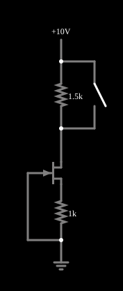

# Fonte de corrente com JFET

<!-- navegacao:inicio -->
[Índice](README.md) · [Próximo: JFET Follower](jfetfollower.md)
<!-- navegacao:fim -->

## Objetivo

Mostrar um JFET com um resistor na fonte (*source*) funcionando como **fonte de corrente**: a corrente na carga quase não depende da resistência da carga.

## O circuito

<!-- esquema:inicio -->

<!-- esquema:fim -->

Uma fonte de $10\ \text{V}$ alimenta o dreno do JFET por um resistor de carga de $1{,}5\ \text{k}\Omega$; o gatilho está ligado à terra e a fonte (*source*) tem um resistor de $1\ \text{k}\Omega$ para a terra. Uma chave em paralelo com a carga de $1{,}5\ \text{k}\Omega$ pode curto-circuitá-la.

<!-- componentes:inicio -->
| N.º | Tipo | Elemento | Valores |
|----:|------|----------|---------|
| 0 | `GroundElm` | ground | Symbol = Earth |
| 4 | `RailElm` | voltage source | Voltage = 10; Waveform = D/C; DC Offset (V) = 0; Internal Resistance (ohms) = 0 |
| 5 | `SwitchElm` | switch (SPST) | Momentary Switch = não; IEC Symbol = não; Label (for linking) = ; Keyboard Shortcut = ; On Resistance (ohms) = 0 |
| 6 | `ResistorElm` | resistor | Resistance (ohms) = 1.5k |
| 7 | `NJfetElm` | JFET | Model = default-jfet; Swap D/S = não |
| 10 | `ResistorElm` | resistor | Resistance (ohms) = 1k |
<!-- componentes:fim -->

## Teoria

O JFET de canal N do simulador (modelo *default-jfet*) tem tensão de corte $V_T = -4\ \text{V}$ e $\beta = 1{,}25\ \text{mA/V}^2$, sem modulação de canal ($\lambda = 0$). Em saturação,

$$I_D = \frac{\beta}{2}\,(V_{GS} - V_T)^2 = I_{DSS}\left(1 - \frac{V_{GS}}{V_T}\right)^2,\qquad I_{DSS} = \frac{\beta}{2}V_T^2 = 10\ \text{mA},$$

e, na região ôhmica ($V_{DS} < V_{GS} - V_T$), $I_D = \beta\bigl[(V_{GS}-V_T)V_{DS} - V_{DS}^2/2\bigr]$.

Com o gatilho em $0\ \text{V}$ e o resistor $R_S$ na fonte, $V_{GS} = -I_D R_S$, e a corrente satisfaz a equação de autopolarização

$$I_D = \frac{\beta}{2}\,(-I_D R_S - V_T)^2 = 0{,}625\ \text{mA/V}^2\,(4 - 1000\,I_D)^2,$$

cuja solução física é $I_D = 2{,}147\ \text{mA}$ ($V_{GS} = -2{,}15\ \text{V}$). Em saturação a corrente não depende de $V_{DS}$, então ela é a mesma qualquer que seja a carga no dreno, desde que o JFET permaneça em saturação.

## Resultados esperados

O simulador dá:

- **Corrente do JFET:** $2{,}147\ \text{mA}$, igual ao valor da equação.
- **Tensão na carga de $1{,}5\ \text{k}\Omega$:** $3{,}22\ \text{V}$ ($2{,}147\ \text{mA}\times 1{,}5\ \text{k}\Omega$); na fonte, $2{,}147\ \text{V}$.
- **Com a chave fechada** (carga em curto-circuito): a tensão na carga vai a $0\ \text{V}$ e a corrente continua $2{,}147\ \text{mA}$, a prova de que o JFET se comporta como fonte de corrente.

## O que observar

Feche e abra a chave: a tensão sobre a carga muda de $3{,}22\ \text{V}$ a $0\ \text{V}$, mas a corrente no resistor da fonte, que o osciloscópio mostra, permanece a mesma.

## Limites do modelo

- O modelo tem $\lambda = 0$: em saturação a corrente não varia nada com $V_{DS}$. Num JFET real há uma pequena variação (resistência de saída finita).
- O valor $I_{DSS} = 10\ \text{mA}$ e $V_T = -4\ \text{V}$ são do modelo padrão; um JFET real varia muito de unidade para unidade.

## Referências

Sedra e Smith, *Microeletrônica*, capítulo sobre transistores de efeito de campo (JFET); Horowitz e Hill, *The Art of Electronics*, capítulo sobre transistores de efeito de campo.

O circuito deste exemplo faz parte da coleção do simulador original de Paul Falstad e Iain Sharp (CircuitJS1); a explicação é deste projeto.
