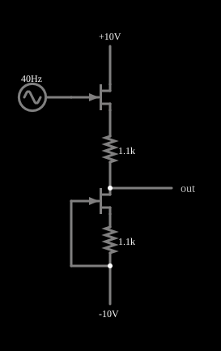

# Seguidor de fonte com JFET e deslocamento nulo

<!-- navegacao:inicio -->
[Índice](README.md) · [Anterior: JFET Follower](jfetfollower.md) · [Próximo: Common-Source Amplifier](jfetamp.md)
<!-- navegacao:fim -->

## Objetivo

Mostrar como **cancelar o deslocamento** contínuo de um seguidor de fonte: com um segundo JFET e alimentação simétrica, a saída segue a entrada com média zero e ganho quase unitário.

## O circuito

<!-- esquema:inicio -->

<!-- esquema:fim -->

Dois JFETs idênticos e dois resistores de $1{,}1\ \text{k}\Omega$ ficam entre fontes simétricas de $+10\ \text{V}$ e $-10\ \text{V}$. O gatilho do primeiro recebe um sinal senoidal de $2\ \text{V}$ de pico e $40\ \text{Hz}$, sem componente contínua; a saída é tomada entre os dois estágios.

<!-- componentes:inicio -->
| N.º | Tipo | Elemento | Valores |
|----:|------|----------|---------|
| 0 | `ResistorElm` | resistor | Resistance (ohms) = 1.1k |
| 1 | `NJfetElm` | JFET | Model = default-jfet; Swap D/S = não |
| 2 | `RailElm` | A/C source | Max Voltage = 2; Waveform = A/C; DC Offset (V) = 0; Internal Resistance (ohms) = 0; Show Voltage = não; Frequency (Hz) = 40; Phase Offset (degrees) = 0 |
| 3 | `NJfetElm` | JFET | Model = default-jfet; Swap D/S = não |
| 4 | `ResistorElm` | resistor | Resistance (ohms) = 1.1k |
| 7 | `RailElm` | voltage source | Voltage = -10; Waveform = D/C; DC Offset (V) = 0; Internal Resistance (ohms) = 0 |
| 8 | `OutputElm` | output | Show Voltage = não |
| 9 | `RailElm` | voltage source | Voltage = 10; Waveform = D/C; DC Offset (V) = 0; Internal Resistance (ohms) = 0 |
<!-- componentes:fim -->

## Símbolos e parâmetros

Os símbolos usados neste documento (definições completas no [glossário](../glossario-simbolos.md)):

| Símbolo | Nome | Significado | Unidade |
|---------|------|-------------|---------|
| $R$ | resistência | oposição de um resistor à passagem da corrente ($V = R I$) | Ω |
| $V_T$ | tensão térmica | $kT/q$: cerca de $25{,}85\ \text{mV}$ a $300\ \text{K}$ | V |
| $\beta$ | ganho de corrente | razão $I_C/I_B$ do transistor bipolar | — |
| $\lambda$ | modulação do comprimento do canal | parâmetro que dá à corrente de saturação do MOSFET uma pequena inclinação com $V_{DS}$ ($0$: sem inclinação) | 1/V |
| $I_D$ | corrente de dreno | corrente que entra pelo dreno do transistor de efeito de campo | A |
| $V_{GS}$ | tensão porta-fonte | tensão entre a porta e a fonte | V |
| $I_{DSS}$ | corrente de dreno de saturação | corrente de dreno com $V_{GS}=0$ | A |
| $V_{DS}$ | tensão dreno-fonte | tensão entre o dreno e a fonte | V |
| $g_m$ | transcondutância | quanto a corrente de saída varia por volt na entrada, $\partial I_D/\partial V_{GS}$ | S |

## Teoria

O JFET de canal N do simulador (modelo *default-jfet*) tem tensão de corte $V_T = -4\ \text{V}$ e $\beta = 1{,}25\ \text{mA/V}^2$, sem modulação de canal ($\lambda = 0$). Em saturação,

$$I_D = \frac{\beta}{2}\thinspace(V_{GS} - V_T)^2 = I_{DSS}\left(1 - \frac{V_{GS}}{V_T}\right)^2,\qquad I_{DSS} = \frac{\beta}{2}V_T^2 = 10\ \text{mA},$$

e, na região ôhmica ($V_{DS} < V_{GS} - V_T$), $I_D = \beta\bigl[(V_{GS}-V_T)V_{DS} - V_{DS}^2/2\bigr]$.

Cada JFET, com o resistor de $1{,}1\ \text{k}\Omega$ na fonte, satisfaz $I_D = 0{,}625\ \text{mA/V}^2\thinspace(4 - 1100\thinspace I_D)^2$, cuja solução física é $I_D = 2{,}007\ \text{mA}$ ($V_{GS} = -2{,}21\ \text{V}$). Os dois estágios têm o mesmo ponto de operação, e portanto a mesma queda $V_{GS}$; com as fontes simétricas, os deslocamentos de tensão dos dois se cancelam e a saída tem componente contínua nula. O ganho em pequenos sinais é $g_m R/(1 + g_m R)$ com $g_m = \beta(V_{GS} - V_T) = 2{,}24\ \text{mS}$, e a saída tem ganho próximo de $1$.

## Resultados esperados

O simulador dá:

- **Corrente de cada JFET** (resistores de $1{,}1\ \text{k}\Omega$): $2{,}007\ \text{mA}$, igual nos dois, o valor da equação.
- **Saída:** valor médio de $-0{,}3\ \text{mV}$ (praticamente zero), e excursão de $-2{,}000\ \text{V}$ a $+2{,}000\ \text{V}$: ganho $1{,}000$ para a entrada de $2\ \text{V}$ de pico.

## O que observar

Compare com o exemplo anterior: lá a saída ficava deslocada de $3{,}3\ \text{V}$ e tinha ganho $0{,}90$; aqui a saída é centrada em $0\ \text{V}$ e iguala a entrada.

## Limites do modelo

- O ganho unitário exato depende de os dois JFETs serem idênticos; com dispositivos reais, que diferem, aparecem um pequeno deslocamento e ganho um pouco menor.
- A amplitude da entrada é pequena em relação à faixa de operação; sinais maiores distorceriam.

## Referências

Sedra e Smith, *Microeletrônica*, capítulo sobre transistores de efeito de campo (JFET); Horowitz e Hill, *The Art of Electronics*, capítulo sobre transistores de efeito de campo.

O circuito deste exemplo faz parte da coleção do simulador original de Paul Falstad e Iain Sharp (CircuitJS1); a explicação é deste projeto.
