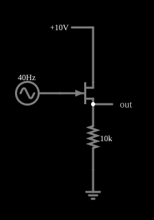

# Seguidor de fonte com JFET

<!-- navegacao:inicio -->
[Índice](README.md) · [Anterior: JFET Current Source](jfetcurrentsrc.md) · [Próximo: JFET Follower w/zero offset](jfetfollower-nooff.md)
<!-- navegacao:fim -->

## Objetivo

Mostrar o **seguidor de fonte** (*source follower*, ou dreno comum) com um JFET: a tensão na fonte segue a do gatilho, com ganho um pouco menor que $1$ e uma tensão contínua de deslocamento.

## O circuito

<!-- esquema:inicio -->

<!-- esquema:fim -->

Um JFET tem o dreno em $10\ \text{V}$ e um resistor de $10\ \text{k}\Omega$ da fonte à terra. O gatilho recebe um sinal senoidal de $2\ \text{V}$ de pico e $40\ \text{Hz}$, sem componente contínua. A saída é tomada no resistor da fonte.

<!-- componentes:inicio -->
| N.º | Tipo | Elemento | Valores |
|----:|------|----------|---------|
| 1 | `ResistorElm` | resistor | Resistance (ohms) = 10k |
| 2 | `OutputElm` | output | Show Voltage = não |
| 3 | `NJfetElm` | JFET | Model = default-jfet; Swap D/S = não |
| 4 | `RailElm` | A/C source | Max Voltage = 2; Waveform = A/C; DC Offset (V) = 0; Internal Resistance (ohms) = 0; Show Voltage = não; Frequency (Hz) = 40; Phase Offset (degrees) = 0 |
| 5 | `GroundElm` | ground | Symbol = Earth |
| 6 | `RailElm` | voltage source | Voltage = 10; Waveform = D/C; DC Offset (V) = 0; Internal Resistance (ohms) = 0 |
<!-- componentes:fim -->

## Teoria

O JFET de canal N do simulador (modelo *default-jfet*) tem tensão de corte $V_T = -4\ \text{V}$ e $\beta = 1{,}25\ \text{mA/V}^2$, sem modulação de canal ($\lambda = 0$). Em saturação,

$$I_D = \frac{\beta}{2}\,(V_{GS} - V_T)^2 = I_{DSS}\left(1 - \frac{V_{GS}}{V_T}\right)^2,\qquad I_{DSS} = \frac{\beta}{2}V_T^2 = 10\ \text{mA},$$

e, na região ôhmica ($V_{DS} < V_{GS} - V_T$), $I_D = \beta\bigl[(V_{GS}-V_T)V_{DS} - V_{DS}^2/2\bigr]$.

**Ponto de operação.** Com o gatilho em $0\ \text{V}$ em média, $V_{GS} = -I_D R_S$, e $I_D = 0{,}625\ \text{mA/V}^2\,(4 - 10^4 I_D)^2$ tem duas raízes, $0{,}328\ \text{mA}$ e $0{,}488\ \text{mA}$; só a primeira dá $V_{GS} > V_T$. Assim $I_D = 0{,}328\ \text{mA}$, $V_{GS} = -3{,}28\ \text{V}$ e a tensão contínua na fonte é $V_S = 3{,}28\ \text{V}$.

**Pequenos sinais.** A transcondutância é $g_m = \beta(V_{GS} - V_T) = 1{,}25\ \text{mS}\cdot 0{,}72 = 0{,}90\ \text{mS}$, e o ganho do seguidor é

$$A_v = \frac{g_m R_S}{1 + g_m R_S} = \frac{9{,}0}{10{,}0} = 0{,}90.$$

## Resultados esperados

O simulador dá, no resistor da fonte:

- **Valor médio:** $3{,}29\ \text{V}$ (teoria: $3{,}28\ \text{V}$); a corrente média, $0{,}329\ \text{mA}$.
- **Excursão:** de $1{,}51\ \text{V}$ a $5{,}10\ \text{V}$, uma amplitude de $1{,}79\ \text{V}$, o que dá ganho de $0{,}90$ para a entrada de $2\ \text{V}$.

## O que observar

Compare no osciloscópio a entrada (centrada em $0\ \text{V}$) e a saída (centrada em $3{,}3\ \text{V}$): são formas de onda iguais, com a saída um pouco menor e deslocada. O deslocamento de $3{,}3\ \text{V}$ é o defeito que o próximo exemplo corrige.

## Limites do modelo

- O ganho de $0{,}90$ vem do modelo quadrático sem modulação de canal; num JFET real o ganho em pequenos sinais depende da frequência e da corrente.
- A amplitude da entrada ($2\ \text{V}$) é grande em relação a $V_T$, por isso há um pouco de distorção.

## Referências

Sedra e Smith, *Microeletrônica*, capítulo sobre transistores de efeito de campo (JFET); Horowitz e Hill, *The Art of Electronics*, capítulo sobre transistores de efeito de campo.

O circuito deste exemplo faz parte da coleção do simulador original de Paul Falstad e Iain Sharp (CircuitJS1); a explicação é deste projeto.
