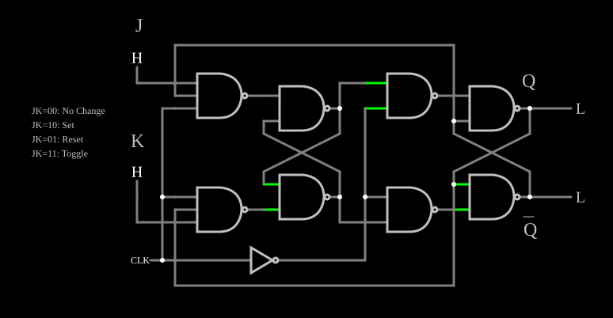

# Flip-flop JK

<!-- navegacao:inicio -->
[Índice](README.md) · [Anterior: Edge-Triggered D Flip-Flop](edgedff.md)
<!-- navegacao:fim -->

## Objetivo

Mostrar o flip-flop **JK**, que resolve o estado proibido do SR: com $J = K = 1$ a saída **inverte** a cada borda do relógio, o que faz dele a célula básica dos contadores.

## O circuito

<!-- esquema:inicio -->

<!-- esquema:fim -->

É um flip-flop mestre-escravo de NANDs (como o [Master-Slave Flip-Flop](masterslaveff.md)) cujas NANDs de entrada têm três entradas: $J$ (elemento 48) ou $K$ (elemento 37), o relógio e a saída realimentada, $\overline{Q}$ para a porta de $J$ e $Q$ para a de $K$. O relógio é uma onda quadrada de $120\ \text{Hz}$; as saídas são $Q$ (elemento 26) e $\overline{Q}$ (elemento 27). O exemplo abre com $J = K = 1$ e $Q = 1$.

<!-- componentes:inicio -->
| N.º | Tipo | Elemento | Valores |
|----:|------|----------|---------|
| 0 | `NandGateElm` | NAND gate | # of Inputs = 2; High Logic Voltage = 5; Schmitt Inputs = não; Invert Inputs = não; Propagation Delay (s) = 0; DeMorgan's Symbol = não |
| 1 | `NandGateElm` | NAND gate | # of Inputs = 2; High Logic Voltage = 5; Schmitt Inputs = não; Invert Inputs = não; Propagation Delay (s) = 0; DeMorgan's Symbol = não |
| 8 | `NandGateElm` | NAND gate | # of Inputs = 2; High Logic Voltage = 5; Schmitt Inputs = não; Invert Inputs = não; Propagation Delay (s) = 0; DeMorgan's Symbol = não |
| 9 | `NandGateElm` | NAND gate | # of Inputs = 2; High Logic Voltage = 5; Schmitt Inputs = não; Invert Inputs = não; Propagation Delay (s) = 0; DeMorgan's Symbol = não |
| 12 | `NandGateElm` | NAND gate | # of Inputs = 2; High Logic Voltage = 5; Schmitt Inputs = não; Invert Inputs = não; Propagation Delay (s) = 0; DeMorgan's Symbol = não |
| 13 | `NandGateElm` | NAND gate | # of Inputs = 2; High Logic Voltage = 5; Schmitt Inputs = não; Invert Inputs = não; Propagation Delay (s) = 0; DeMorgan's Symbol = não |
| 24 | `NandGateElm` | NAND gate | # of Inputs = 3; High Logic Voltage = 5; Schmitt Inputs = não; Invert Inputs = não; Propagation Delay (s) = 0; DeMorgan's Symbol = não |
| 25 | `InverterElm` | inverter | Slew Rate (V/ns) = 500m; High Logic Voltage = 5; DeMorgan's Symbol = não |
| 26 | `LogicOutputElm` | logic output | Threshold = 2.5; Current Required = não; Numeric = não; Ternary = não |
| 27 | `LogicOutputElm` | logic output | Threshold = 2.5; Current Required = não; Numeric = não; Ternary = não |
| 28 | `TextElm` | text | Text = Q; Size = 24; Draw Bar On Top = não; Color = #c0c0c0 |
| 29 | `TextElm` | text | Text = Q; Size = 24; Draw Bar On Top = sim; Color = #c0c0c0 |
| 31 | `TextElm` | text | Text = J; Size = 24; Draw Bar On Top = não; Color = #c0c0c0 |
| 32 | `RailElm` | square wave gen | Max Voltage = 2.5; Waveform = Square Wave; DC Offset (V) = 2.5; Internal Resistance (ohms) = 0; Show Voltage = não; Specify As = Frequency/Duty Cycle; Frequency (Hz) = 120; Phase Offset (degrees) = 0; Duty Cycle = 50; Rise/Fall Time (s) = 0 |
| 33 | `NandGateElm` | NAND gate | # of Inputs = 3; High Logic Voltage = 5; Schmitt Inputs = não; Invert Inputs = não; Propagation Delay (s) = 0; DeMorgan's Symbol = não |
| 37 | `LogicInputElm` | logic input | Momentary Switch = não; High Logic Voltage = 5; Low Voltage = 0; Numeric = não; Ternary = não; Keyboard Shortcut =  |
| 38 | `TextElm` | text | Text = K; Size = 24; Draw Bar On Top = não; Color = #c0c0c0 |
| 48 | `LogicInputElm` | logic input | Momentary Switch = não; High Logic Voltage = 5; Low Voltage = 0; Numeric = não; Ternary = não; Keyboard Shortcut =  |
| 49 | `TextElm` | text | Text = JK=00: No Change; Size = 12; Draw Bar On Top = não; Color = #c0c0c0 |
| 50 | `TextElm` | text | Text = JK=10: Set; Size = 12; Draw Bar On Top = não; Color = #c0c0c0 |
| 51 | `TextElm` | text | Text = JK=01: Reset; Size = 12; Draw Bar On Top = não; Color = #c0c0c0 |
| 52 | `TextElm` | text | Text = JK=11: Toggle; Size = 12; Draw Bar On Top = não; Color = #c0c0c0 |
<!-- componentes:fim -->

## Teoria

A realimentação garante que só a entrada capaz de mudar o estado chegue ao latch: $J$ só age quando $Q = 0$ e $K$ só age quando $Q = 1$. Na borda de descida do relógio:

| $J$ | $K$ | $Q$ seguinte |
|----:|----:|------|
| 0 | 0 | $Q$ (guarda) |
| 1 | 0 | 1 (*set*) |
| 0 | 1 | 0 (*reset*) |
| 1 | 1 | $\overline{Q}$ (inverte) |

Com $J = K = 1$ a saída muda a cada borda de descida: é um **divisor de frequência por 2**, e a saída tem metade da frequência do relógio. Ligando flip-flops assim em cadeia obtém-se o [4-Bit Ripple Counter](counter.md).

## Resultados esperados

O simulador dá, com $J = K = 1$, $Q$ alternando a cada borda de descida ($4{,}2$, $12{,}5$, $20{,}9\ \text{ms}$, …): $Q = 5\ \text{V}$ em $2\ \text{ms}$, $0$ em $8\ \text{ms}$, $5\ \text{V}$ em $16\ \text{ms}$, com frequência de $60\ \text{Hz}$, metade dos $120\ \text{Hz}$ do relógio. Com $J = 0$ e $K = 1$, $Q$ vai a $0$ na primeira borda e fica; com $J = 1$ e $K = 0$, ou com $J = K = 0$, $Q$ continua em $5\ \text{V}$.

## O que observar

Mude $J$ e $K$ e compare com a tabela impressa ao lado do circuito; acompanhe nos osciloscópios a saída com metade da frequência do relógio.

## Limites do modelo

- O flip-flop JK mestre-escravo real tem o problema de *ones catching* (o mestre captura um pulso em $J$ ou $K$ durante a fase alta); com entradas mudando só entre bordas, o exemplo não o mostra.
- Portas sem atraso.

## Referências

Mano e Ciletti, *Digital Design*, capítulo sobre flip-flops JK e T; Wakerly, *Digital Design: Principles and Practices*.

O circuito deste exemplo faz parte da coleção do simulador original de Paul Falstad e Iain Sharp (CircuitJS1); a explicação é deste projeto.
