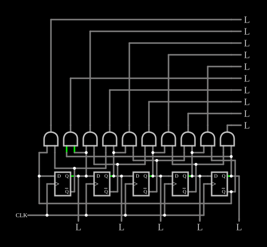

# Contador Johnson

<!-- navegacao:inicio -->
[Índice](README.md) · [Anterior: Gray Code Counter](graycode.md) · [Próximo: Cascading Ring Counters](ringcascade.md)
<!-- navegacao:fim -->

## Objetivo

Mostrar o **contador Johnson** (anel torcido): um registrador de deslocamento cuja última saída volta **invertida** à entrada. Com $n$ flip-flops ele tem $2n$ estados, cada um reconhecível por uma única porta AND de duas entradas.

## O circuito

<!-- esquema:inicio -->

<!-- esquema:fim -->

Cinco flip-flops D disparados pela borda de subida, ligados em registrador de deslocamento ($Q$ de cada um no $D$ do seguinte), com $\overline{Q}$ do último na entrada $D$ do primeiro. O relógio é uma onda quadrada de $300\ \text{Hz}$. As saídas $Q_0$ a $Q_4$ aparecem embaixo (elementos 119 a 123). Dez portas AND de duas entradas decodificam os dez estados e acionam dez saídas lógicas, de cima para baixo os elementos 82, 83, 84, 89, 90, 100, 101, 102, 103 e 104. O exemplo abre no estado $Q_0 \dots Q_4 = 01111$.

<!-- componentes:inicio -->
| N.º | Tipo | Elemento | Valores |
|----:|------|----------|---------|
| 0 | `DFlipFlopElm` | D flip-flop | High Logic Voltage = 5; Reset Pin = não; Set Pin = não; Invert Set/Reset = não |
| 1 | `DFlipFlopElm` | D flip-flop | High Logic Voltage = 5; Reset Pin = não; Set Pin = não; Invert Set/Reset = não |
| 2 | `DFlipFlopElm` | D flip-flop | High Logic Voltage = 5; Reset Pin = não; Set Pin = não; Invert Set/Reset = não |
| 3 | `DFlipFlopElm` | D flip-flop | High Logic Voltage = 5; Reset Pin = não; Set Pin = não; Invert Set/Reset = não |
| 4 | `DFlipFlopElm` | D flip-flop | High Logic Voltage = 5; Reset Pin = não; Set Pin = não; Invert Set/Reset = não |
| 23 | `RailElm` | square wave gen | Max Voltage = 2.5; Waveform = Square Wave; DC Offset (V) = 2.5; Internal Resistance (ohms) = 0; Show Voltage = não; Specify As = Frequency/Duty Cycle; Frequency (Hz) = 300; Phase Offset (degrees) = 0; Duty Cycle = 50; Rise/Fall Time (s) = 0 |
| 24 | `AndGateElm` | AND gate | # of Inputs = 2; High Logic Voltage = 5; Schmitt Inputs = não; Invert Inputs = não; Propagation Delay (s) = 0; DeMorgan's Symbol = não |
| 25 | `AndGateElm` | AND gate | # of Inputs = 2; High Logic Voltage = 5; Schmitt Inputs = não; Invert Inputs = não; Propagation Delay (s) = 0; DeMorgan's Symbol = não |
| 26 | `AndGateElm` | AND gate | # of Inputs = 2; High Logic Voltage = 5; Schmitt Inputs = não; Invert Inputs = não; Propagation Delay (s) = 0; DeMorgan's Symbol = não |
| 27 | `AndGateElm` | AND gate | # of Inputs = 2; High Logic Voltage = 5; Schmitt Inputs = não; Invert Inputs = não; Propagation Delay (s) = 0; DeMorgan's Symbol = não |
| 28 | `AndGateElm` | AND gate | # of Inputs = 2; High Logic Voltage = 5; Schmitt Inputs = não; Invert Inputs = não; Propagation Delay (s) = 0; DeMorgan's Symbol = não |
| 29 | `AndGateElm` | AND gate | # of Inputs = 2; High Logic Voltage = 5; Schmitt Inputs = não; Invert Inputs = não; Propagation Delay (s) = 0; DeMorgan's Symbol = não |
| 30 | `AndGateElm` | AND gate | # of Inputs = 2; High Logic Voltage = 5; Schmitt Inputs = não; Invert Inputs = não; Propagation Delay (s) = 0; DeMorgan's Symbol = não |
| 31 | `AndGateElm` | AND gate | # of Inputs = 2; High Logic Voltage = 5; Schmitt Inputs = não; Invert Inputs = não; Propagation Delay (s) = 0; DeMorgan's Symbol = não |
| 32 | `AndGateElm` | AND gate | # of Inputs = 2; High Logic Voltage = 5; Schmitt Inputs = não; Invert Inputs = não; Propagation Delay (s) = 0; DeMorgan's Symbol = não |
| 33 | `AndGateElm` | AND gate | # of Inputs = 2; High Logic Voltage = 5; Schmitt Inputs = não; Invert Inputs = não; Propagation Delay (s) = 0; DeMorgan's Symbol = não |
| 82 | `LogicOutputElm` | logic output | Threshold = 2.5; Current Required = não; Numeric = não; Ternary = não |
| 83 | `LogicOutputElm` | logic output | Threshold = 2.5; Current Required = não; Numeric = não; Ternary = não |
| 84 | `LogicOutputElm` | logic output | Threshold = 2.5; Current Required = não; Numeric = não; Ternary = não |
| 89 | `LogicOutputElm` | logic output | Threshold = 2.5; Current Required = não; Numeric = não; Ternary = não |
| 90 | `LogicOutputElm` | logic output | Threshold = 2.5; Current Required = não; Numeric = não; Ternary = não |
| 100 | `LogicOutputElm` | logic output | Threshold = 2.5; Current Required = não; Numeric = não; Ternary = não |
| 101 | `LogicOutputElm` | logic output | Threshold = 2.5; Current Required = não; Numeric = não; Ternary = não |
| 102 | `LogicOutputElm` | logic output | Threshold = 2.5; Current Required = não; Numeric = não; Ternary = não |
| 103 | `LogicOutputElm` | logic output | Threshold = 2.5; Current Required = não; Numeric = não; Ternary = não |
| 104 | `LogicOutputElm` | logic output | Threshold = 2.5; Current Required = não; Numeric = não; Ternary = não |
| 119 | `LogicOutputElm` | logic output | Threshold = 2.5; Current Required = não; Numeric = não; Ternary = não |
| 120 | `LogicOutputElm` | logic output | Threshold = 2.5; Current Required = não; Numeric = não; Ternary = não |
| 121 | `LogicOutputElm` | logic output | Threshold = 2.5; Current Required = não; Numeric = não; Ternary = não |
| 122 | `LogicOutputElm` | logic output | Threshold = 2.5; Current Required = não; Numeric = não; Ternary = não |
| 123 | `LogicOutputElm` | logic output | Threshold = 2.5; Current Required = não; Numeric = não; Ternary = não |
<!-- componentes:fim -->

## Teoria

Partindo de tudo em $0$, o anel torcido enche-se de $1$ pela esquerda e depois esvazia-se:

$$00000 \to 10000 \to 11000 \to 11100 \to 11110 \to 11111 \to 01111 \to 00111 \to 00011 \to 00001 \to 00000.$$

São $2n = 10$ estados para $n = 5$, contra $n$ estados de um contador em anel com um só bit circulando e $2^n$ de um binário. Em cada passo só um flip-flop muda, como no [código Gray](graycode.md), e cada estado é identificado pela fronteira entre os $1$ e os $0$, isto é, por um par de bits vizinhos: basta uma AND de duas entradas por estado, sem os pulsos espúrios de um decodificador de contador binário. É a base do contador de década 4017.

## Resultados esperados

O simulador percorre os dez estados acima, um por borda de subida ($3{,}33\ \text{ms}$), com ciclo de $33{,}3\ \text{ms}$ ($30\ \text{Hz}$): $01111$ em $1\ \text{ms}$ (saída decodificada do elemento 101 acesa), $00000$ em $16\ \text{ms}$ (elemento 82 aceso) e $11111$ em $33\ \text{ms}$ (elemento 100 aceso). Em cada instante exatamente uma das dez saídas decodificadas está em $5\ \text{V}$.

## O que observar

Veja a única saída decodificada acesa descer a coluna, uma posição por período do relógio, enquanto as saídas de baixo se enchem e se esvaziam de $1$.

## Limites do modelo

- Um contador Johnson real pode, ao ligar, cair num dos estados que não pertencem ao ciclo (com $1$ e $0$ alternados) e ficar preso num ciclo inválido; o 4017 tem lógica para corrigir isso. O exemplo parte de um estado válido.

## Referências

Wakerly, *Digital Design: Principles and Practices*, capítulo sobre contadores em anel e Johnson; Texas Instruments, folha de dados do CD4017B.

O circuito deste exemplo faz parte da coleção do simulador original de Paul Falstad e Iain Sharp (CircuitJS1); a explicação é deste projeto.
