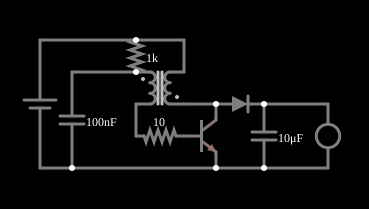

# Joule thief

<!-- navegacao:inicio -->
[Índice](README.md) · [Anterior: True RMS Converter](rmsconverter.md) · [Próximo: Full-Wave Rectifier](transrectifier.md)
<!-- navegacao:fim -->

## Objetivo

Mostrar o **Joule thief**, um conversor elevador de tensão que acende um LED com uma pilha de $1{,}5\ \text{V}$, abaixo da tensão que o LED exige. É um oscilador de bloqueio de um transistor: um transformador faz a realimentação que liga e desliga o transistor, e a energia do circuito magnético é entregue, em pulsos, ao LED por um diodo.

## O circuito

<!-- esquema:inicio -->

<!-- esquema:fim -->

Uma fonte de $1{,}5\ \text{V}$ (a pilha) alimenta um transformador de dois enrolamentos e um transistor NPN ($\beta = 100$). O transformador é descrito no simulador por uma indutância de $400\ \text{nH}$ no enrolamento "primário", uma razão $N_1/N_2 = 1/6$ e um acoplamento de $0{,}999$, com a polaridade do secundário invertida; a indutância do secundário é $L_2 = L_1 (N_1/N_2)^2 = 11{,}1\ \text{nH}$. O enrolamento primário está em série com a base, por meio de um resistor de $10\ \Omega$; um resistor de $1\ \text{k}\Omega$ e um capacitor de $100\ \text{nF}$ ligam esse enrolamento à pilha. O secundário liga a pilha ao coletor. Do coletor sai um diodo para um capacitor de $10\ \mu\text{F}$ em paralelo com um LED vermelho, que é a carga. Três osciloscópios mostram a corrente da pilha, a tensão de saída e a corrente do LED.

<!-- componentes:inicio -->
| N.º | Tipo | Elemento | Valores |
|----:|------|----------|---------|
| 0 | `TransformerElm` | transformer | Primary Inductance (H) = 400n; Ratio (N1/N2) = 166.7m; Coupling Coefficient = 999m; Trapezoidal Approximation = não; Swap Secondary Polarity = sim; Saturation Current (A) (0=none) = 0 |
| 1 | `NTransistorElm` | transistor | Beta/hFE = 100; Swap E/C = não; Draw Circle = não; Model = default |
| 3 | `ResistorElm` | resistor | Resistance (ohms) = 1k |
| 9 | `VoltageElm` | voltage source | Voltage = 1.5; Waveform = D/C; DC Offset (V) = 0; Internal Resistance (ohms) = 0; Show Voltage = não; Circle Symbol = não |
| 10 | `CapacitorElm` | capacitor | Capacitance (F) = 100n; Trapezoidal Approximation = sim; Initial Voltage (on Reset) = 1m; Series Resistance = 0 |
| 13 | `ResistorElm` | resistor | Resistance (ohms) = 10 |
| 14 | `CapacitorElm` | capacitor | Capacitance (F) = 10μ; Trapezoidal Approximation = sim; Initial Voltage (on Reset) = 1m; Series Resistance = 0 |
| 15 | `DiodeElm` | diode | Model = default |
| 21 | `LEDElm` | LED | Red Value (0-1) = 1; Green Value (0-1) = 0; Blue Value (0-1) = 0; Max Brightness Current (A) = 10m; Model = 1N4004 (general purpose) |
<!-- componentes:fim -->

## Teoria

**Oscilador de bloqueio.** Ao ligar, o resistor de $1\ \text{k}\Omega$ polariza a base e o transistor começa a conduzir. A corrente do coletor atravessa o enrolamento do coletor; a variação dessa corrente induz no enrolamento da base, pelo acoplamento magnético e com a polaridade invertida, uma tensão que **aumenta** a corrente de base: é uma realimentação positiva, que leva o transistor à condução forte. Ela se mantém enquanto a corrente de base sustenta a de coletor ($I_C \le \beta I_B$); quando o transistor deixa de acompanhá-la, a tensão induzida cai, a corrente de base diminui e o transistor corta. O enrolamento, cuja corrente não pode se anular de forma abrupta, passa a impor uma tensão de polaridade oposta no coletor.

**Conversão elevadora.** Essa tensão ultrapassa a da pilha e faz o diodo conduzir: o capacitor de saída é carregado até a tensão em que o LED conduz, que é maior que $1{,}5\ \text{V}$. O capacitor de $10\ \mu\text{F}$ alisa a tensão, e a energia vem da pilha em pulsos de corrente. O rendimento é

$$\eta = \frac{P_{saida}}{P_{entrada}} = \frac{V_{LED}\,\overline{I_{LED}}}{V_{bat}\,\overline{I_{bat}}}.$$

A relação quantitativa entre a indutância, a corrente de pico e a frequência de chaveamento depende do acoplamento e do transistor; este documento não a deduz e fica nas medidas do simulador.

## Resultados esperados

Em regime, numa janela de $0{,}2\ \text{ms}$ ($0{,}3$ a $0{,}5\ \text{ms}$), o simulador dá: tensão de saída média de $1{,}876\ \text{V}$, com ondulação de $1{,}869$ a $1{,}889\ \text{V}$ ($20\ \text{mV}$ pico a pico, $1\%$); corrente média do LED de $12{,}7\ \text{mA}$; corrente média da pilha de $22{,}1\ \text{mA}$, com um pico máximo de $0{,}13\ \text{A}$ (os picos típicos ficam em torno de $67\ \text{mA}$). A potência de entrada é $1{,}5 \cdot 22{,}1 = 33{,}1\ \text{mW}$ e a de saída, $1{,}876 \cdot 12{,}7 = 23{,}8\ \text{mW}$, o que dá $\eta = 72\%$ nessa janela; em outras janelas de $0{,}2\ \text{ms}$ ($0{,}5$ a $0{,}7$, $1$ a $1{,}2$ e $2$ a $2{,}2\ \text{ms}$) o rendimento ficou entre $66\%$ e $72\%$ e a corrente da pilha entre $21{,}3$ e $23{,}7\ \text{mA}$. O transistor comuta em torno de $290\ \text{kHz}$ (período médio de $3{,}4\ \mu\text{s}$, mas variando de $2{,}1$ a $5{,}1\ \mu\text{s}$): os ciclos não são idênticos. A corrente da pilha nunca cai abaixo de $0{,}98\ \text{mA}$. As verificações conferem a tensão de saída (média, máximo e mínimo), as correntes médias da pilha e do LED e o pico da corrente da pilha na janela de $0{,}3$ a $0{,}5\ \text{ms}$ (tolerância de $0{,}5\%$ a $2\%$).

## O que observar

A tensão de saída fica quase constante em $1{,}9\ \text{V}$, a corrente da pilha aparece como uma sequência de pulsos curtos e o LED recebe uma corrente praticamente contínua de cerca de $12\ \text{mA}$. Para testar, e comparando na mesma janela de $0{,}3$ a $0{,}5\ \text{ms}$: reduza o capacitor de saída para valores muito pequenos e veja a tensão do LED passar a pulsar (no simulador, de $0{,}47\ \text{V}$ a $2{,}0\ \text{V}$, com picos de $0{,}15\ \text{A}$ no LED, quando o capacitor é de $1\ \text{pF}$); multiplique a indutância do primário por $4$ (para $1{,}6\ \mu\text{H}$) e veja que o pico da corrente da pilha quase não muda ($0{,}124\ \text{A}$ contra $0{,}131\ \text{A}$), enquanto a corrente média do LED cai de $12{,}7\ \text{mA}$ para $8{,}7\ \text{mA}$; reduza a tensão da pilha e veja a corrente do LED diminuir (nessa janela a saída pode ainda não estar em regime).

## Limites do modelo

- Os valores de indutância ($400\ \text{nH}$ e $11{,}1\ \text{nH}$) são muito menores que os de um Joule thief real, feito com um núcleo de ferrite e bobinas de alguns $\mu\text{H}$; por isso a frequência aqui é muito mais alta. O exemplo mostra o princípio, não um projeto.
- O transformador do simulador é linear, sem saturação do núcleo, que num circuito real limita a corrente; aqui o limite vem do ganho do transistor.
- O transistor tem $\beta = 100$ constante e não há capacitâncias; na prática o tempo de armazenamento do transistor entra na frequência.
- A frequência, a corrente de pico e os rendimentos de outras janelas, assim como as experiências sugeridas acima, são medidas do simulador e não fazem parte das verificações automáticas.

## Referências

Horowitz e Hill, *The Art of Electronics*, seção 9.x (conversores elevadores); Erickson e Maksimović, *Fundamentals of Power Electronics*, capítulo sobre o conversor elevador.

O circuito deste exemplo faz parte da coleção do simulador original de Paul Falstad e Iain Sharp (CircuitJS1); a explicação é deste projeto.
