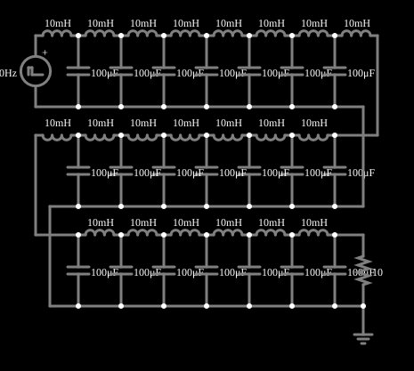

# Escada LC

<!-- navegacao:inicio -->
[Índice](README.md) · [Anterior: LC Modes (3)](coupled3.md)
<!-- navegacao:fim -->

## Objetivo

Mostrar uma linha de atraso feita com uma escada de indutores e capacitores: um pulso aplicado numa ponta aparece na outra depois de um atraso fixo, quase sem distorção, quando a linha termina em sua impedância característica.

## O circuito

<!-- esquema:inicio -->

<!-- esquema:fim -->

Uma escada LC com $21$ seções: cada seção tem um indutor de $10\ \text{mH}$ em série e um capacitor de $100\ \mu\text{F}$ para a terra (o circuito é dobrado em três fileiras para caber na tela). A escada é alimentada por um gerador de pulsos de $5\ \text{V}$ e $40\ \text{Hz}$ (cada pulso dura $4\ \text{ms}$) e termina num resistor de $10\ \Omega$. Dois osciloscópios mostram a tensão de entrada e a da carga.

<!-- componentes:inicio -->
| N.º | Tipo | Elemento | Valores |
|----:|------|----------|---------|
| 0 | `VoltageElm` | pulse gen | Max Voltage = 5; Waveform = Pulse; DC Offset (V) = 0; Internal Resistance (ohms) = 0; Show Voltage = não; Specify As = Frequency/Duty Cycle; Frequency (Hz) = 40; Phase Offset (degrees) = 0; Duty Cycle = 15.9; Rise/Fall Time (s) = 0 |
| 2 | `InductorElm` | inductor | Inductance (H) = 10m; Trapezoidal Approximation = sim; Initial Current (on Reset) (A) = 0; Saturation Current (A) (0=none) = 0 |
| 3 | `InductorElm` | inductor | Inductance (H) = 10m; Trapezoidal Approximation = sim; Initial Current (on Reset) (A) = 0; Saturation Current (A) (0=none) = 0 |
| 4 | `InductorElm` | inductor | Inductance (H) = 10m; Trapezoidal Approximation = sim; Initial Current (on Reset) (A) = 0; Saturation Current (A) (0=none) = 0 |
| 5 | `InductorElm` | inductor | Inductance (H) = 10m; Trapezoidal Approximation = sim; Initial Current (on Reset) (A) = 0; Saturation Current (A) (0=none) = 0 |
| 6 | `InductorElm` | inductor | Inductance (H) = 10m; Trapezoidal Approximation = sim; Initial Current (on Reset) (A) = 0; Saturation Current (A) (0=none) = 0 |
| 7 | `InductorElm` | inductor | Inductance (H) = 10m; Trapezoidal Approximation = sim; Initial Current (on Reset) (A) = 0; Saturation Current (A) (0=none) = 0 |
| 8 | `InductorElm` | inductor | Inductance (H) = 10m; Trapezoidal Approximation = sim; Initial Current (on Reset) (A) = 0; Saturation Current (A) (0=none) = 0 |
| 9 | `CapacitorElm` | capacitor | Capacitance (F) = 100μ; Trapezoidal Approximation = sim; Initial Voltage (on Reset) = 1m; Series Resistance = 0 |
| 10 | `CapacitorElm` | capacitor | Capacitance (F) = 100μ; Trapezoidal Approximation = sim; Initial Voltage (on Reset) = 1m; Series Resistance = 0 |
| 11 | `CapacitorElm` | capacitor | Capacitance (F) = 100μ; Trapezoidal Approximation = sim; Initial Voltage (on Reset) = 1m; Series Resistance = 0 |
| 12 | `CapacitorElm` | capacitor | Capacitance (F) = 100μ; Trapezoidal Approximation = sim; Initial Voltage (on Reset) = 1m; Series Resistance = 0 |
| 13 | `CapacitorElm` | capacitor | Capacitance (F) = 100μ; Trapezoidal Approximation = sim; Initial Voltage (on Reset) = 1m; Series Resistance = 0 |
| 14 | `CapacitorElm` | capacitor | Capacitance (F) = 100μ; Trapezoidal Approximation = sim; Initial Voltage (on Reset) = 1m; Series Resistance = 0 |
| 15 | `CapacitorElm` | capacitor | Capacitance (F) = 100μ; Trapezoidal Approximation = sim; Initial Voltage (on Reset) = 1m; Series Resistance = 0 |
| 22 | `InductorElm` | inductor | Inductance (H) = 10m; Trapezoidal Approximation = sim; Initial Current (on Reset) (A) = 0; Saturation Current (A) (0=none) = 0 |
| 26 | `CapacitorElm` | capacitor | Capacitance (F) = 100μ; Trapezoidal Approximation = sim; Initial Voltage (on Reset) = 1m; Series Resistance = 0 |
| 27 | `InductorElm` | inductor | Inductance (H) = 10m; Trapezoidal Approximation = sim; Initial Current (on Reset) (A) = 0; Saturation Current (A) (0=none) = 0 |
| 28 | `InductorElm` | inductor | Inductance (H) = 10m; Trapezoidal Approximation = sim; Initial Current (on Reset) (A) = 0; Saturation Current (A) (0=none) = 0 |
| 29 | `InductorElm` | inductor | Inductance (H) = 10m; Trapezoidal Approximation = sim; Initial Current (on Reset) (A) = 0; Saturation Current (A) (0=none) = 0 |
| 30 | `InductorElm` | inductor | Inductance (H) = 10m; Trapezoidal Approximation = sim; Initial Current (on Reset) (A) = 0; Saturation Current (A) (0=none) = 0 |
| 31 | `InductorElm` | inductor | Inductance (H) = 10m; Trapezoidal Approximation = sim; Initial Current (on Reset) (A) = 0; Saturation Current (A) (0=none) = 0 |
| 32 | `InductorElm` | inductor | Inductance (H) = 10m; Trapezoidal Approximation = sim; Initial Current (on Reset) (A) = 0; Saturation Current (A) (0=none) = 0 |
| 33 | `CapacitorElm` | capacitor | Capacitance (F) = 100μ; Trapezoidal Approximation = sim; Initial Voltage (on Reset) = 1m; Series Resistance = 0 |
| 34 | `CapacitorElm` | capacitor | Capacitance (F) = 100μ; Trapezoidal Approximation = sim; Initial Voltage (on Reset) = 1m; Series Resistance = 0 |
| 35 | `CapacitorElm` | capacitor | Capacitance (F) = 100μ; Trapezoidal Approximation = sim; Initial Voltage (on Reset) = 1m; Series Resistance = 0 |
| 36 | `CapacitorElm` | capacitor | Capacitance (F) = 100μ; Trapezoidal Approximation = sim; Initial Voltage (on Reset) = 1m; Series Resistance = 0 |
| 37 | `CapacitorElm` | capacitor | Capacitance (F) = 100μ; Trapezoidal Approximation = sim; Initial Voltage (on Reset) = 1m; Series Resistance = 0 |
| 38 | `CapacitorElm` | capacitor | Capacitance (F) = 100μ; Trapezoidal Approximation = sim; Initial Voltage (on Reset) = 1m; Series Resistance = 0 |
| 47 | `InductorElm` | inductor | Inductance (H) = 10m; Trapezoidal Approximation = sim; Initial Current (on Reset) (A) = 0; Saturation Current (A) (0=none) = 0 |
| 51 | `CapacitorElm` | capacitor | Capacitance (F) = 100μ; Trapezoidal Approximation = sim; Initial Voltage (on Reset) = 1m; Series Resistance = 0 |
| 54 | `InductorElm` | inductor | Inductance (H) = 10m; Trapezoidal Approximation = sim; Initial Current (on Reset) (A) = 0; Saturation Current (A) (0=none) = 0 |
| 55 | `InductorElm` | inductor | Inductance (H) = 10m; Trapezoidal Approximation = sim; Initial Current (on Reset) (A) = 0; Saturation Current (A) (0=none) = 0 |
| 56 | `InductorElm` | inductor | Inductance (H) = 10m; Trapezoidal Approximation = sim; Initial Current (on Reset) (A) = 0; Saturation Current (A) (0=none) = 0 |
| 57 | `InductorElm` | inductor | Inductance (H) = 10m; Trapezoidal Approximation = sim; Initial Current (on Reset) (A) = 0; Saturation Current (A) (0=none) = 0 |
| 58 | `InductorElm` | inductor | Inductance (H) = 10m; Trapezoidal Approximation = sim; Initial Current (on Reset) (A) = 0; Saturation Current (A) (0=none) = 0 |
| 59 | `InductorElm` | inductor | Inductance (H) = 10m; Trapezoidal Approximation = sim; Initial Current (on Reset) (A) = 0; Saturation Current (A) (0=none) = 0 |
| 60 | `CapacitorElm` | capacitor | Capacitance (F) = 100μ; Trapezoidal Approximation = sim; Initial Voltage (on Reset) = 1m; Series Resistance = 0 |
| 61 | `CapacitorElm` | capacitor | Capacitance (F) = 100μ; Trapezoidal Approximation = sim; Initial Voltage (on Reset) = 1m; Series Resistance = 0 |
| 62 | `CapacitorElm` | capacitor | Capacitance (F) = 100μ; Trapezoidal Approximation = sim; Initial Voltage (on Reset) = 1m; Series Resistance = 0 |
| 63 | `CapacitorElm` | capacitor | Capacitance (F) = 100μ; Trapezoidal Approximation = sim; Initial Voltage (on Reset) = 1m; Series Resistance = 0 |
| 64 | `CapacitorElm` | capacitor | Capacitance (F) = 100μ; Trapezoidal Approximation = sim; Initial Voltage (on Reset) = 1m; Series Resistance = 0 |
| 71 | `CapacitorElm` | capacitor | Capacitance (F) = 100μ; Trapezoidal Approximation = sim; Initial Voltage (on Reset) = 1m; Series Resistance = 0 |
| 74 | `ResistorElm` | resistor | Resistance (ohms) = 10 |
| 75 | `GroundElm` | ground | Symbol = Earth |
<!-- componentes:fim -->

## Teoria

Uma seção LC é um modelo de um trecho curto de uma linha de transmissão. Numa escada com $N$ seções de $L$ e $C$:

- a **impedância característica** é $Z_0 = \sqrt{L/C} = \sqrt{10\ \text{mH}/100\ \mu\text{F}} = 10\ \Omega$ (para frequências bem abaixo do corte): uma linha terminada em $Z_0$ não reflete a onda;
- o **atraso** de propagação é $T = N\sqrt{LC} = 21\cdot 1\ \text{ms} = 21\ \text{ms}$;
- a **frequência de corte** é $f_c = \dfrac{1}{\pi\sqrt{LC}} = 318\ \text{Hz}$: acima dela a escada não transmite; abaixo, a velocidade de propagação depende da frequência (**dispersão**), e por isso um pulso com bordas abruptas se deforma ao se propagar.

Um pulso de $4\ \text{ms}$ de largura tem componentes de frequência acima do corte e chega com bordas suavizadas e um pequeno sobressinal.

## Resultados esperados

A carga de $10\ \Omega$ coincide com $Z_0$, e a integração numérica independente do circuito dá o pulso chegando à carga depois de cerca de $21\ \text{ms}$ ($0{,}617\ \text{V}$ em $20\ \text{ms}$, $2{,}815\ \text{V}$ em $22\ \text{ms}$ e um pico de $5{,}21\ \text{V}$ em $24{,}1\ \text{ms}$), com $0{,}0819\ \text{V}$ ainda presentes em $40\ \text{ms}$ por causa da dispersão. O pico passa um pouco do nível de $5\ \text{V}$ do pulso (sobressinal de $4\%$) e a largura é aproximadamente a do pulso de entrada. As verificações conferem esses cinco valores (tolerância de 2%; o simulador fica a menos de 0,2% da integração independente).

## O que observar

- No osciloscópio a tensão de entrada e a da carga têm a mesma forma, a de carga atrasada de cerca de $21\ \text{ms}$.
- Troque o resistor de carga por um de valor muito maior ou menor: aparecem reflexões e o pulso volta pela escada.
- Aumente a frequência do gerador: os pulsos se fundem quando a escada, de banda limitada, não os acompanha.

## Limites do modelo

A escada é uma aproximação discreta de uma linha contínua: só se comporta como uma linha ideal bem abaixo da frequência de corte e a dispersão deforma pulsos curtos. Os componentes são ideais (sem resistência dos indutores nem perdas nos capacitores).

## Referências

- J. W. Nilsson e S. A. Riedel, *Circuitos Elétricos*, Pearson.
- P. Horowitz e W. Hill, *The Art of Electronics*, Cambridge University Press.

O circuito deste exemplo faz parte da coleção do simulador original de Paul Falstad e Iain Sharp (CircuitJS1); a explicação é deste projeto.
