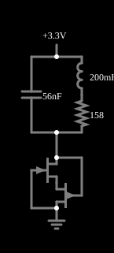

# Oscilador com diodo lambda

<!-- navegacao:inicio -->
[Índice](README.md) · [Anterior: Lambda Diode](lambda-diode.md)
<!-- navegacao:fim -->

## Objetivo

Mostrar um **oscilador de resistência negativa**: a região descendente do diodo lambda compensa as perdas de um circuito ressonante LC e faz a oscilação se manter sozinha.

## O circuito

<!-- esquema:inicio -->

<!-- esquema:fim -->

Em paralelo com o diodo lambda (dois JFETs complementares, como no exemplo anterior) há um capacitor de $56\ \text{nF}$ e um indutor de $200\ \text{mH}$ com resistência série de $158\ \Omega$. A polarização do diodo é dada por uma fonte com cursor (*Voltage*), ajustável de $2\ \text{V}$ a $4\ \text{V}$ e ajustada em $3{,}28\ \text{V}$. Três osciloscópios mostram o capacitor, o indutor e o diodo.

<!-- componentes:inicio -->
| N.º | Tipo | Elemento | Valores |
|----:|------|----------|---------|
| 0 | `NJfetElm` | JFET | Model = default-jfet; Swap D/S = não |
| 3 | `GroundElm` | ground | Symbol = Earth |
| 4 | `ResistorElm` | resistor | Resistance (ohms) = 158 |
| 5 | `InductorElm` | inductor | Inductance (H) = 200m; Trapezoidal Approximation = sim; Initial Current (on Reset) (A) = 0; Saturation Current (A) (0=none) = 0 |
| 6 | `CapacitorElm` | capacitor | Capacitance (F) = 56n; Trapezoidal Approximation = sim; Initial Voltage (on Reset) = 1m; Series Resistance = 0 |
| 12 | `VarRailElm` | voltage source | Min Voltage = 2; Max Voltage = 4; Slider Text = Voltage |
| 13 | `PJfetElm` | JFET | Model = default-jfet; Swap D/S = não |
<!-- componentes:fim -->

## Símbolos e parâmetros

Os símbolos usados neste documento (definições completas no [glossário](../glossario-simbolos.md)):

| Símbolo | Nome | Significado | Unidade |
|---------|------|-------------|---------|
| $L$ | indutância | quanto fluxo magnético uma bobina cria por ampère | H |
| $C$ | capacitância | quanta carga um capacitor guarda por volt aplicado | F |
| $f_0$ | frequência de ressonância | frequência em que o circuito responde ao máximo | Hz |

## Teoria

Um circuito LC com perdas tem oscilação que se amortece: a resistência dissipa energia. Um elemento de resistência diferencial negativa, que entrega energia quando polarizado na região descendente da curva, repõe essa energia. A oscilação começa quando a condutância negativa do diodo supera a condutância de perdas do circuito e cresce até a amplitude em que os trechos de resistência positiva e negativa da curva do diodo, ao longo do ciclo, se equilibram.

Para pequenas oscilações o circuito ressoa em $f_0 = 1/(2\pi\sqrt{LC}) = 1/(2\pi\sqrt{0{,}2\ \text{H}\cdot 56\ \text{nF}}) = 1{,}50\ \text{kHz}$.

## Resultados esperados

O simulador dá, em regime permanente:

- **Frequência da oscilação** (tensão no capacitor): $899{,}6\ \text{Hz}$.
- **Amplitude:** a tensão no capacitor oscila de $-3{,}63\ \text{V}$ a $+4{,}73\ \text{V}$ (valor médio de $-0{,}26\ \text{V}$), uma oscilação estável, igual em janelas de tempo diferentes.
- **Corrente no indutor:** de $-3{,}67\ \text{mA}$ a $+2{,}15\ \text{mA}$.

## O que observar

A frequência medida ($900\ \text{Hz}$) é bem menor que a de pequenos sinais ($1{,}50\ \text{kHz}$): a amplitude da oscilação é tão grande que o diodo passa pelas regiões ôhmica, de saturação e de corte em cada ciclo, e a oscilação não é senoidal. Experimente mover o cursor de polarização, entre $2$ e $4\ \text{V}$: ele desloca o ponto de operação do diodo na curva.

## Limites do modelo

- O valor de $900\ \text{Hz}$ não foi derivado: a explicação acima (grande sinal, forma de onda não senoidal) é qualitativa e este projeto não a verificou por cálculo.
- O diodo lambda é ideal, sem capacitâncias; um circuito real teria capacitâncias do JFET em paralelo com o tanque.

## Referências

Sedra e Smith, *Microeletrônica*, capítulo sobre transistores de efeito de campo (JFET); Horowitz e Hill, *The Art of Electronics*, capítulo sobre transistores de efeito de campo.

O circuito deste exemplo faz parte da coleção do simulador original de Paul Falstad e Iain Sharp (CircuitJS1); a explicação é deste projeto.
