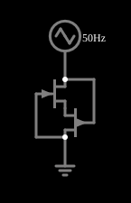

# Diodo lambda

<!-- navegacao:inicio -->
[Índice](README.md) · [Anterior: Volume Control](volume.md) · [Próximo: Lambda Diode Oscillator](lambda-diode-osc.md)
<!-- navegacao:fim -->

## Objetivo

Mostrar o **diodo lambda**, feito com dois JFETs complementares: sua curva $I$–$V$ tem a forma da letra grega $\lambda$, com uma região de **resistência negativa** em que a corrente diminui quando a tensão aumenta.

## O circuito

<!-- esquema:inicio -->

<!-- esquema:fim -->

Uma onda triangular de $0$ a $10\ \text{V}$ e $50\ \text{Hz}$ alimenta a associação em série de um JFET de canal N e um de canal P. O gatilho do JFET N está ligado à terra (ao outro extremo da associação) e o do JFET P está ligado à alimentação. O osciloscópio desenha a corrente em função da tensão aplicada.

<!-- componentes:inicio -->
| N.º | Tipo | Elemento | Valores |
|----:|------|----------|---------|
| 0 | `RailElm` | triangle gen | Max Voltage = 5; Waveform = Triangle; DC Offset (V) = 5; Internal Resistance (ohms) = 0; Show Voltage = não; Frequency (Hz) = 50; Phase Offset (degrees) = 0 |
| 1 | `GroundElm` | ground | Symbol = Earth |
| 2 | `NJfetElm` | JFET | Model = default-jfet; Swap D/S = não |
| 3 | `PJfetElm` | JFET | Model = default-jfet; Swap D/S = não |
<!-- componentes:fim -->

## Teoria

O JFET de canal N do simulador (modelo *default-jfet*) tem tensão de corte $V_T = -4\ \text{V}$ e $\beta = 1{,}25\ \text{mA/V}^2$, sem modulação de canal ($\lambda = 0$). Em saturação,

$$I_D = \frac{\beta}{2}\thinspace(V_{GS} - V_T)^2 = I_{DSS}\left(1 - \frac{V_{GS}}{V_T}\right)^2,\qquad I_{DSS} = \frac{\beta}{2}V_T^2 = 10\ \text{mA},$$

e, na região ôhmica ($V_{DS} < V_{GS} - V_T$), $I_D = \beta\bigl[(V_{GS}-V_T)V_{DS} - V_{DS}^2/2\bigr]$.

Na associação, a tensão $V$ se divide entre os dois JFETs e cada um tem $|V_{GS}| = V/2$ em saturação. Para $V \ge 4\ \text{V}$ (os dois em saturação),

$$I = I_{DSS}\left(1 - \frac{V}{2|V_T|}\right)^2 = 10\ \text{mA}\left(1 - \frac{V}{8\ \text{V}}\right)^2,$$

que decresce até zero em $V = 8\ \text{V}$: é a região de resistência negativa. Para $V$ pequeno os dois estão na região ôhmica e a associação é um resistor de condutância $\beta |V_T|/2 = 2{,}5\ \text{mS}$, de modo que a corrente sobe linearmente. O pico fica entre os dois comportamentos.

## Resultados esperados

O simulador dá a corrente em função da tensão aplicada:

| $V$ | $I$ simulada | $I$ teórica |
|---:|---:|---:|
| $0{,}1\ \text{V}$ | $0{,}233\ \text{mA}$ | $2{,}5\ \text{mS}\cdot V = 0{,}24\ \text{mA}$ |
| $3{,}0\ \text{V}$ (pico) | $3{,}283\ \text{mA}$ | |
| $4{,}0\ \text{V}$ | $2{,}506\ \text{mA}$ | $2{,}50\ \text{mA}$ |
| $5{,}0\ \text{V}$ | $1{,}411\ \text{mA}$ | $1{,}41\ \text{mA}$ |
| $6{,}0\ \text{V}$ | $0{,}628\ \text{mA}$ | $0{,}63\ \text{mA}$ |
| $\ge 8\ \text{V}$ | $0$ | $0$ |

A corrente máxima, $3{,}3\ \text{mA}$, ocorre em cerca de $3\ \text{V}$.

## O que observar

No osciloscópio, a curva $I$–$V$ sobe, passa por um máximo e cai a zero: com a triangular a corrente faz o caminho de ida e de volta. A região descendente, com inclinação negativa, é o que permite usar o diodo lambda em osciladores, como no exemplo seguinte.

## Limites do modelo

- A teoria acima usa o modelo quadrático sem modulação de canal; para $V < 4\ \text{V}$ ela só dá o comportamento assintótico, e o pico foi tomado do simulador.
- O diodo lambda é uma curiosidade: no mercado, o diodo túnel e o diodo Gunn cumprem a mesma função de resistência negativa.

## Referências

Sedra e Smith, *Microeletrônica*, capítulo sobre transistores de efeito de campo (JFET); Horowitz e Hill, *The Art of Electronics*, capítulo sobre transistores de efeito de campo.

O circuito deste exemplo faz parte da coleção do simulador original de Paul Falstad e Iain Sharp (CircuitJS1); a explicação é deste projeto.
