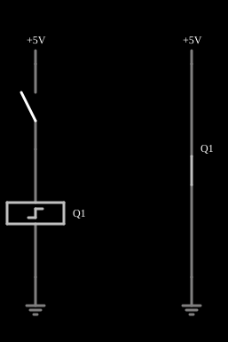

# Relé de travamento

<!-- navegacao:inicio -->
[Índice](README.md) · [Anterior: 3-Phase Motor](3motor.md) · [Próximo: Gyrator](gyratorelm.md)
<!-- navegacao:fim -->

## Objetivo

Mostrar um **relé de travamento** (*latching*): um relé que guarda a posição do contato sem corrente na bobina, e que troca de posição a cada pulso de corrente. Funciona como uma memória de 1 bit, um *flip-flop* eletromecânico.

## O circuito

<!-- esquema:inicio -->

<!-- esquema:fim -->

Uma fonte de $5\ \text{V}$ alimenta, por um botão momentâneo, a bobina do relé ($200\ \text{mH}$, $20\ \Omega$, corrente de acionamento de $20\ \text{mA}$ e de desligamento de $15\ \text{mA}$, tempo de comutação de $5\ \text{ms}$). O contato do relé, etiquetado *Q1* como a bobina, liga uma segunda fonte de $5\ \text{V}$ diretamente à terra, só através da resistência do contato fechado ($50\ \text{m}\Omega$): a corrente nessa fonte, de $100\ \text{A}$ com o contato fechado, indica a posição dele.

<!-- componentes:inicio -->
| N.º | Tipo | Elemento | Valores |
|----:|------|----------|---------|
| 0 | `RelayCoilElm` | relay (on) | Type = Latching; Inductance (H) = 200m; On Current (A) = 20m; Off Current (A) = 15m; Coil Resistance (ohms) = 20; Switching Time (s) = 5m; Label (for linking) = Q1 |
| 1 | `SwitchElm` | switch (SPST) | Momentary Switch = sim; IEC Symbol = não; Label (for linking) = ; Keyboard Shortcut = ; On Resistance (ohms) = 0 |
| 2 | `RailElm` | voltage source | Voltage = 5; Waveform = D/C; DC Offset (V) = 0; Internal Resistance (ohms) = 0 |
| 3 | `GroundElm` | ground | Symbol = Earth |
| 4 | `RailElm` | voltage source | Voltage = 5; Waveform = D/C; DC Offset (V) = 0; Internal Resistance (ohms) = 0 |
| 5 | `RelayContactElm` | relay (off) | On Resistance (ohms) = 50m; Off Resistance (ohms) = 1M; Label (for linking) = Q1; Normally Closed = não; IEC Symbol = sim |
| 6 | `GroundElm` | ground | Symbol = Earth |
<!-- componentes:fim -->

## Símbolos e parâmetros

Os símbolos usados neste documento (definições completas no [glossário](../glossario-simbolos.md)):

| Símbolo | Nome | Significado | Unidade |
|---------|------|-------------|---------|
| $L$ | indutância | quanto fluxo magnético uma bobina cria por ampère | H |
| $R$ | resistência | oposição de um resistor à passagem da corrente ($V = R I$) | Ω |
| $V$ | tensão | diferença de potencial elétrico entre dois pontos do circuito | V |
| $R_{\text{contato}}$ | resistência de contato | resistência do contato fechado | Ω |

## Teoria

A bobina é um indutor com resistência: ao se fechar o botão, a corrente sobe com a constante de tempo $L/R = 200\ \text{mH}/20\ \Omega = 10\ \text{ms}$ até $5\ \text{V}/20\ \Omega = 250\ \text{mA}$. Quando a corrente média passa de $20\ \text{mA}$ por mais de $5\ \text{ms}$, o relé de travamento **inverte** a posição do contato, e a mantém quando o botão é solto: a corrente cai abaixo de $15\ \text{mA}$ e o relé fica pronto para o pulso seguinte, sem voltar ao estado anterior. Cada pulso, portanto, alterna o contato: aberto, fechado, aberto...

Com o contato fechado a corrente é $V/R_{contato} = 5\ \text{V}/50\ \text{m}\Omega = 100\ \text{A}$.

## Resultados esperados

O simulador dá, com um passo de $5\ \text{ms}$:

- **Início:** o contato está fechado, com $100\ \text{A}$ na fonte.
- **Um pulso no botão** (apertar em $0{,}1\ \text{s}$, soltar em $0{,}2\ \text{s}$): o contato abre e a corrente da fonte cai a zero (poucos $\mu\text{A}$), e continua zero depois que o botão é solto, o relé guardou a posição. A corrente na bobina durante o pulso é de $246\ \text{mA}$.
- **Segundo pulso** (apertar em $0{,}3\ \text{s}$, soltar em $0{,}4\ \text{s}$): o contato fecha de novo e a corrente volta a $100\ \text{A}$.

## O que observar

Aperte o botão uma vez e observe o contato abrir e permanecer aberto; aperte de novo e ele fecha. Para um relé comum (sem travamento) o contato voltaria à posição inicial ao soltar o botão.

## Limites do modelo

- O contato fechado liga uma fonte ideal à terra por só $50\ \text{m}\Omega$, um curto-circuito de demonstração; numa instalação real haveria uma carga e um fusível.
- O relé não modela a mecânica do contato (rebote, tempo de queda); só o tempo de comutação de $5\ \text{ms}$.
- O passo de simulação de $5\ \text{ms}$ é o do exemplo; os tempos de comutação do relé são do mesmo tamanho do passo.

## Referências

Horowitz e Hill, *The Art of Electronics*, seção sobre relés; folhas de dados de relés de travamento (*latching relays*) de fabricantes.

O circuito deste exemplo faz parte da coleção do simulador original de Paul Falstad e Iain Sharp (CircuitJS1); a explicação é deste projeto.
