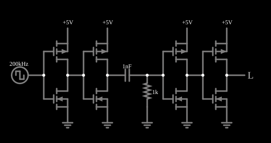

# Detector de borda de subida

<!-- navegacao:inicio -->
[Índice](README.md) · [Anterior: Delayed Buffer](delayrc.md) · [Próximo: Switchable Filter](switchfilter.md)
<!-- navegacao:fim -->

## Objetivo

Mostrar um **detector de borda de subida**: um circuito digital que gera um pulso curto cada vez que o sinal de entrada sobe de nível baixo para alto, e nenhum pulso quando ele desce. A base é um **diferenciador** RC seguido de inversores que fazem a limiarização.

## O circuito

<!-- esquema:inicio -->

<!-- esquema:fim -->

Um gerador de onda quadrada de $200\ \text{kHz}$ (período de $5\ \mu\text{s}$, razão cíclica de $50\%$, de $0$ a $5\ \text{V}$) passa por dois [inversores CMOS](cmosinverter.md) (que fazem o papel de *buffers*), depois por um capacitor de $1\ \text{nF}$ em série com um resistor de $1\ \text{k}\Omega$ à terra (um filtro passa-altas, ou diferenciador, com $\tau = RC = 1\ \mu\text{s}$) e, por fim, por mais dois inversores, que levam a saída do diferenciador a níveis lógicos; a saída é uma saída lógica. Dois osciloscópios mostram a entrada e a saída.

<!-- componentes:inicio -->
| N.º | Tipo | Elemento | Valores |
|----:|------|----------|---------|
| 0 | `PMosfetElm` | MOSFET | Model = default-nodiode; Swap D/S = não |
| 1 | `NMosfetElm` | MOSFET | Model = default-nodiode; Swap D/S = não |
| 4 | `RailElm` | voltage source | Voltage = 5; Waveform = D/C; DC Offset (V) = 0; Internal Resistance (ohms) = 0 |
| 5 | `GroundElm` | ground | Symbol = Earth |
| 6 | `GroundElm` | ground | Symbol = Earth |
| 10 | `PMosfetElm` | MOSFET | Model = default-nodiode; Swap D/S = não |
| 11 | `NMosfetElm` | MOSFET | Model = default-nodiode; Swap D/S = não |
| 14 | `GroundElm` | ground | Symbol = Earth |
| 15 | `RailElm` | voltage source | Voltage = 5; Waveform = D/C; DC Offset (V) = 0; Internal Resistance (ohms) = 0 |
| 16 | `CapacitorElm` | capacitor | Capacitance (F) = 1n; Trapezoidal Approximation = sim; Initial Voltage (on Reset) = 1m; Series Resistance = 0 |
| 17 | `ResistorElm` | resistor | Resistance (ohms) = 1k |
| 23 | `NMosfetElm` | MOSFET | Model = default-nodiode; Swap D/S = não |
| 24 | `PMosfetElm` | MOSFET | Model = default-nodiode; Swap D/S = não |
| 27 | `RailElm` | voltage source | Voltage = 5; Waveform = D/C; DC Offset (V) = 0; Internal Resistance (ohms) = 0 |
| 28 | `GroundElm` | ground | Symbol = Earth |
| 32 | `NMosfetElm` | MOSFET | Model = default-nodiode; Swap D/S = não |
| 33 | `PMosfetElm` | MOSFET | Model = default-nodiode; Swap D/S = não |
| 36 | `GroundElm` | ground | Symbol = Earth |
| 37 | `RailElm` | voltage source | Voltage = 5; Waveform = D/C; DC Offset (V) = 0; Internal Resistance (ohms) = 0 |
| 38 | `LogicOutputElm` | logic output | Threshold = 2.5; Current Required = não; Numeric = não; Ternary = não |
| 39 | `RailElm` | square wave gen | Max Voltage = 2.5; Waveform = Square Wave; DC Offset (V) = 2.5; Internal Resistance (ohms) = 0; Show Voltage = não; Specify As = Frequency/Duty Cycle; Frequency (Hz) = 200k; Phase Offset (degrees) = 0; Duty Cycle = 50; Rise/Fall Time (s) = 0 |
<!-- componentes:fim -->

## Teoria

O capacitor em série com o resistor transmite as **variações** de tensão. Numa borda de subida de $0$ a $V_{DD}$, o nó entre eles pula para $\approx V_{DD}$ e decai com $\tau = RC$:

$$v(t) = V_p\,e^{-t/\tau}, \qquad V_p \le V_{DD};$$

numa borda de descida, o nó pula para $-V_p$ e decai a zero. O inversor seguinte tem limiar $V_{th} = 2{,}5\ \text{V}$: a saída fica em nível lógico "alto" enquanto $v > V_{th}$, isto é, durante

$$t_w = \tau\,\ln\frac{V_p}{V_{th}}.$$

Na borda de descida o nó vai a $-V_p$, abaixo do limiar, e não há pulso: o circuito responde só à borda de subida. A largura do pulso, $t_w$, é ajustada por $\tau$ e deve ser menor que a metade do período para os pulsos se separarem.

## Resultados esperados

Nas bordas de subida da entrada ($20{,}006$ e $25{,}006\ \mu\text{s}$) a tensão no resistor salta a $V_p = 4{,}535\ \text{V}$ (um pouco menos de $5\ \text{V}$, pela resistência de ligado dos inversores e pela duração finita da borda) e decai; ela cruza $2{,}5\ \text{V}$ em $20{,}612\ \mu\text{s}$, $0{,}611\ \mu\text{s}$ depois do pico. A fórmula com $V_p = 4{,}535\ \text{V}$ dá $t_w = 1{,}025\ \mu\text{s} \cdot \ln(4{,}535/2{,}5) = 0{,}611\ \mu\text{s}$ (com $\tau_{ef} = 1{,}025\ \mu\text{s}$, quase o valor de $RC$). A saída sobe nesse instante e desce em $20{,}614\ \mu\text{s}$: um pulso de $0{,}608\ \mu\text{s}$ (a largura prevista para $V_p = 5\ \text{V}$ seria $0{,}69\ \mu\text{s}$). Nas bordas de descida ($22{,}506$ e $27{,}506\ \mu\text{s}$) o nó pula a $-4{,}534\ \text{V}$ e a saída permanece em zero. A média da saída é $0{,}606\ \text{V}$, de $5\ \text{V}$ vezes a razão cíclica de $0{,}608/5 = 12{,}2\%$. As verificações conferem a saída em quatro instantes (dentro do pulso, depois dele, depois da borda de descida e no pulso seguinte), os dois picos do diferenciador e a média e o máximo da saída (tolerância de $0{,}1\%$ a $1\%$).

## O que observar

Nos osciloscópios, a entrada é uma onda quadrada e a saída, uma sequência de pulsos estreitos que começam em cada borda de subida. Para testar: aumente o capacitor para $2{,}2\ \text{nF}$ e veja o pulso alargar ($t_w \propto RC$); reduza-o para $0{,}1\ \text{nF}$ e veja o pulso estreitar.

## Limites do modelo

- O pico $V_p$ de $4{,}535\ \text{V}$ e a largura do pulso ($0{,}61\ \mu\text{s}$ em vez dos $0{,}69\ \mu\text{s}$ ideais) vêm do simulador; este documento não deduz por que o pico fica $9\%$ abaixo de $V_{DD}$.
- Os inversores têm limiar ideal e atraso próprio nulo; num circuito real, o limiar varia e o pulso pode ser mais curto, ou desaparecer, com $V_p$ pequeno.
- Os pulsos de uma borda e da seguinte só são distintos porque $t_w \ll T/2$.

## Referências

Sedra e Smith, *Microelectronic Circuits*, capítulos sobre o MOSFET, a lógica CMOS e os circuitos de capacitor chaveado; Weste e Harris, *CMOS VLSI Design*.

O circuito deste exemplo faz parte da coleção do simulador original de Paul Falstad e Iain Sharp (CircuitJS1); a explicação é deste projeto.
