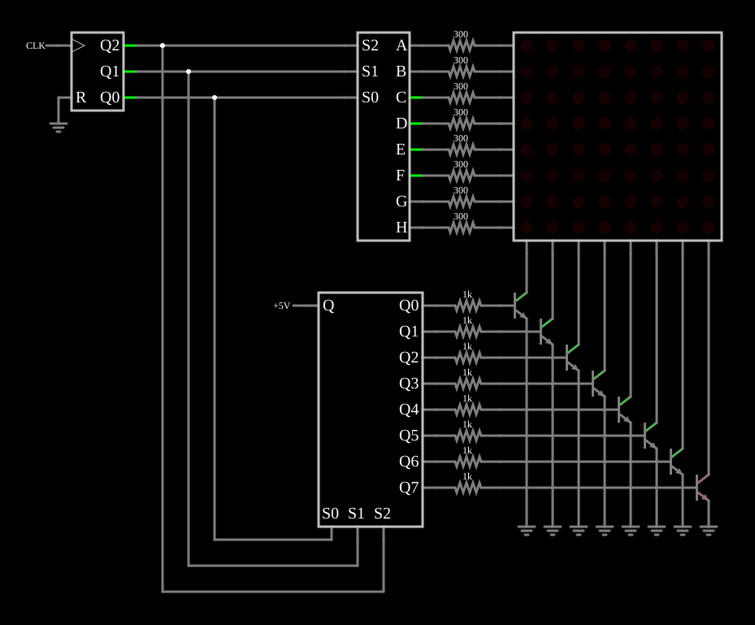

# Matriz de LEDs 8×8 com varredura

<!-- navegacao:inicio -->
[Índice](README.md) · [Próximo: DIAC/TRIAC Dimmer](triacdimmer.md)
<!-- navegacao:fim -->

## Objetivo

Mostrar a **multiplexação** de uma matriz de LEDs: em vez de 64 fios independentes, um contador, um demultiplexador e um gerador de padrão acendem uma linha de cada vez, tão depressa que o olho vê a imagem inteira.

## O circuito

<!-- esquema:inicio -->

<!-- esquema:fim -->

Um relógio de $500\ \text{Hz}$ alimenta um contador de 3 bits. O contador endereça um demultiplexador de 3 bits que ativa, uma por vez, uma das oito linhas da matriz através de um transistor NPN ($\beta = 100$, base com $1\ \text{k}\Omega$). O mesmo contador endereça um gerador de padrão (*smiley generator*, uma lógica personalizada) que dá os 8 bits das colunas daquela linha, cada coluna ligada à matriz por um resistor de $300\ \Omega$. A matriz de LEDs tem $8\times 8$ pontos.

O gerador guarda oito palavras de 8 bits, uma para cada valor do contador:

```
00111100   ..####..
01000010   .#....#.
10101001   #.#.#..#
10000101   #....#.#
10000101   #....#.#
10101001   #.#.#..#
01000010   .#....#.
00111100   ..####..
```

<!-- componentes:inicio -->
| N.º | Tipo | Elemento | Valores |
|----:|------|----------|---------|
| 0 | `ResistorElm` | resistor | Resistance (ohms) = 300 |
| 1 | `NTransistorElm` | transistor | Beta/hFE = 100; Swap E/C = não; Draw Circle = não; Model = default |
| 2 | `NTransistorElm` | transistor | Beta/hFE = 100; Swap E/C = não; Draw Circle = não; Model = default |
| 3 | `NTransistorElm` | transistor | Beta/hFE = 100; Swap E/C = não; Draw Circle = não; Model = default |
| 4 | `NTransistorElm` | transistor | Beta/hFE = 100; Swap E/C = não; Draw Circle = não; Model = default |
| 5 | `NTransistorElm` | transistor | Beta/hFE = 100; Swap E/C = não; Draw Circle = não; Model = default |
| 6 | `NTransistorElm` | transistor | Beta/hFE = 100; Swap E/C = não; Draw Circle = não; Model = default |
| 7 | `NTransistorElm` | transistor | Beta/hFE = 100; Swap E/C = não; Draw Circle = não; Model = default |
| 14 | `NTransistorElm` | transistor | Beta/hFE = 100; Swap E/C = não; Draw Circle = não; Model = default |
| 16 | `GroundElm` | ground | Symbol = Earth |
| 17 | `GroundElm` | ground | Symbol = Earth |
| 18 | `GroundElm` | ground | Symbol = Earth |
| 19 | `GroundElm` | ground | Symbol = Earth |
| 20 | `GroundElm` | ground | Symbol = Earth |
| 21 | `GroundElm` | ground | Symbol = Earth |
| 22 | `GroundElm` | ground | Symbol = Earth |
| 23 | `GroundElm` | ground | Symbol = Earth |
| 24 | `ResistorElm` | resistor | Resistance (ohms) = 1k |
| 25 | `ResistorElm` | resistor | Resistance (ohms) = 1k |
| 26 | `ResistorElm` | resistor | Resistance (ohms) = 1k |
| 27 | `ResistorElm` | resistor | Resistance (ohms) = 1k |
| 28 | `ResistorElm` | resistor | Resistance (ohms) = 1k |
| 29 | `ResistorElm` | resistor | Resistance (ohms) = 1k |
| 30 | `ResistorElm` | resistor | Resistance (ohms) = 1k |
| 31 | `ResistorElm` | resistor | Resistance (ohms) = 1k |
| 32 | `DeMultiplexerElm` | Demultiplexer | High Logic Voltage = 5; # of Select Bits = 3; Output Mode = Individual Outputs; Bus Select = não; Keep Inactive Outputs High (74139) = não |
| 33 | `RailElm` | voltage source | Voltage = 5; Waveform = D/C; DC Offset (V) = 0; Internal Resistance (ohms) = 0 |
| 34 | `CounterElm` | Counter | High Logic Voltage = 5; Bit Order = MSB First; Invert reset pin = não; # of Bits = 3; Modulus = 0; Up/Down Pin = não; Negative Edge Triggered = não |
| 37 | `RailElm` | square wave gen | Max Voltage = 2.5; Waveform = Square Wave; DC Offset (V) = 2.5; Internal Resistance (ohms) = 0; Show Voltage = não; Specify As = Frequency/Duty Cycle; Frequency (Hz) = 500; Phase Offset (degrees) = 0; Duty Cycle = 50; Rise/Fall Time (s) = 0 |
| 38 | `GroundElm` | ground | Symbol = Earth |
| 39 | `CustomLogicElm` | smiley generator | High Logic Voltage = 5; Model Name = smiley; Inputs = S2,S1,S0; Outputs = A,B,C,D,E,F,G,H; Info Text = smiley generator; Definition = 000=00111100 001=01000010 010=10101001 011=10000101 100=1000 |
| 52 | `LEDArrayElm` | LED array | Grid Width = 8; Grid Height = 8 |
| 53 | `ResistorElm` | resistor | Resistance (ohms) = 300 |
| 54 | `ResistorElm` | resistor | Resistance (ohms) = 300 |
| 55 | `ResistorElm` | resistor | Resistance (ohms) = 300 |
| 56 | `ResistorElm` | resistor | Resistance (ohms) = 300 |
| 57 | `ResistorElm` | resistor | Resistance (ohms) = 300 |
| 58 | `ResistorElm` | resistor | Resistance (ohms) = 300 |
| 59 | `ResistorElm` | resistor | Resistance (ohms) = 300 |
<!-- componentes:fim -->

## Símbolos e parâmetros

Os símbolos usados neste documento (definições completas no [glossário](../glossario-simbolos.md)):

| Símbolo | Nome | Significado | Unidade |
|---------|------|-------------|---------|
| $N$ | número de LEDs acesos | quantidade de LEDs da matriz que estão acesos | — |
| $\beta$ | ganho de corrente | razão $I_C/I_B$ do transistor bipolar | — |

## Teoria

A **multiplexação por varredura** liga as $N$ linhas de uma matriz uma de cada vez, em ciclo, e só o ponto onde a linha e a coluna ligadas se cruzam acende. Se o ciclo completo se repete mais depressa que cerca de $50\ \text{Hz}$, o olho funde os quadros e vê a imagem inteira, com brilho médio igual a $1/N$ do brilho instantâneo.

Aqui o contador divide o relógio de $500\ \text{Hz}$ por 2, 4 e 8 nos três bits: $250$, $125$ e $62{,}5\ \text{Hz}$. Uma varredura completa das 8 linhas leva $8/500\ \text{Hz} = 16\ \text{ms}$, o que dá $62{,}5$ quadros por segundo, acima do limiar de cintilação. Cada linha fica acesa $1/8$ do tempo.

## Resultados esperados

O simulador dá:

- **Relógio:** $500\ \text{Hz}$.
- **Bits do contador:** $250\ \text{Hz}$ (bit 0), $125\ \text{Hz}$ (bit 1) e $62{,}5\ \text{Hz}$ (bit 2), o que dá uma varredura completa a cada $16\ \text{ms}$.
- **LEDs acesos:** a tensão sobre um LED aceso é de cerca de $1{,}79\ \text{V}$ e as linhas não selecionadas ficam em $0\ \text{V}$.

## O que observar

Observe, com a simulação parada num instante, que só uma linha da matriz está acesa; com a simulação em marcha, o desenho de rosto aparece inteiro. Reduza a frequência do relógio (por exemplo, para $5\ \text{Hz}$) e veja as linhas acendendo uma a uma.

## Limites do modelo

- O olho humano não é simulado: a persistência da visão é um fenômeno da percepção, não do circuito.
- Os LEDs são modelados por uma tensão direta fixa de cerca de $1{,}8\ \text{V}$; não há curva I–V completa nem variação de brilho.
- A corrente de cada coluna é limitada só pelo resistor de $300\ \Omega$; em uma matriz real a corrente de pico por LED é maior que a média, e os transistores precisam suportá-la.

## Referências

Horowitz e Hill, *The Art of Electronics*, seção sobre multiplexação de mostradores; Floyd, *Digital Fundamentals*, capítulo sobre contadores e decodificadores.

O circuito deste exemplo faz parte da coleção do simulador original de Paul Falstad e Iain Sharp (CircuitJS1); a explicação é deste projeto.
