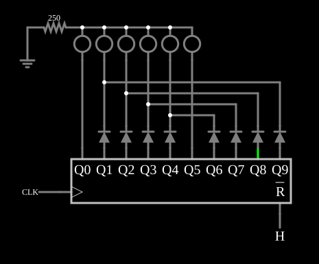

# Sequencial de LEDs (vai e volta)

<!-- navegacao:inicio -->
[Índice](README.md) · [Anterior: Divide-by-3](divideby3.md) · [Próximo: Traffic Light](traffic.md)
<!-- navegacao:fim -->

## Objetivo

Mostrar como um contador em anel de 10 saídas e alguns diodos fazem uma luz correr para um lado e voltar por seis LEDs, o efeito de "vai e volta".

## O circuito

<!-- esquema:inicio -->

<!-- esquema:fim -->

Um contador em anel de 10 saídas ($Q_0$ a $Q_9$) recebe um relógio de $1\ \text{kHz}$; uma entrada lógica (elemento 1) vai ao seu *reset*, ativo em nível baixo, e fica em $1$. Seis LEDs vermelhos têm os catodos ligados juntos a um resistor de $250\ \Omega$ para a terra. Os LEDs das pontas (elementos 4 e 20) são acionados diretamente por $Q_0$ e $Q_5$. Cada um dos outros quatro (elementos 7, 8, 9 e 10) é acionado por duas saídas através de dois diodos, que formam uma porta OU: $Q_1$ e $Q_9$, $Q_2$ e $Q_8$, $Q_3$ e $Q_7$, $Q_4$ e $Q_6$.

<!-- componentes:inicio -->
| N.º | Tipo | Elemento | Valores |
|----:|------|----------|---------|
| 0 | `RingCounterElm` | ring counter | High Logic Voltage = 5; Invert reset pin = sim; # of Bits = 10 |
| 1 | `LogicInputElm` | logic input | Momentary Switch = não; High Logic Voltage = 5; Low Voltage = 0; Numeric = não; Ternary = não; Keyboard Shortcut =  |
| 2 | `RailElm` | square wave gen | Max Voltage = 2.5; Waveform = Square Wave; DC Offset (V) = 2.5; Internal Resistance (ohms) = 0; Show Voltage = não; Specify As = Frequency/Duty Cycle; Frequency (Hz) = 1k; Phase Offset (degrees) = 0; Duty Cycle = 50; Rise/Fall Time (s) = 0 |
| 4 | `LEDElm` | LED | Red Value (0-1) = 1; Green Value (0-1) = 0; Blue Value (0-1) = 0; Max Brightness Current (A) = 10m; Model = 1N4004 (general purpose) |
| 5 | `ResistorElm` | resistor | Resistance (ohms) = 250 |
| 6 | `GroundElm` | ground | Symbol = Earth |
| 7 | `LEDElm` | LED | Red Value (0-1) = 1; Green Value (0-1) = 0; Blue Value (0-1) = 0; Max Brightness Current (A) = 10m; Model = 1N4004 (general purpose) |
| 8 | `LEDElm` | LED | Red Value (0-1) = 1; Green Value (0-1) = 0; Blue Value (0-1) = 0; Max Brightness Current (A) = 10m; Model = 1N4004 (general purpose) |
| 9 | `LEDElm` | LED | Red Value (0-1) = 1; Green Value (0-1) = 0; Blue Value (0-1) = 0; Max Brightness Current (A) = 10m; Model = 1N4004 (general purpose) |
| 10 | `LEDElm` | LED | Red Value (0-1) = 1; Green Value (0-1) = 0; Blue Value (0-1) = 0; Max Brightness Current (A) = 10m; Model = 1N4004 (general purpose) |
| 16 | `DiodeElm` | diode | Model = default |
| 17 | `DiodeElm` | diode | Model = default |
| 18 | `DiodeElm` | diode | Model = default |
| 19 | `DiodeElm` | diode | Model = default |
| 20 | `LEDElm` | LED | Red Value (0-1) = 1; Green Value (0-1) = 0; Blue Value (0-1) = 0; Max Brightness Current (A) = 10m; Model = 1N4004 (general purpose) |
| 22 | `DiodeElm` | diode | Model = default |
| 23 | `DiodeElm` | diode | Model = default |
| 24 | `DiodeElm` | diode | Model = default |
| 25 | `DiodeElm` | diode | Model = default |
<!-- componentes:fim -->

## Teoria

O contador em anel avança uma saída por período do relógio: $Q_0, Q_1, \dots, Q_9, Q_0, \dots$. Com o mapeamento acima, a luz acende as posições

$$1, 2, 3, 4, 5, 6, 5, 4, 3, 2, \ 1, 2, \dots$$

(numerando os LEDs da esquerda para a direita): seis posições na ida e quatro na volta, porque as pontas aparecem só uma vez por ciclo. O ciclo tem $10$ passos. Os diodos impedem que a saída alta de um par alimente a saída baixa do outro, isto é, fazem a porta OU sem curto-circuitar as saídas do contador.

A corrente do LED é a da saída de $5\ \text{V}$ menos a queda no LED (e no diodo, quando há um), dividida pelos $250\ \Omega$; os LEDs alimentados por diodo recebem um pouco menos de corrente.

## Resultados esperados

O simulador avança uma posição a cada $1\ \text{ms}$ e repete o ciclo a cada $10\ \text{ms}$. Um LED de ponta conduz $12{,}5\ \text{mA}$ (por exemplo, o elemento 4 em $1{,}2\ \text{ms}$ e o elemento 20 em $6{,}2\ \text{ms}$); um LED acionado através de diodo conduz $10{,}3\ \text{mA}$ (o elemento 7 em $0{,}2\ \text{ms}$, o elemento 8 em $9{,}2\ \text{ms}$, já na volta). Em cada instante só um LED está aceso.

## O que observar

Veja a luz ir até a ponta direita e voltar; repare na diferença de brilho entre os LEDs das pontas e os do meio, que recebem menos corrente.

## Limites do modelo

- Os LEDs usam o modelo do diodo 1N4004 com cor; a queda direta não é a de um LED vermelho real (cerca de $1{,}8$ a $2\ \text{V}$).
- O contador em anel aciona os LEDs diretamente; um CMOS real (como o 4017) limitaria a corrente de saída bem abaixo de $12\ \text{mA}$.

## Referências

Texas Instruments, folha de dados do CD4017B (contador de década com saídas decodificadas); Horowitz e Hill, *The Art of Electronics*, sobre portas OU com diodos.

O circuito deste exemplo faz parte da coleção do simulador original de Paul Falstad e Iain Sharp (CircuitJS1); a explicação é deste projeto.
