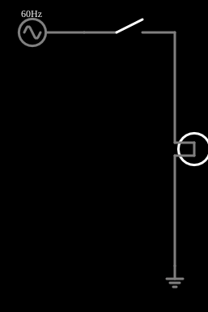

# Lâmpada incandescente

<!-- navegacao:inicio -->
[Índice](README.md) · [Próximo: Wien Bridge Oscillator](wienbridge.md)
<!-- navegacao:fim -->

## Objetivo

Mostrar que a **resistência de uma lâmpada incandescente depende da temperatura**: a lâmpada fria tem resistência muito menor que a quente, e por isso a corrente de partida é várias vezes a de regime.

## O circuito

<!-- esquema:inicio -->

<!-- esquema:fim -->

Uma lâmpada de $100\ \text{W}$ e $120\ \text{V}$ (tempos de aquecimento e resfriamento de $0{,}4\ \text{s}$) é ligada, por uma chave, a uma fonte senoidal de $169{,}7\ \text{V}$ de pico ($120\ \text{V}$ eficazes) e $60\ \text{Hz}$. A chave começa aberta. Três osciloscópios acompanham a lâmpada.

<!-- componentes:inicio -->
| N.º | Tipo | Elemento | Valores |
|----:|------|----------|---------|
| 0 | `LampElm` | lamp | Nominal Power = 100; Nominal Voltage = 120; Warmup Time (s) = 400m; Cooldown Time (s) = 400m |
| 1 | `RailElm` | A/C source | Max Voltage = 169.7; Waveform = A/C; DC Offset (V) = 0; Internal Resistance (ohms) = 0; Show Voltage = não; Frequency (Hz) = 60; Phase Offset (degrees) = 0 |
| 2 | `GroundElm` | ground | Symbol = Earth |
| 3 | `SwitchElm` | switch (SPST) | Momentary Switch = não; IEC Symbol = não; Label (for linking) = ; Keyboard Shortcut = ; On Resistance (ohms) = 0 |
<!-- componentes:fim -->

## Símbolos e parâmetros

Os símbolos usados neste documento (definições completas no [glossário](../glossario-simbolos.md)):

| Símbolo | Nome | Significado | Unidade |
|---------|------|-------------|---------|
| $t$ | tempo | instante, contado a partir do início da simulação | s |
| $R$ | resistência | oposição de um resistor à passagem da corrente ($V = R I$) | Ω |
| $P$ | potência | energia transformada por unidade de tempo | W |
| $V$ | tensão | diferença de potencial elétrico entre dois pontos do circuito | V |
| $T$ | temperatura do filamento | temperatura do filamento da lâmpada | K |
| $R_{\text{nom}}$ | resistência nominal | resistência do filamento na temperatura de operação | Ω |
| $V_n$ | tensão nominal | tensão para a qual a lâmpada é especificada | V |
| $P_n$ | potência nominal | potência da lâmpada na tensão nominal | W |
| $C_{\text{th}}$ | capacitância térmica | calor necessário para elevar a temperatura do filamento de um grau | J/K |
| $P_{\text{el}}$ | potência elétrica | potência elétrica entregue ao filamento | W |
| $P_{\text{perda}}$ | potência perdida | potência dissipada como calor na linha | W |
| $I_{\text{ef}}$ | corrente eficaz | valor eficaz da corrente | A |

## Teoria

A resistência de um filamento de tungstênio cresce com a temperatura: o simulador usa uma relação empírica $R(T)$ em que $R_{nom} = V_n^2/P_n = 144\ \Omega$ é o valor na temperatura de operação. A temperatura do filamento obedece ao balanço de energia

$$C_{th}\thinspace\frac{dT}{dt} = P_{el} - P_{perda}(T),$$

com tempos característicos de aquecimento e resfriamento de $0{,}4\ \text{s}$. Ao ligar, $T = 300\ \text{K}$ e a resistência é baixa; a corrente é alta e aquece o filamento, o que aumenta a resistência e faz a corrente cair até o regime, em que $P = 100\ \text{W}$ e

$$I_{ef} = \frac{P}{V} = \frac{100\ \text{W}}{120\ \text{V}} = 0{,}833\ \text{A}.$$

## Resultados esperados

O simulador dá, com a chave fechada em $t = 0$ (corrente de pico por ciclo):

| Instante | Corrente de pico |
|---|---:|
| primeiro ciclo ($0$ a $16{,}7\ \text{ms}$) | $6{,}96\ \text{A}$ |
| $0{,}1\ \text{s}$ | $1{,}59\ \text{A}$ |
| $0{,}3\ \text{s}$ | $1{,}30\ \text{A}$ |
| $1\ \text{s}$ | $1{,}19\ \text{A}$ |
| $3\ \text{s}$ (regime) | $1{,}177\ \text{A}$ |

No regime, o valor eficaz da corrente é de $0{,}832\ \text{A}$ (teoria: $0{,}833\ \text{A}$) e o da tensão, $120{,}0\ \text{V}$. A corrente de partida é $5{,}9$ vezes a de regime ($1{,}177\ \text{A}$ de pico): a resistência fria é de cerca de $24\ \Omega$, contra $144\ \Omega$ quente.

## O que observar

Feche a chave e veja a corrente começar alta e cair em uns poucos décimos de segundo. É por isso que as lâmpadas incandescentes queimam, em geral, no instante em que são ligadas: a corrente de partida, a filamento frio, é a de maior estresse.

## Limites do modelo

- A relação $R(T)$ é uma aproximação empírica; ela dá uma razão de $5{,}9$ entre a resistência quente e a fria no simulador, menor que as razões de $10$ ou mais de uma lâmpada real.
- A lâmpada é modelada como um resistor dependente da temperatura, sem a luz emitida.

## Referências

Incropera e DeWitt, *Fundamentals of Heat and Mass Transfer* (resistividade do tungstênio); Horowitz e Hill, *The Art of Electronics*, seção sobre lâmpadas incandescentes.

O circuito deste exemplo faz parte da coleção do simulador original de Paul Falstad e Iain Sharp (CircuitJS1); a explicação é deste projeto.
