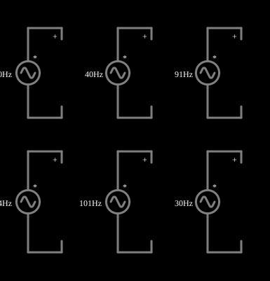

# Figuras de Lissajous

<!-- navegacao:inicio -->
[Índice](README.md) · [Próximo: Checkerboard](plot2d-checker.md)
<!-- navegacao:fim -->

## Objetivo

Mostrar o osciloscópio no **modo X–Y**: em vez de desenhar cada tensão contra o tempo, ele desenha uma tensão contra a outra. Com duas senoides de frequências quase iguais, o desenho é uma **figura de Lissajous**. É uma demonstração: o que importa é a figura que o osciloscópio desenha, e não um valor num componente.

## O circuito

<!-- esquema:inicio -->

<!-- esquema:fim -->

Seis fontes senoidais de $5\ \text{V}$ de pico formam três pares. Em cada par, um voltímetro mede cada fonte e um osciloscópio X–Y desenha a tensão de uma contra a da outra:

| Par | Eixo X | Eixo Y | Razão |
|:---:|---:|---:|---:|
| 1 | $100\ \text{Hz}$ | $104\ \text{Hz}$ | $25:26$ |
| 2 | $40\ \text{Hz}$ | $101\ \text{Hz}$ | $40:101$ |
| 3 | $91\ \text{Hz}$ | $30\ \text{Hz}$ | $91:30$ |

<!-- componentes:inicio -->
| N.º | Tipo | Elemento | Valores |
|----:|------|----------|---------|
| 0 | `VoltageElm` | A/C source | Max Voltage = 5; Waveform = A/C; DC Offset (V) = 0; Internal Resistance (ohms) = 0; Show Voltage = não; Frequency (Hz) = 100; Phase Offset (degrees) = 0 |
| 1 | `VoltageElm` | A/C source | Max Voltage = 5; Waveform = A/C; DC Offset (V) = 0; Internal Resistance (ohms) = 0; Show Voltage = não; Frequency (Hz) = 104; Phase Offset (degrees) = 0 |
| 6 | `ProbeElm` | voltmeter | Show Voltage = não; Value = Voltage; Scale = Auto; Use Circle Symbol = não; Series Resistance (0 = infinite) = 0 |
| 7 | `ProbeElm` | voltmeter | Show Voltage = não; Value = Voltage; Scale = Auto; Use Circle Symbol = não; Series Resistance (0 = infinite) = 0 |
| 8 | `VoltageElm` | A/C source | Max Voltage = 5; Waveform = A/C; DC Offset (V) = 0; Internal Resistance (ohms) = 0; Show Voltage = não; Frequency (Hz) = 40; Phase Offset (degrees) = 0 |
| 9 | `VoltageElm` | A/C source | Max Voltage = 5; Waveform = A/C; DC Offset (V) = 0; Internal Resistance (ohms) = 0; Show Voltage = não; Frequency (Hz) = 101; Phase Offset (degrees) = 0 |
| 18 | `VoltageElm` | A/C source | Max Voltage = 5; Waveform = A/C; DC Offset (V) = 0; Internal Resistance (ohms) = 0; Show Voltage = não; Frequency (Hz) = 91; Phase Offset (degrees) = 0 |
| 19 | `VoltageElm` | A/C source | Max Voltage = 5; Waveform = A/C; DC Offset (V) = 0; Internal Resistance (ohms) = 0; Show Voltage = não; Frequency (Hz) = 30; Phase Offset (degrees) = 0 |
| 20 | `ProbeElm` | voltmeter | Show Voltage = não; Value = Voltage; Scale = Auto; Use Circle Symbol = não; Series Resistance (0 = infinite) = 0 |
| 21 | `ProbeElm` | voltmeter | Show Voltage = não; Value = Voltage; Scale = Auto; Use Circle Symbol = não; Series Resistance (0 = infinite) = 0 |
| 22 | `ProbeElm` | voltmeter | Show Voltage = não; Value = Voltage; Scale = Auto; Use Circle Symbol = não; Series Resistance (0 = infinite) = 0 |
| 23 | `ProbeElm` | voltmeter | Show Voltage = não; Value = Voltage; Scale = Auto; Use Circle Symbol = não; Series Resistance (0 = infinite) = 0 |
<!-- componentes:fim -->

## Teoria

Duas senoides $x = A\sin(2\pi f_x t)$ e $y = B\sin(2\pi f_y t + \varphi)$ desenham, no plano $(x, y)$, uma curva fechada quando $f_x/f_y$ é racional. Se $f_x/f_y = p/q$ (frações irredutíveis), a curva se fecha depois de $T = q/f_x = p/f_y$, e o desenho tem $p$ e $q$ pontos de tangência com os lados da caixa que o envolve (em cada eixo).

No par 1, as frequências diferem só de $4\ \text{Hz}$: o desenho parece uma elipse que muda de forma devagar, porque a fase relativa cresce como $\Delta\varphi(t) = 2\pi\,(104 - 100)\,t$. Passa por uma reta ($y = x$) em $t = 0$, por uma circunferência em $\Delta\varphi = \pi/2$ ($t = 62{,}5\ \text{ms}$), por outra reta ($y = -x$) em $\Delta\varphi = \pi$ ($t = 125\ \text{ms}$), e se repete a cada $1/4\ \text{Hz} = 250\ \text{ms}$.

Os pares 2 e 3 têm razões que não são simples, e o desenho fica entrelaçado e denso, fechando em $1\ \text{s}$ (máximo divisor comum de $1\ \text{Hz}$).

## Resultados esperados

O simulador dá:

- **Frequências das seis fontes:** $100$, $104$, $40$, $101$, $91$ e $30\ \text{Hz}$ (medidas ao longo de $200\ \text{ms}$), todas com pico de $5\ \text{V}$.
- **Par 1 em $t = 62{,}5\ \text{ms}$:** a fonte de $100\ \text{Hz}$ está em $5\ \text{V}$ e a de $104\ \text{Hz}$ em $0\ \text{V}$, o ponto $(5, 0)$ da circunferência.
- **Par 1 em $t = 31{,}25\ \text{ms}$:** $x = 3{,}52\ \text{V}$ e $y = 5{,}00\ \text{V}$, um ponto da elipse intermediária.

## O que observar

Veja o primeiro osciloscópio: a elipse gira e se achata, passando por reta, elipse, circunferência, elipse e reta de novo a cada $250\ \text{ms}$. Mude a frequência de uma das fontes para $100\ \text{Hz}$ e o desenho para de girar (a fase relativa fica fixa).

## Limites do modelo

- O desenho do modo X–Y é o resultado, mas as verificações do documento só conferem as tensões das fontes, que o desenho usa; o desenho em si não é medido.
- O desenho de razões complicadas, como as dos pares 2 e 3, é denso e difícil de ler a olho.
- As frequências são exatas e as fontes são ideais; num laboratório, dois geradores independentes derivam e o desenho gira.

## Referências

Fórmulas e figuras de Lissajous em qualquer texto de instrumentação, como Tektronix, *XYZs of Oscilloscopes*; Bentley, *Principles of Measurement Systems*.

O circuito deste exemplo faz parte da coleção do simulador original de Paul Falstad e Iain Sharp (CircuitJS1); a explicação é deste projeto.
