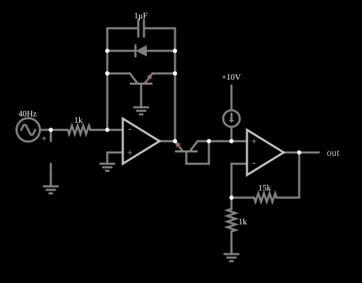

# Amplificador logarítmico

<!-- navegacao:inicio -->
[Índice](README.md) · [Anterior: Summing Amplifier](amp-sum.md) · [Próximo: Class-D Amplifier](classd.md)
<!-- navegacao:fim -->

## Objetivo

Mostrar como usar a relação exponencial entre a tensão e a corrente de um transistor para construir um amplificador cuja saída é proporcional ao **logaritmo** da entrada, e como um segundo transistor cancela a dependência da temperatura.

## O circuito

<!-- esquema:inicio -->

<!-- esquema:fim -->

Uma fonte senoidal de $40\ \text{Hz}$, com $3\ \text{V}$ de amplitude sobre $3\ \text{V}$ de nível contínuo (de $0$ a $6\ \text{V}$), liga-se por um resistor de $1\ \text{k}\Omega$ à entrada inversora de um primeiro amplificador operacional. Na realimentação desse operacional está um transistor NPN com a base aterrada (a corrente de coletor entra no transistor e a tensão base-emissor aparece na saída), em paralelo com um capacitor de $1\ \mu\text{F}$ e um diodo de proteção. Uma fonte de corrente de $10\ \text{mA}$ polariza um segundo transistor, que serve de referência, e um segundo operacional, não inversor com ganho $1 + 15\ \text{k}\Omega/1\ \text{k}\Omega = 16$, amplifica a diferença. Um osciloscópio de X-Y mostra a saída contra a entrada.

<!-- componentes:inicio -->
| N.º | Tipo | Elemento | Valores |
|----:|------|----------|---------|
| 0 | `OpAmpElm` | op-amp | Max Output (V) = 15; Min Output (V) = -15; Gain = 100k |
| 1 | `DiodeElm` | diode | Model = default |
| 3 | `CapacitorElm` | capacitor | Capacitance (F) = 1μ; Trapezoidal Approximation = sim; Initial Voltage (on Reset) = 1m; Series Resistance = 0 |
| 7 | `ResistorElm` | resistor | Resistance (ohms) = 1k |
| 8 | `RailElm` | A/C source | Max Voltage = 3; Waveform = A/C; DC Offset (V) = 3; Internal Resistance (ohms) = 0; Show Voltage = não; Frequency (Hz) = 40; Phase Offset (degrees) = 0 |
| 9 | `GroundElm` | ground | Symbol = Earth |
| 10 | `NTransistorElm` | transistor | Beta/hFE = 100; Swap E/C = não; Draw Circle = não; Model = default |
| 15 | `CurrentElm` | current source | Current (A) = 10m; Max Voltage (V, 0=unlimited) = 0 |
| 16 | `RailElm` | voltage source | Voltage = 10; Waveform = D/C; DC Offset (V) = 0; Internal Resistance (ohms) = 0 |
| 17 | `OpAmpElm` | op-amp | Max Output (V) = 15; Min Output (V) = -15; Gain = 100k |
| 18 | `ResistorElm` | resistor | Resistance (ohms) = 15k |
| 19 | `ResistorElm` | resistor | Resistance (ohms) = 1k |
| 22 | `GroundElm` | ground | Symbol = Earth |
| 23 | `OutputElm` | output | Show Voltage = não |
| 24 | `ProbeElm` | voltmeter | Show Voltage = não; Value = Voltage; Scale = Auto; Use Circle Symbol = não; Series Resistance (0 = infinite) = 0 |
| 25 | `GroundElm` | ground | Symbol = Earth |
| 26 | `NTransistorElm` | transistor | Beta/hFE = 100; Swap E/C = sim; Draw Circle = não; Model = default |
| 31 | `GroundElm` | ground | Symbol = Earth |
<!-- componentes:fim -->

## Teoria

Num transistor bipolar, a corrente de coletor é $I_C = I_S\,e^{V_{BE}/V_T}$, ou seja,

$$V_{BE} = V_T \ln\frac{I_C}{I_S}, \qquad V_T = \frac{kT}{q}\approx 25\ \text{mV}.$$

No primeiro estágio a corrente de entrada $I_\text{in} = V_\text{in}/R$ passa toda pelo transistor da realimentação, então a saída do primeiro operacional é $-V_{BE} = -V_T \ln(I_\text{in}/I_S)$. Isso depende da temperatura e da corrente de saturação $I_S$, que varia muito de transistor para transistor.

O segundo transistor, polarizado com $I_\text{ref} = 10\ \text{mA}$, tem $V_{BE,\text{ref}} = V_T\ln(I_\text{ref}/I_S)$. Somá-lo à saída do primeiro estágio elimina $I_S$:

$$V_x = -V_T \ln\frac{I_\text{in}}{I_S} + V_T \ln\frac{I_\text{ref}}{I_S} = V_T \ln\frac{I_\text{ref}}{I_\text{in}}.$$

O segundo operacional multiplica por $1 + R_a/R_b = 16$:

$$V_\text{out} = 16\,V_T \ln\frac{I_\text{ref}}{I_\text{in}} = K\,\ln\frac{10\ \text{mA}}{V_\text{in}/1\ \text{k}\Omega}.$$

## Resultados esperados

Ajustando $K$ aos valores simulados na faixa de 3 a 6 V obtém-se $K \approx 0{,}41\ \text{V}$ (isto é, $16\,V_T$ com $V_T \approx 25{,}5\ \text{mV}$ no modelo). Com esse $K$:

| $V_\text{in}$ | $K\ln(10/V_\text{in})$ | Saída do simulador |
|---------------:|------------------------:|-------------------:|
| $5{,}051\ \text{V}$ ($t = 3\ \text{ms}$) | $0{,}279\ \text{V}$ | $0{,}2787\ \text{V}$ |
| $6{,}000\ \text{V}$ ($t = 6{,}25\ \text{ms}$) | $0{,}208\ \text{V}$ | $0{,}2073\ \text{V}$ |
| $3{,}004\ \text{V}$ ($t = 12{,}5\ \text{ms}$) | $0{,}491\ \text{V}$ | $0{,}4927\ \text{V}$ |

Cada vez que a entrada dobra (de $3$ para $6\ \text{V}$), a saída diminui de $K\ln 2 \approx 0{,}28\ \text{V}$. Em $t = 10\ \text{ms}$ o primeiro estágio dá $-0{,}636\ \text{V}$. As verificações conferem esses quatro valores (tolerância de 1%).

## O que observar

- No gráfico X-Y a curva sai e entrada tem a forma de um logaritmo: sobe devagar quando a entrada é grande e rapidamente quando ela é pequena.
- Perto de $V_\text{in} = 0$ o logaritmo divergiria. No modelo, a saída chega a cerca de $2{,}4\ \text{V}$, bem abaixo do que a fórmula daria: a lei só vale numa faixa de correntes.
- O capacitor de $1\ \mu\text{F}$ na realimentação dá estabilidade ao circuito e causa um pequeno atraso da saída.

## Limites do modelo

A lei logarítmica depende do modelo exponencial do transistor, que o simulador usa com um único $I_S$, sem a resistência de espalhamento nem a variação de $\beta$ nas correntes baixas; no circuito real o intervalo útil é de algumas décadas de corrente. A temperatura é fixa na simulação, então não se vê a compensação térmica funcionando (apenas a estrutura que a produz). Os dois transistores são idênticos por construção; num circuito real é preciso casá-los (par integrado).

## Referências

- A. S. Sedra e K. C. Smith, *Microeletrônica*, Pearson.
- P. Horowitz e W. Hill, *The Art of Electronics*, Cambridge University Press.
- W. G. Jung, *Op Amp Applications Handbook*, Newnes.

O circuito deste exemplo faz parte da coleção do simulador original de Paul Falstad e Iain Sharp (CircuitJS1); a explicação é deste projeto.
