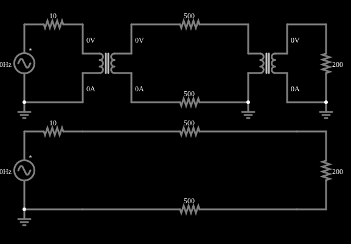

# Transmissão de potência a longa distância

<!-- navegacao:inicio -->
[Índice](README.md) · [Anterior: Step-Down Transformer](transformerdown.md)
<!-- navegacao:fim -->

## Objetivo

Mostrar por que a energia elétrica é transmitida em alta tensão: elevar a tensão com um transformador reduz a corrente na linha e, com ela, a potência perdida na resistência dos fios.

## O circuito

<!-- esquema:inicio -->

<!-- esquema:fim -->

Há dois circuitos, um sobre o outro, com a mesma fonte ($169{,}7\ \text{V}$ de pico, $60\ \text{Hz}$, resistência de $10\ \Omega$), a mesma linha de transmissão (dois fios de $500\ \Omega$, ou seja, $1\ \text{k}\Omega$ de ida e volta) e a mesma carga de $200\ \Omega$.

- **Em cima:** um transformador elevador de $1{:}1000$ (primário de $0{,}5\ \text{H}$) sobe a tensão para a linha, e um abaixador de $1000{:}1$ (primário de $10^6\ \text{H}$) a devolve à carga.
- **Embaixo:** a fonte alimenta a linha e a carga diretamente.

Os dois osciloscópios mostram a tensão em cada carga.

<!-- componentes:inicio -->
| N.º | Tipo | Elemento | Valores |
|----:|------|----------|---------|
| 0 | `VoltageElm` | A/C source | Max Voltage = 169.7; Waveform = A/C; DC Offset (V) = 0; Internal Resistance (ohms) = 0; Show Voltage = não; Frequency (Hz) = 60; Phase Offset (degrees) = 0 |
| 2 | `TransformerElm` | transformer | Primary Inductance (H) = 500m; Ratio (N1/N2) = 1m; Coupling Coefficient = 999m; Trapezoidal Approximation = sim; Swap Secondary Polarity = não; Saturation Current (A) (0=none) = 0 |
| 5 | `ResistorElm` | resistor | Resistance (ohms) = 10 |
| 8 | `ResistorElm` | resistor | Resistance (ohms) = 500 |
| 9 | `ResistorElm` | resistor | Resistance (ohms) = 500 |
| 12 | `TransformerElm` | transformer | Primary Inductance (H) = 1M; Ratio (N1/N2) = 1k; Coupling Coefficient = 999m; Trapezoidal Approximation = sim; Swap Secondary Polarity = não; Saturation Current (A) (0=none) = 0 |
| 17 | `ResistorElm` | resistor | Resistance (ohms) = 200 |
| 18 | `VoltageElm` | A/C source | Max Voltage = 169.7; Waveform = A/C; DC Offset (V) = 0; Internal Resistance (ohms) = 0; Show Voltage = não; Frequency (Hz) = 60; Phase Offset (degrees) = 0 |
| 19 | `ResistorElm` | resistor | Resistance (ohms) = 10 |
| 20 | `ResistorElm` | resistor | Resistance (ohms) = 500 |
| 21 | `ResistorElm` | resistor | Resistance (ohms) = 500 |
| 25 | `ResistorElm` | resistor | Resistance (ohms) = 200 |
| 26 | `GroundElm` | ground | Symbol = Earth |
| 27 | `GroundElm` | ground | Symbol = Earth |
| 28 | `GroundElm` | ground | Symbol = Earth |
| 29 | `GroundElm` | ground | Symbol = Earth |
<!-- componentes:fim -->

## Teoria

Dois enrolamentos que compartilham fluxo magnético formam um transformador. Com indutâncias próprias $L_1$ e $L_2$ e indutância mútua $M = k\sqrt{L_1 L_2}$ (o coeficiente de acoplamento $k$ vale $0{,}999$ nestes exemplos),

$$v_1 = L_1\frac{di_1}{dt} - M\frac{di_2}{dt},\qquad v_2 = M\frac{di_1}{dt} - L_2\frac{di_2}{dt},$$

com $i_2$ a corrente que o secundário entrega à carga. A razão de espiras $n = N_1/N_2$ liga as indutâncias, $L_2 = L_1/n^2$. No limite ideal ($k \to 1$, $L_1\to\infty$):

$$\frac{V_2}{V_1} = \frac{1}{n},\qquad \frac{I_2}{I_1} = n,\qquad Z_{refletida} = n^2 R_L,$$

e a potência se conserva ($V_1 I_1 = V_2 I_2$). Em regime senoidal, com $R_s$ a resistência em série com a fonte, $Z_1 = R_s + j\omega L_1$ e $Z_2 = R_L + j\omega L_2$, a resolução exata do circuito dá

$$I_1 = \frac{V\,Z_2}{Z_1 Z_2 + \omega^2 M^2},\qquad \frac{V_L}{V} = \frac{j\omega M\,R_L}{Z_1 Z_2 + \omega^2 M^2}.$$

A diferença para o caso ideal vem da indutância de magnetização finita (que consome uma corrente reativa $V/\omega L_1$), da indutância de dispersão $(1-k^2)L_1$ e da resistência série $R_s$.

**Perda na linha.** A potência dissipada na resistência $R_{linha}$ de uma linha que transporta a corrente $I$ é $P_{perda} = R_{linha} I^2$. Para entregar uma potência $P = V I$ com uma tensão $V$ maior, a corrente $I = P/V$ é menor, e a perda cai com o quadrado da tensão:

$$P_{perda} = R_{linha}\,\frac{P^2}{V^2}.$$

## Resultados esperados

**Sem transformadores** (embaixo): $I = 169{,}7/(10 + 1000 + 200) = 140{,}3\ \text{mA}$ de pico, a carga recebe $28{,}05\ \text{V}$ ($1{,}97\ \text{W}$) e a linha dissipa $9{,}84\ \text{W}$, ou seja, $83\%$ da potência fornecida ($11{,}9\ \text{W}$) é perdida na linha.

**Com transformadores** (em cima), pela resolução exata do circuito em regime senoidal (três malhas e as indutâncias mútuas): a carga recebe $160{,}7\ \text{V}$ de pico ($64{,}6\ \text{W}$), a corrente na linha é de apenas $0{,}911\ \text{mA}$ e a linha dissipa $0{,}41\ \text{mW}$. A fonte fornece $76{,}1\ \text{W}$, dos quais $11{,}5\ \text{W}$ ficam na resistência de $10\ \Omega$ da própria fonte, pela corrente de magnetização do primeiro transformador ($0{,}5\ \text{H}$ tem reatância de apenas $188\ \Omega$ a $60\ \text{Hz}$); o rendimento é de $85\%$ contra $16{,}5\%$ sem transformadores.

As verificações conferem a tensão de pico nas duas cargas e a corrente de pico na linha dos dois circuitos (tolerâncias de 2% e 3%; o simulador fica a menos de 0,1% da resolução exata).

## O que observar

- Compare a tensão nas duas cargas: $160\ \text{V}$ contra $28\ \text{V}$, com a mesma fonte e a mesma linha.
- Passe o ponteiro sobre os resistores da linha: a corrente do circuito de cima é cerca de 150 vezes menor.
- A tensão na linha de cima chega a centenas de milhares de volts: é o preço de reduzir a corrente, e por isso as linhas reais usam torres altas e isoladores.

## Limites do modelo

O exemplo usa valores didáticos (uma linha de $1\ \text{k}\Omega$, transformadores com razão de $1000$), longe de uma linha real, cuja resistência é da ordem de poucos ohms por quilômetro. Não modela a reatância e a capacitância da linha, a corrente de excitação não linear do núcleo, nem as perdas nos transformadores além da dispersão.

## Referências

- C. K. Alexander e M. N. O. Sadiku, *Fundamentos de Circuitos Elétricos*, AMGH.
- P. Horowitz e W. Hill, *The Art of Electronics*, Cambridge University Press.

O circuito deste exemplo faz parte da coleção do simulador original de Paul Falstad e Iain Sharp (CircuitJS1); a explicação é deste projeto.
