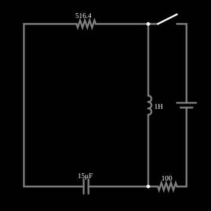

# LRC criticamente amortecido

<!-- navegacao:inicio -->
[Índice](README.md) · [Anterior: Wheatstone Bridge](wheatstone.md) · [Próximo: Current Source](currentsrcelm.md)
<!-- navegacao:fim -->

## Objetivo

Mostrar o amortecimento crítico de um circuito RLC em série: a resistência exata que leva o circuito ao repouso o mais depressa possível, sem oscilar.

## O circuito

<!-- esquema:inicio -->

<!-- esquema:fim -->

Um indutor de $1\ \text{H}$, um resistor de $516{,}4\ \Omega$ e um capacitor de $15\ \mu\text{F}$ formam uma malha em série. Uma chave liga a ela um ramo com fonte de $5\ \text{V}$ e resistor de $100\ \Omega$. O exemplo abre com a chave **aberta**: a malha está livre, e o capacitor e o indutor começam com a energia que tinham quando o arquivo foi salvo ($-9{,}86\ \text{V}$ no capacitor e $30{,}2\ \text{mA}$ no indutor). Três osciloscópios mostram a corrente do indutor e as tensões.

<!-- componentes:inicio -->
| N.º | Tipo | Elemento | Valores |
|----:|------|----------|---------|
| 0 | `ResistorElm` | resistor | Resistance (ohms) = 516.4 |
| 1 | `SwitchElm` | switch (SPST) | Momentary Switch = não; IEC Symbol = não; Label (for linking) = ; Keyboard Shortcut = ; On Resistance (ohms) = 0 |
| 3 | `CapacitorElm` | capacitor | Capacitance (F) = 15μ; Trapezoidal Approximation = sim; Initial Voltage (on Reset) = 1m; Series Resistance = 0 |
| 4 | `InductorElm` | inductor | Inductance (H) = 1; Trapezoidal Approximation = sim; Initial Current (on Reset) (A) = 0; Saturation Current (A) (0=none) = 0 |
| 5 | `VoltageElm` | voltage source | Voltage = 5; Waveform = D/C; DC Offset (V) = 0; Internal Resistance (ohms) = 0; Show Voltage = não; Circle Symbol = não |
| 6 | `ResistorElm` | resistor | Resistance (ohms) = 100 |
<!-- componentes:fim -->

## Teoria

A malha RLC livre obedece a $L\,\ddot q + R\,\dot q + q/C = 0$, ou, para a tensão do capacitor,

$$\ddot v_C + 2\alpha\,\dot v_C + \omega_0^2\,v_C = 0,\qquad \alpha = \frac{R}{2L},\quad \omega_0 = \frac{1}{\sqrt{LC}}.$$

O comportamento depende de $\zeta = \alpha/\omega_0 = \dfrac{R}{2}\sqrt{C/L}$:

- $\zeta < 1$: **subamortecido**, oscilação que decai, $v_C \propto e^{-\alpha t}\cos(\omega_d t + \varphi)$ com $\omega_d = \sqrt{\omega_0^2 - \alpha^2}$;
- $\zeta > 1$: **superamortecido**, soma de duas exponenciais decrescentes;
- $\zeta = 1$: **criticamente amortecido**, $R = R_c = 2\sqrt{L/C}$, o caso limite, em que a solução é

$$v_C(t) = e^{-\alpha t}\bigl[v_0 + (\dot v_0 + \alpha v_0)\,t\bigr].$$

O amortecimento crítico é o que leva a energia a zero mais depressa sem cruzar o zero mais de uma vez; é o ajuste usado, por exemplo, em amortecedores e em instrumentos de ponteiro.

## Resultados esperados

Aqui $\alpha = 516{,}4/2 = 258{,}2\ \text{s}^{-1}$ e $\omega_0 = 1/\sqrt{1\cdot 15\ \mu\text{F}} = 258{,}2\ \text{rad/s}$, logo $\zeta = 1{,}000$ ($R_c = 2\sqrt{1/15\ \mu\text{F}} = 516{,}4\ \Omega$). Com $v_0 = -9{,}86\ \text{V}$ e $\dot v_0 = i/C = -2013\ \text{V/s}$, a tensão do capacitor vale

| $t$ | $v_C$ | corrente do indutor |
|----:|------:|--------------------:|
| $2\ \text{ms}$ | $-11{,}32\ \text{V}$ | $-3{,}05\ \text{mA}$ |
| $5\ \text{ms}$ | $-8{,}98\ \text{V}$ | $-15{,}97\ \text{mA}$ |
| $10\ \text{ms}$ | $-4{,}19\ \text{V}$ | $-11{,}07\ \text{mA}$ |
| $20\ \text{ms}$ | $-0{,}578\ \text{V}$ | $-1{,}85\ \text{mA}$ |

(o sentido positivo da corrente do indutor é o de cima para baixo no esquema). A tensão passa por um valor mais negativo antes de voltar a zero, porque a corrente inicial ainda descarrega o capacitor no mesmo sentido, mas **não oscila**. As verificações conferem a tensão do capacitor em $2$, $10$ e $20\ \text{ms}$ e a corrente do indutor em $5$ e $10\ \text{ms}$, com tolerância de 2% (o simulador fica a menos de 0,1% da solução analítica).

**Com a chave fechada**, o ramo da fonte e do resistor de $100\ \Omega$ se liga em paralelo com o indutor, o amortecimento do circuito muda (os polos passam a ser $-96 \pm j40\ \text{s}^{-1}$, ou seja, $\zeta \approx 0{,}92$, ligeiramente subamortecido) e o circuito vai para o regime de $50\ \text{mA}$ no indutor e $0\ \text{V}$ no capacitor; este cálculo é de um modelo à parte e não é conferido pelas verificações.

## O que observar

- Veja nos osciloscópios a tensão e a corrente decaírem sem oscilar.
- Aumente $R$ (duplo clique no resistor): o circuito fica superamortecido e leva mais tempo para chegar ao repouso. Diminua $R$: aparecem oscilações, e quanto menor o $R$ mais voltas antes de parar.
- Compare o tempo para a tensão cair a $10\%$ do valor inicial nos três casos: o crítico é o mais rápido entre os que não oscilam.

## Limites do modelo

Componentes ideais (o resistor de $516{,}4\ \Omega$ é arredondado: $R_c = 516{,}398\ \Omega$, de modo que $\zeta = 1{,}000004$, ainda assim criticamente amortecido para fins práticos). Indutores reais têm resistência de enrolamento que soma à do resistor e altera o amortecimento.

## Referências

- J. W. Nilsson e S. A. Riedel, *Circuitos Elétricos*, Pearson.
- C. K. Alexander e M. N. O. Sadiku, *Fundamentos de Circuitos Elétricos*, AMGH.

O circuito deste exemplo faz parte da coleção do simulador original de Paul Falstad e Iain Sharp (CircuitJS1); a explicação é deste projeto.
