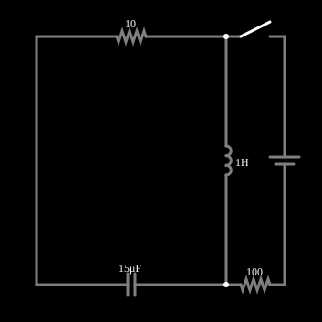

# Circuito RLC série: resposta natural

<!-- navegacao:inicio -->
[Índice](README.md) · [Anterior: Inductor](induct.md) · [Próximo: Voltage Divider](voltdivide.md)
<!-- navegacao:fim -->

## Objetivo

Mostrar a oscilação amortecida de um circuito RLC série: a energia troca de forma entre o capacitor e o indutor enquanto o resistor a dissipa.

## O circuito

<!-- esquema:inicio -->

<!-- esquema:fim -->

Um resistor de $10\ \Omega$, um indutor de $1\ \text{H}$ e um capacitor de $15\ \mu\text{F}$ formam uma malha em série. Um ramo com fonte de 5 V e resistor de $100\ \Omega$ está desligado por uma chave aberta. O exemplo é salvo com o capacitor em $-9{,}86\ \text{V}$ e, depois de **Reiniciar**, ele volta a $-10\ \text{V}$ (tensão inicial configurada). Três osciloscópios mostram as grandezas do indutor, do capacitor e do resistor; há *sliders* para $R$, $L$ e $C$.

<!-- componentes:inicio -->
| N.º | Tipo | Elemento | Valores |
|----:|------|----------|---------|
| 0 | `ResistorElm` | resistor | Resistance (ohms) = 10 |
| 1 | `SwitchElm` | switch (SPST) | Momentary Switch = não; IEC Symbol = não; Label (for linking) = ; Keyboard Shortcut = ; On Resistance (ohms) = 0 |
| 3 | `CapacitorElm` | capacitor | Capacitance (F) = 15μ; Trapezoidal Approximation = sim; Initial Voltage (on Reset) = -10; Series Resistance = 0 |
| 4 | `InductorElm` | inductor | Inductance (H) = 1; Trapezoidal Approximation = sim; Initial Current (on Reset) (A) = 0; Saturation Current (A) (0=none) = 0 |
| 5 | `VoltageElm` | voltage source | Voltage = 5; Waveform = D/C; DC Offset (V) = 0; Internal Resistance (ohms) = 0; Show Voltage = não; Circle Symbol = não |
| 6 | `ResistorElm` | resistor | Resistance (ohms) = 100 |
<!-- componentes:fim -->

## Teoria

Sem fonte, a lei das tensões de Kirchhoff dá $L\,\ddot q + R\,\dot q + q/C = 0$, ou, para a tensão do capacitor,

$$\frac{d^2 v_C}{dt^2} + 2\alpha\,\frac{dv_C}{dt} + \omega_0^2\,v_C = 0,\qquad \alpha = \frac{R}{2L},\qquad \omega_0=\frac{1}{\sqrt{LC}}.$$

Se $\alpha<\omega_0$ (subamortecido) a solução oscila com frequência $\omega_d$ e amplitude que decai com $e^{-\alpha t}$:

$$v_C(t) = e^{-\alpha t}\left[v_0\cos\omega_d t + \frac{\alpha v_0}{\omega_d}\sin\omega_d t\right],\qquad \omega_d = \sqrt{\omega_0^2-\alpha^2}.$$

O fator de qualidade é $Q = \dfrac{\omega_0 L}{R}$. Se $\alpha=\omega_0$ o amortecimento é crítico, e se $\alpha>\omega_0$ não há oscilação.

## Resultados esperados

Com $R=10\ \Omega$, $L=1\ \text{H}$ e $C=15\ \mu\text{F}$:

$$\alpha = 5\ \text{s}^{-1},\qquad \omega_0 = 258{,}2\ \text{rad/s},\qquad \omega_d = 258{,}1\ \text{rad/s}\ \ (f_d = 41{,}08\ \text{Hz}),\qquad Q = 25{,}8.$$

O período é $T = 24{,}34\ \text{ms}$, e depois de um período a amplitude é $e^{-\alpha T} = 0{,}885$ da anterior. Partindo de $9{,}86\ \text{V}$ (estado salvo), a tensão no capacitor um período depois é $9{,}86\cdot0{,}885 = 8{,}73\ \text{V}$ em módulo (o sinal é o da convenção do simulador para este capacitor: $-8{,}72\ \text{V}$). As verificações conferem a frequência $f_d$ e esse valor.

## O que observar

- Aumente $R$ pelo *slider* até $2\sqrt{L/C} \approx 516\ \Omega$ (amortecimento crítico): a oscilação desaparece.
- Diminua $R$: a oscilação dura mais ($Q$ maior).
- Compare a tensão e a corrente do capacitor: como $i = C\,dv/dt$, a corrente está adiantada $90^\circ$ em relação à tensão.
- Feche a chave da fonte para ver a resposta forçada somada à natural.

## Limites do modelo

Componentes ideais: o indutor real tem resistência do fio e perdas no núcleo, e o capacitor real tem resistência série equivalente, de modo que o amortecimento real é maior que o de $R$ sozinho.

## Referências

- J. W. Nilsson e S. A. Riedel, *Circuitos Elétricos*, Pearson.
- C. K. Alexander e M. N. O. Sadiku, *Fundamentos de Circuitos Elétricos*, AMGH.

O circuito deste exemplo faz parte da coleção do simulador original de Paul Falstad e Iain Sharp (CircuitJS1); a explicação é deste projeto.
