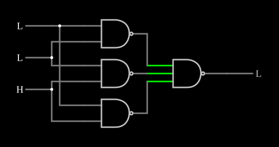

# Lógica de maioria

<!-- navegacao:inicio -->
[Índice](README.md) · [Anterior: 2-to-1 Mux](mux3state.md) · [Próximo: 2-Bit Comparator](digcompare.md)
<!-- navegacao:fim -->

## Objetivo

Mostrar a **função maioria** de três entradas, cuja saída é $1$ quando pelo menos duas entradas são $1$. É a base da votação em sistemas redundantes e o vai-um de um somador.

## O circuito

<!-- esquema:inicio -->

<!-- esquema:fim -->

Três entradas lógicas, $A$ (elemento 0), $B$ (elemento 1) e $C$ (elemento 2), vão a três portas NAND de duas entradas, uma para cada par ($AB$, $BC$, $AC$). Uma NAND de três entradas junta as três e aciona a saída (elemento 21). O exemplo abre com $C = 1$ e $A = B = 0$.

<!-- componentes:inicio -->
| N.º | Tipo | Elemento | Valores |
|----:|------|----------|---------|
| 0 | `LogicInputElm` | logic input | Momentary Switch = não; High Logic Voltage = 5; Low Voltage = 0; Numeric = não; Ternary = não; Keyboard Shortcut =  |
| 1 | `LogicInputElm` | logic input | Momentary Switch = não; High Logic Voltage = 5; Low Voltage = 0; Numeric = não; Ternary = não; Keyboard Shortcut =  |
| 2 | `LogicInputElm` | logic input | Momentary Switch = não; High Logic Voltage = 5; Low Voltage = 0; Numeric = não; Ternary = não; Keyboard Shortcut =  |
| 15 | `NandGateElm` | NAND gate | # of Inputs = 3; High Logic Voltage = 5; Schmitt Inputs = não; Invert Inputs = não; Propagation Delay (s) = 0; DeMorgan's Symbol = não |
| 18 | `NandGateElm` | NAND gate | # of Inputs = 2; High Logic Voltage = 5; Schmitt Inputs = não; Invert Inputs = não; Propagation Delay (s) = 0; DeMorgan's Symbol = não |
| 19 | `NandGateElm` | NAND gate | # of Inputs = 2; High Logic Voltage = 5; Schmitt Inputs = não; Invert Inputs = não; Propagation Delay (s) = 0; DeMorgan's Symbol = não |
| 20 | `NandGateElm` | NAND gate | # of Inputs = 2; High Logic Voltage = 5; Schmitt Inputs = não; Invert Inputs = não; Propagation Delay (s) = 0; DeMorgan's Symbol = não |
| 21 | `LogicOutputElm` | logic output | Threshold = 2.5; Current Required = não; Numeric = não; Ternary = não |
<!-- componentes:fim -->

## Teoria

A maioria é a soma dos produtos de cada par:

$$M = AB + BC + AC.$$

Na forma NAND-NAND (pela lei de De Morgan, $X + Y + Z = \overline{\overline{X}\,\overline{Y}\,\overline{Z}}$), cada produto vira uma NAND e a soma vira a NAND final:

$$M = \overline{\overline{AB} \cdot \overline{BC} \cdot \overline{AC}}.$$

A mesma função é o vai-um do [Full Adder](fulladd.md). Em sistemas tolerantes a falhas (redundância modular tripla), três cópias de um circuito alimentam um votador de maioria, e uma cópia defeituosa é mascarada pelas outras duas.

## Resultados esperados

O simulador dá:

| $A$ | $B$ | $C$ | $M$ |
|----:|----:|----:|----:|
| 0 | 0 | 0 | 0 |
| 1 | 0 | 0 | 0 |
| 0 | 1 | 0 | 0 |
| 0 | 0 | 1 | 0 |
| 1 | 1 | 0 | 1 |
| 1 | 0 | 1 | 1 |
| 0 | 1 | 1 | 1 |
| 1 | 1 | 1 | 1 |

## O que observar

Clique nas entradas: a saída segue o valor que aparece em pelo menos duas delas.

## Limites do modelo

- Portas ideais, sem atraso.

## Referências

Mano e Ciletti, *Digital Design*, capítulo sobre implementação NAND-NAND; von Neumann, "Probabilistic Logics and the Synthesis of Reliable Organisms from Unreliable Components" (1956), sobre votação por maioria.

O circuito deste exemplo faz parte da coleção do simulador original de Paul Falstad e Iain Sharp (CircuitJS1); a explicação é deste projeto.
