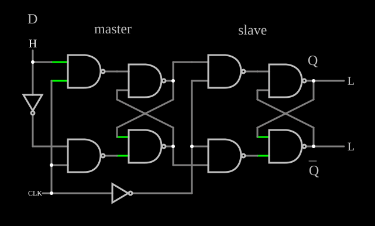

# Flip-flop D mestre-escravo

<!-- navegacao:inicio -->
[Índice](README.md) · [Anterior: Clocked SR Flip-Flop](clockedsrff.md) · [Próximo: Edge-Triggered D Flip-Flop](edgedff.md)
<!-- navegacao:fim -->

## Objetivo

Mostrar o flip-flop **mestre-escravo**: dois latches D em série, habilitados em fases opostas do relógio, fazem a saída mudar só na borda de descida.

## O circuito

<!-- esquema:inicio -->

<!-- esquema:fim -->

O **mestre** é um latch D de quatro NANDs: duas NANDs de controle recebem $D$ (elemento 38) e $\overline{D}$ (um inversor) junto com o relógio, e alimentam um latch SR de NANDs. O **escravo** é igual, mas recebe as saídas do mestre e o relógio invertido (outro inversor). As saídas do escravo são $Q$ (elemento 27) e $\overline{Q}$ (elemento 28). O relógio é uma onda quadrada de $120\ \text{Hz}$. O exemplo abre com $D = 1$.

<!-- componentes:inicio -->
| N.º | Tipo | Elemento | Valores |
|----:|------|----------|---------|
| 0 | `NandGateElm` | NAND gate | # of Inputs = 2; High Logic Voltage = 5; Schmitt Inputs = não; Invert Inputs = não; Propagation Delay (s) = 0; DeMorgan's Symbol = não |
| 1 | `NandGateElm` | NAND gate | # of Inputs = 2; High Logic Voltage = 5; Schmitt Inputs = não; Invert Inputs = não; Propagation Delay (s) = 0; DeMorgan's Symbol = não |
| 8 | `NandGateElm` | NAND gate | # of Inputs = 2; High Logic Voltage = 5; Schmitt Inputs = não; Invert Inputs = não; Propagation Delay (s) = 0; DeMorgan's Symbol = não |
| 9 | `NandGateElm` | NAND gate | # of Inputs = 2; High Logic Voltage = 5; Schmitt Inputs = não; Invert Inputs = não; Propagation Delay (s) = 0; DeMorgan's Symbol = não |
| 12 | `NandGateElm` | NAND gate | # of Inputs = 2; High Logic Voltage = 5; Schmitt Inputs = não; Invert Inputs = não; Propagation Delay (s) = 0; DeMorgan's Symbol = não |
| 13 | `NandGateElm` | NAND gate | # of Inputs = 2; High Logic Voltage = 5; Schmitt Inputs = não; Invert Inputs = não; Propagation Delay (s) = 0; DeMorgan's Symbol = não |
| 24 | `NandGateElm` | NAND gate | # of Inputs = 2; High Logic Voltage = 5; Schmitt Inputs = não; Invert Inputs = não; Propagation Delay (s) = 0; DeMorgan's Symbol = não |
| 25 | `NandGateElm` | NAND gate | # of Inputs = 2; High Logic Voltage = 5; Schmitt Inputs = não; Invert Inputs = não; Propagation Delay (s) = 0; DeMorgan's Symbol = não |
| 26 | `InverterElm` | inverter | Slew Rate (V/ns) = 500m; High Logic Voltage = 5; DeMorgan's Symbol = não |
| 27 | `LogicOutputElm` | logic output | Threshold = 2.5; Current Required = não; Numeric = não; Ternary = não |
| 28 | `LogicOutputElm` | logic output | Threshold = 2.5; Current Required = não; Numeric = não; Ternary = não |
| 29 | `TextElm` | text | Text = Q; Size = 24; Draw Bar On Top = não; Color = #c0c0c0 |
| 30 | `TextElm` | text | Text = Q; Size = 24; Draw Bar On Top = sim; Color = #c0c0c0 |
| 31 | `TextElm` | text | Text = master; Size = 24; Draw Bar On Top = não; Color = #c0c0c0 |
| 32 | `TextElm` | text | Text = slave; Size = 24; Draw Bar On Top = não; Color = #c0c0c0 |
| 35 | `InverterElm` | inverter | Slew Rate (V/ns) = 500m; High Logic Voltage = 5; DeMorgan's Symbol = não |
| 38 | `LogicInputElm` | logic input | Momentary Switch = não; High Logic Voltage = 5; Low Voltage = 0; Numeric = não; Ternary = não; Keyboard Shortcut =  |
| 39 | `TextElm` | text | Text = D; Size = 24; Draw Bar On Top = não; Color = #c0c0c0 |
| 40 | `RailElm` | square wave gen | Max Voltage = 2.5; Waveform = Square Wave; DC Offset (V) = 2.5; Internal Resistance (ohms) = 0; Show Voltage = não; Specify As = Frequency/Duty Cycle; Frequency (Hz) = 120; Phase Offset (degrees) = 0; Duty Cycle = 50; Rise/Fall Time (s) = 0 |
<!-- componentes:fim -->

## Teoria

- **Relógio alto:** o mestre está transparente e segue $D$; o escravo está fechado e guarda o valor anterior.
- **Relógio baixo:** o mestre fecha, com o valor que $D$ tinha na borda de descida; o escravo fica transparente e copia esse valor para $Q$.

Como os dois nunca estão transparentes juntos, $D$ nunca atravessa o flip-flop de uma vez: a saída assume, na **borda de descida**, o valor de $D$ naquele instante, e o mantém por um período inteiro. A mesma ideia, com chaves CMOS em vez de NANDs, está em [CMOS Master-Slave Flip-Flop](cmosmsff.md).

## Resultados esperados

Com o relógio de $120\ \text{Hz}$, as bordas de descida ocorrem em $4{,}17$, $12{,}51$ e $20{,}84\ \text{ms}$. O simulador dá:

- $D$ levado a $0$ em $9\ \text{ms}$ (relógio alto): $Q$ continua em $5\ \text{V}$ em $12\ \text{ms}$ e vai a $0$ na borda de $12{,}51\ \text{ms}$ (lido em $13\ \text{ms}$);
- $D$ levado a $0$ em $13\ \text{ms}$ (relógio baixo): $Q$ continua em $5\ \text{V}$ até a borda de $20{,}84\ \text{ms}$ e está em $0$ em $21{,}5\ \text{ms}$.

## O que observar

Mude $D$ nas duas fases do relógio e compare com os osciloscópios: a saída só responde nas bordas de descida.

## Limites do modelo

- Portas sem atraso: os tempos de *setup* e *hold*, que num flip-flop real proíbem mudar $D$ muito perto da borda, não aparecem.

## Referências

Mano e Ciletti, *Digital Design*, capítulo sobre flip-flops; Wakerly, *Digital Design: Principles and Practices*, capítulo sobre latches e flip-flops.

O circuito deste exemplo faz parte da coleção do simulador original de Paul Falstad e Iain Sharp (CircuitJS1); a explicação é deste projeto.
