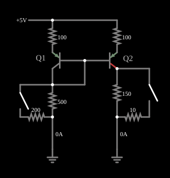

# Espelho de corrente

<!-- navegacao:inicio -->
[Índice](README.md) · [Anterior: Current Source Ramp](currentsrcramp.md) · [Próximo: Darlington Pair](darlington.md)
<!-- navegacao:fim -->

## Objetivo

Mostrar o espelho de corrente: dois transistores iguais copiam, no ramo de saída, a corrente de um ramo de referência, qualquer que seja a carga.

## O circuito

<!-- esquema:inicio -->

<!-- esquema:fim -->

Dois transistores PNP idênticos ($\beta = 1000$) têm as bases ligadas entre si e os emissores ligados a $5\ \text{V}$ por resistores de $100\ \Omega$. O coletor do primeiro (Q1) está ligado à sua base ("transistor diodo") e a um ramo de referência ($500\ \Omega$ e, por uma chave, mais $200\ \Omega$ em paralelo); o coletor do segundo (Q2) alimenta uma carga de $150\ \Omega$, ligada à terra, e uma outra chave pode curto-circuitá-la (com um resistor de $10\ \Omega$).

<!-- componentes:inicio -->
| N.º | Tipo | Elemento | Valores |
|----:|------|----------|---------|
| 0 | `PTransistorElm` | transistor | Beta/hFE = 1k; Swap E/C = não; Draw Circle = não; Model = default |
| 1 | `PTransistorElm` | transistor | Beta/hFE = 1k; Swap E/C = não; Draw Circle = não; Model = default |
| 5 | `ResistorElm` | resistor | Resistance (ohms) = 100 |
| 6 | `ResistorElm` | resistor | Resistance (ohms) = 100 |
| 8 | `RailElm` | voltage source | Voltage = 5; Waveform = D/C; DC Offset (V) = 0; Internal Resistance (ohms) = 0 |
| 9 | `ResistorElm` | resistor | Resistance (ohms) = 500 |
| 10 | `ResistorElm` | resistor | Resistance (ohms) = 150 |
| 12 | `SwitchElm` | switch (SPST) | Momentary Switch = não; IEC Symbol = não; Label (for linking) = ; Keyboard Shortcut = ; On Resistance (ohms) = 0 |
| 13 | `ResistorElm` | resistor | Resistance (ohms) = 200 |
| 15 | `SwitchElm` | switch (SPST) | Momentary Switch = não; IEC Symbol = não; Label (for linking) = ; Keyboard Shortcut = ; On Resistance (ohms) = 0 |
| 16 | `ResistorElm` | resistor | Resistance (ohms) = 10 |
| 19 | `GroundElm` | ground | Symbol = Earth |
| 20 | `GroundElm` | ground | Symbol = Earth |
| 21 | `TextElm` | text | Text = Q1; Size = 16; Draw Bar On Top = não; Color = #c0c0c0 |
| 22 | `TextElm` | text | Text = Q2; Size = 16; Draw Bar On Top = não; Color = #c0c0c0 |
<!-- componentes:fim -->

## Teoria

O transistor bipolar do simulador (modelo "default") segue o modelo de Ebers–Moll, com $V_{BE}$ e $V_{BC}$ as tensões base-emissor e base-coletor (para um NPN):

$$I_C = I_s\left(e^{V_{BE}/V_T} - e^{V_{BC}/V_T}\right) - \frac{I_s}{\beta_R}\left(e^{V_{BC}/V_T} - 1\right),\qquad I_B = \frac{I_s}{\beta}\left(e^{V_{BE}/V_T} - 1\right) + \frac{I_s}{\beta_R}\left(e^{V_{BC}/V_T} - 1\right),$$

com $I_s = 10^{-13}\ \text{A}$, $\beta = 100$, $\beta_R = 1$ e $V_T = 25{,}865\ \text{mV}$; sem efeito Early, sem capacitâncias e sem resistências série. Na **região ativa** ($V_{BE} \approx 0{,}65$ a $0{,}75\ \text{V}$, junção base-coletor com polarização inversa) isso se reduz a $I_C = \beta I_B = I_s\,e^{V_{BE}/V_T}$, com transcondutância $g_m = I_C/V_T$ e resistência de emissor $r_e = V_T/I_E$. O PNP é o complementar, com todas as tensões e correntes invertidas.

## Resultados esperados

Como as duas bases e os dois emissores estão no mesmo potencial (e os resistores de emissor são iguais), $V_{BE}$ é o mesmo e as correntes de coletor são iguais, $I_{C2} = I_{C1}$. A corrente de referência é a de Q1, $I_{ref} = I_{C1} + 2I_B$, e a de saída,

$$I_{out} = I_{C2} = \frac{I_{ref}}{1 + 2/\beta},$$

com erro de $2/\beta = 0{,}2\%$ para $\beta = 1000$. Em Q2 a corrente é **independente da tensão de coletor** (sem efeito Early), portanto a carga não a altera.

## O que observar

No estado inicial a corrente de referência é $7{,}249\ \text{mA}$ (pelos resistores de emissor) e a de saída, $7{,}242\ \text{mA}$: razão de $0{,}999$. Com a chave de $200\ \Omega$ fechada, a referência sobe a $17{,}82\ \text{mA}$ e a saída a $17{,}80\ \text{mA}$. A carga não altera a saída: curto-circuitando a de $150\ \Omega$ pelo resistor de $10\ \Omega$ (outra chave), a corrente se divide ($0{,}45\ \text{mA}$ no resistor de $150\ \Omega$ e $6{,}79\ \text{mA}$ no de $10\ \Omega$), mas a soma continua $7{,}24\ \text{mA}$. As verificações conferem a corrente do ramo de referência, a saída e a corrente do resistor de $10\ \Omega$ com a chave de carga, e a referência e a saída com a chave de $200\ \Omega$ (tolerância de 1%; as correntes foram calculadas por integração independente, a menos de $10^{-5}$ do simulador).

## Limites do modelo

- A corrente de saída acompanha a de referência: as duas mudam juntas ao fechar a chave de $200\ \Omega$.
- Mude a carga com a outra chave: a corrente total de saída não muda; só a tensão sobre a carga.
- O espelho é a base da polarização de circuitos integrados analógicos.

## Referências

O modelo não tem efeito Early: um espelho real tem resistência de saída finita, e a cópia perde precisão quando a tensão no coletor de saída é muito diferente da de referência; as duas junções de Q1 e Q2 devem estar na mesma temperatura. Os resistores de emissor melhoram o casamento.

O circuito deste exemplo faz parte da coleção do simulador original de Paul Falstad e Iain Sharp (CircuitJS1); a explicação é deste projeto.
